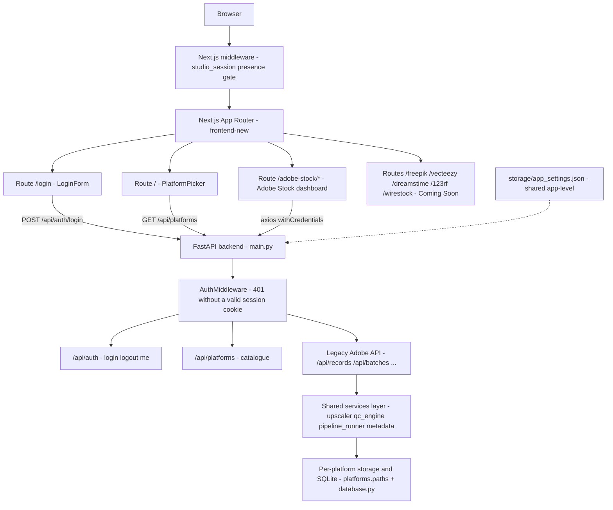
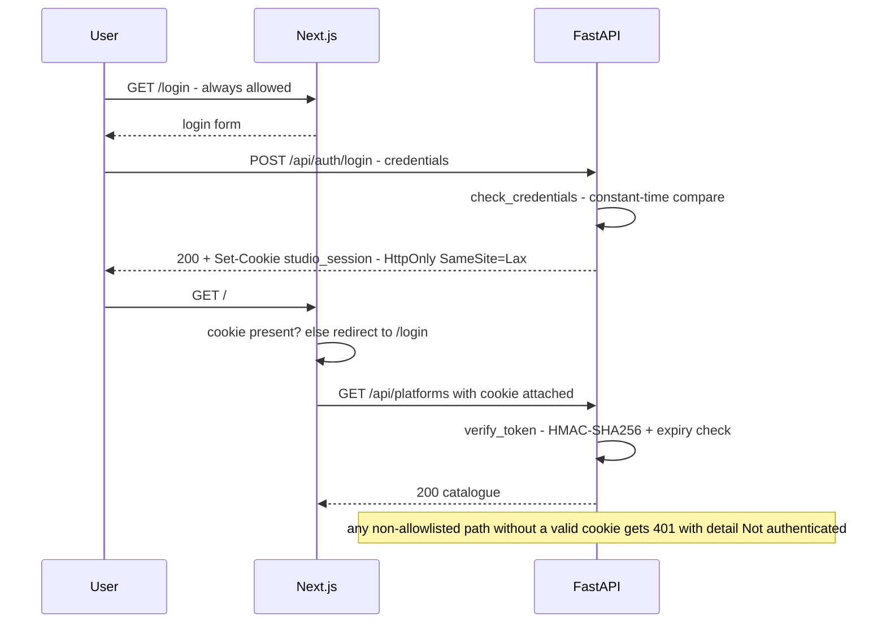

# Architecture — AI Stock Studio

## 1. Overview

**AI Stock Studio** is a universal, local-first, multi-platform image-upload
studio: a single FastAPI backend + Next.js App Router frontend that prepares
AI-generated images for stock marketplaces. Adobe Stock — the original,
fully wired pipeline — is the first platform in the catalogue; five more
(Freepik, Vecteezy, Dreamstime, 123RF, Wirestock) are already registered with
storage, database, and route contracts in place, waiting behind "Coming Soon"
pages. This document explains the system so a future developer (or AI agent)
can understand it and **add a new platform confidently** — see the checklist in
§7.

## 2. High-level architecture



- **Frontend**: Next.js App Router in `frontend-new/` (dev: port 3100 via
  `start-dev.cmd`, API base `http://localhost:8001` from
  `NEXT_PUBLIC_API_BASE_URL`).
- **Backend**: FastAPI in `backend/` (flat layout), title **"AI Stock
  Studio"**, mounted routers: `platforms` + `auth` + the legacy Adobe set.
- **Data**: one isolated directory + SQLite database per platform under
  `storage/platforms/`, plus one shared app-level settings file.

## 3. Platform registry & route map

The registry is a frozen dataclass in `backend/platforms/registry.py`:
`Platform(id, name, tagline, status, route)` bundled in the `PLATFORMS`
tuple (display order), with helpers `get_platform()` and `list_platforms()`.
`status` is validated at construction: only `"available"` or
`"coming_soon"`. `backend/platforms/routers.py` exposes it as
`GET /api/platforms` (all, in order) and `GET /api/platforms/{platform_id}`
(404 `"Unknown platform"` for anything not in the catalogue).

| id | Name | Route | Status | Backend DB |
| --- | --- | --- | --- | --- |
| `adobe_stock` | Adobe Stock | `/adobe-stock` | `available` | `storage/platforms/adobe_stock/adobe_stock.db` — the default engine |
| `freepik` | Freepik | `/freepik` | `coming_soon` | `storage/platforms/freepik/freepik.db` — created lazily |
| `vecteezy` | Vecteezy | `/vecteezy` | `coming_soon` | `storage/platforms/vecteezy/vecteezy.db` — created lazily |
| `dreamstime` | Dreamstime | `/dreamstime` | `coming_soon` | `storage/platforms/dreamstime/dreamstime.db` — created lazily |
| `123rf` | 123RF | `/123rf` | `coming_soon` | `storage/platforms/123rf/123rf.db` — created lazily |
| `wirestock` | Wirestock | `/wirestock` | `coming_soon` | `storage/platforms/wirestock/wirestock.db` — created lazily |

The frontend keeps a **single catalog** in
`frontend-new/src/lib/platforms.ts` (`PLATFORMS: PlatformMeta[]` +
`getPlatform(id)`) that mirrors the backend contract exactly on **ids,
routes, and status** (taglines may be phrased differently per side). It is
consumed by `PlatformPicker`, `PlatformCard`, and `PlatformComingSoon`.

Frontend route map:

| Route | Page | Notes |
| --- | --- | --- |
| `/login` | `LoginForm` | standalone sign-in |
| `/` | `PlatformPicker` | post-login master platform picker |
| `/adobe-stock` | moved dashboard home | original dashboard |
| `/adobe-stock/gallery` | gallery | |
| `/adobe-stock/batch/[id]` | batch detail | |
| `/adobe-stock/prompts` | prompts | |
| `/adobe-stock/prompts/library` | prompt library | |
| `/adobe-stock/settings` | config | |
| `/freepik`, `/vecteezy`, `/dreamstime`, `/123rf`, `/wirestock` | `PlatformComingSoon` | one folder each, renders the shared coming-soon page |

## 4. Storage & database isolation

```
storage/
  app_settings.json            # shared, app-level (APP_SETTINGS_PATH)
  platforms/
    adobe_stock/
      .migrated                # migration marker — re-runs become no-ops
      adobe_stock.db           # 161 records migrated, stored paths rewritten
      inbox/ thumbnails/ ready_to_upload/ refined/ upscaled/
      converted/ removed/ white/ srgb/ quarantine/
    freepik/                   # created lazily per platform
    vecteezy/ ...              # same 10-subdir skeleton + own <id>.db
  _recovery_backup/            # one-time recovery snapshot from the
                               # migration-race incident (deletion candidate)
```

**Rules:**

1. **Data never crosses platforms.** Every platform gets the same ten
   standard subdirectories (`STANDARD_SUBDIRS` in `backend/platforms/paths.py`)
   and its own SQLite file. A platform's records never touch another
   platform's engine.
2. **Path resolution goes through `get_platform_paths(platform_id)`**
   (`PlatformPaths` dataclass with `root`, `inbox_dir`, `ready_dir`, ...,
   `db_path`). It creates the skeleton directories on call (`create=False`
   for read-only probes). Adobe Stock's root is tied by construction to
   `config.ADOBE_STOCK_ROOT`.
3. **Engines are per platform.** `backend/database.py` preserves the default
   `engine` / `SessionLocal` / `Base` / `get_db` (Adobe Stock's, because 60+
   test files import those names) and adds `get_platform_engine(id)` (Adobe →
   the default engine; others → a cached SQLite engine at that platform's
   `db_path`), `get_platform_session_factory(id)`, and
   `init_platform_tables(id)`. All engines share one pragma helper
   (`set_sqlite_pragma` → WAL, `synchronous=NORMAL`, 5 s busy timeout,
   foreign keys on).
4. **`app_settings.json` is shared, not platform data.**
   `APP_SETTINGS_PATH` deliberately stays at `storage/` (operator settings
   are app-level) and is excluded from migration.
5. In `backend/config.py`, `STORAGE_ROOT`, `PLATFORMS_ROOT`, and
   `ADOBE_STOCK_ROOT` are module constants; every `settings.*_DIR` field and
   `DB_PATH` is re-pointed under `storage/platforms/adobe_stock/` (the
   legacy bindings — see §6). Pydantic settings use `extra: "ignore"`.

**Legacy migration** (`backend/services/legacy_storage_migration.py`): on
first startup, `run_legacy_storage_migration()` — the *first* action in the
`main.py` lifespan — moves the ten legacy `storage/` directories plus
`adobe_stock.db` (and its `-shm`/`-wal` sidecars) into
`storage/platforms/adobe_stock/`. Safety design:

- **Marker-gated**: a `.migrated` marker inside the platform root makes every
  later start a no-op; the marker is written **only when the run had zero
  failures** — a skipped or failed DB move counts as failure, so the next
  start retries (regression-tested).
- **Merge, never overwrite**: if a destination exists (pre-created by
  `create_data_directories()`), children move one by one; name collisions are
  skipped with a warning.
- **Stored paths are rewritten**: records hold absolute file paths, so all
  `TEXT`/`VARCHAR`/`CHAR` columns of every table are updated with
  parameterized `REPLACE` calls for both `\` and `/` separator spellings.
- **`app_settings.json` is never migrated.**
- Errors are logged, never raised — migration failure cannot take the app
  down, and the absent marker guarantees a retry.

## 5. Authentication flow

Deliberately lightweight: this is a **local-first tool, not a
production-hardened multi-user service** — single account, static password,
no rate limiting, no server-side session store, a default dev signing key.



**Backend pieces:**

- `backend/auth_config.py` — standalone `AuthSettings` / `auth_settings`
  (kept out of `config.py` on purpose), reads the same `.env` files as
  `config.py` (repo root first, then `backend/`), `extra: "ignore"`.
- `backend/services/auth_service.py` — stdlib-only token:
  `create_token` / `verify_token` produce/validate
  `base64url(payload) + "." + base64url(HMAC-SHA256(secret, payload))` where
  payload is `{"u": username, "exp": unix_expiry}`; signature checked with
  `hmac.compare_digest`; `check_credentials` compares both fields in
  constant time; `set_session_cookie` / `clear_session_cookie` manage the
  HttpOnly, `SameSite=Lax`, `path=/` cookie (max-age = TTL).
- `backend/services/auth_middleware.py` — `install_auth_middleware(app)`,
  called in `main.py` after CORS. Checked **per request**: `AUTH_ENABLED`
  off → pass through; `OPTIONS` → pass; allowlist
  (`/api/auth/login`, `/api/auth/logout`, `/docs`, `/redoc`,
  `/openapi.json` as prefixes; `/health` and `/favicon.ico` exact). Note
  `/api/auth/me` is **not** exempt — it answers the same
  `401 {"detail": "Not authenticated"}` shape via the middleware. Everything
  else, including `/thumbnails` static files and unknown paths, is gated.
- `backend/routers/auth.py` — `POST /api/auth/login` (401
  `{"detail": "Invalid credentials"}` on mismatch; success returns the JSON
  body *with* the cookie attached), `POST /api/auth/logout` (always 200),
  `GET /api/auth/me` (`{"user": {...}}` or 401).

**Frontend pieces:**

- `frontend-new/src/middleware.ts` — presence-only gate: no `studio_session`
  cookie → redirect to `/login`; `/login` always allowed (prevents redirect
  loops); matcher skips `_next/static`, `_next/image`, `favicon.ico`, `api/`,
  and any dotted path (static assets). Validity is the backend's job.
- `src/lib/auth.ts` — typed `loginUser` / `logoutUser` / `fetchMe` (a
  dedicated axios call so a 401 stays distinguishable from an outage).
- `src/components/auth/AuthProvider.tsx` — app-wide context mounted in the
  root layout; on mount it probes `/api/auth/me`, and a 401 there triggers a
  **best-effort `/api/auth/logout`** to clear a stale cookie the presence
  gate would otherwise keep admitting.
- `src/lib/client.ts` — the shared axios instance has
  `withCredentials: true`; its 401 interceptor (anywhere except the login
  call) best-effort-logouts the dead cookie and redirects to `/login` unless
  already there (**loop guard**). Raw `fetch` calls elsewhere pass
  `credentials: "include"` (`lib/delivery.ts`, `lib/research.ts`,
  `hooks/useResearchStream.ts`).

**Environment variables** (all optional; defaults = local-only
`admin`/`admin`):

| Variable | Default | Purpose |
| --- | --- | --- |
| `AUTH_ENABLED` | `True` | master switch; off = everything passes |
| `AUTH_USERNAME` | `admin` | the single local account |
| `AUTH_PASSWORD` | `admin` | its password |
| `AUTH_SECRET_KEY` | `dev-secret-change-me` | HMAC key for session cookies |
| `AUTH_SESSION_TTL_HOURS` | `24` | cookie/session lifetime |
| `AUTH_COOKIE_NAME` | `studio_session` | cookie name (mirrored in frontend middleware) |

## 6. The shared processing layer

**Contract — platform-agnostic code, zero data sharing.**
`backend/services/*` holds reusable processors (`upscaler`, `qc_engine`,
`pipeline_runner`, `llm_client`, `gemini_auditor`, `gemini_metadata`,
`metadata_formatter`, `exiftool_embedder`, `bg_remover`, `ocr_scanner`,
`record_metrics`, `image_normalizer`, `storage`, ...). They are shared at the
**code** level only; no two platforms may share data. Two rules follow:

1. **New platform adapters must pass explicit paths** resolved via
   `platforms.paths.get_platform_paths(id)` (and engines via
   `database.get_platform_engine(id)`) — never rely on globals.
2. **Never read the global `settings.*_DIR` fields from new code.** They are
   pinned to `ADOBE_STOCK_ROOT` for the legacy layer (dozens of call sites
   read them), so they are Adobe-only by construction: a new platform reading
   them would silently leak Adobe data into its own pipeline.

**What is legacy-Adobe-specific today:**

- `backend/routers/*` (everything except `platforms/` and `auth`) — routes
  like `/api/records`, `/api/batches`, `/upload` speak Adobe Stock data.
- `backend/tasks/*` (`audit_orchestrator`, `stage_orchestrator`,
  `promote_orchestrator`) — inject the global `Settings`.
- The `settings.*_DIR` / `DB_PATH` bindings in `config.py` (now pointing at
  the Adobe platform root) — retiring these global bindings in favor of
  injected `PlatformPaths` is the planned deeper refactor.

**API namespace convention (documented, with a future migration):** the
legacy top-level namespace (`/api/records`, `/api/batches`, ...) **belongs to
the Adobe Stock platform for now**. New platforms should
mount their routers under **`/api/platforms/{id}/...`** (the catalogue
already lives at `/api/platforms`). Folding the legacy namespace into
`/api/platforms/adobe_stock/...` is a known future migration candidate.

## 7. How to add a new platform — checklist

Adding a platform is registry-first; the data contract does the rest.

1. **Backend registry** — add a `Platform(...)` entry to `PLATFORMS` in
   `backend/platforms/registry.py` with a unique `id`, `name`, `tagline`,
   `status` (`"coming_soon"` to start), and `route`. Tuple order = display
   order in the picker. The status literal is validated in
   `__post_init__`.
2. **Frontend catalog** — mirror the `id` / `route` / `status` in
   `PLATFORMS` in `frontend-new/src/lib/platforms.ts`. These two lists are
   the single sources of truth on their respective sides; keep them in
   lockstep.
3. **Frontend route** — create
   `frontend-new/src/app/<route-slug>/page.tsx` that renders
   `<PlatformComingSoon platform={getPlatform("<id>")!} />` with a
   `metadata.title`. This alone makes the picker card functional.
4. **Storage dirs** — resolve the platform skeleton with
   `platforms.paths.get_platform_paths("<id>")`; it returns the `root`, the
   ten standard subdirectories, and `db_path`, creating directories as
   needed. **Never reuse another platform's paths or the global
   `settings.*_DIR` bindings.**
5. **Own database (optional but expected for real data)** —
   `database.get_platform_engine("<id>")` +
   `get_platform_session_factory("<id>")` +
   `init_platform_tables("<id>")`. Sessions must come from the owning
   platform's factory — **never share a session or engine across
   platforms**.
6. **API namespace** — mount the new routers in `main.py` under
   `/api/platforms/{id}/...`. Do not add to the legacy top-level namespace
   (see §6).
7. **Real UI** — replace the coming-soon page with the platform's workspace
   (mirror the `/adobe-stock/*` folder structure if useful), then flip
   `status` to `"available"` in **both** registries.
8. **Header/nav** — `components/chrome/Header.tsx` gates product nav on
   `pathname.startsWith("/adobe-stock")`; add an equivalent prefix check +
   nav items for the new pipeline.
9. **Shared services** — call processors with explicit paths from
   `get_platform_paths(id)`; keep platform-specific glue in routers/tasks,
   platform-agnostic logic in `services/`.
10. **Tests** — add API tests alongside
    `backend/tests/test_platforms_api.py` (catalogue entry appears, route
    resolves) and storage tests proving isolation (the platform's DB/paths
    are its own).

## 8. Known limitations / future work

- **Legacy API namespace** — `/api/records`, `/api/batches`, etc. belong to
  the Adobe Stock platform; migrating them under `/api/platforms/adobe_stock/`
  is a documented candidate (would touch every frontend API call).
- **Global `settings.*_DIR` bindings** — still Adobe-bound by design until
  the deeper refactor retires them in favor of injected `PlatformPaths`.
- **Auth is lightweight** — single account, static password, default dev
  secret, no rate limiting/rotation. Fine on localhost; harden before any
  network exposure.
- **Catalog duplication** — backend `registry.py` and frontend
  `platforms.ts` must be kept in lockstep by hand (ids/routes/status).
- **`storage/_recovery_backup/`** — one-time snapshot from the
  migration-race incident (`legacy_adobe_stock.db*`,
  `platform_empty_adobe_stock.db*`, `.migrated`); safe to delete once the
  migrated data is confirmed, then remove this line.
- **Engine cache** — `_PLATFORM_ENGINES` is never cleared at runtime
  (intentional for a local app; pools stay warm per platform).

## 9. Validation summary

All of the following were verified at the time this document was written:

- **Backend**: full pytest suite — **1562 passed, 0 failed**
  (65 files under `backend/tests/`, including 10 new platform/migration
  tests — 7 in `test_platforms_api.py`, 3 in
  `test_legacy_storage_migration.py` — and 8 in `test_auth.py`).
- **Frontend**: `npx tsc --noEmit` clean; production `next build` succeeds
  (all 13 page routes plus the not-found page: `/login`, `/`, the six
  `/adobe-stock` routes, and the five coming-soon routes).
- **Live smoke test**: `POST /api/auth/login` 200 (admin/admin),
  `GET /api/auth/me` 200, `GET /api/platforms` 200 returning all six ids
  (`adobe_stock, freepik, vecteezy, dreamstime, 123rf, wirestock`),
  unauthenticated request 401, bad password 401, authenticated
  `GET /api/records` 200.
- **Data**: `storage/platforms/adobe_stock/adobe_stock.db` holds the 161
  migrated records with stored path prefixes rewritten to the new root.
