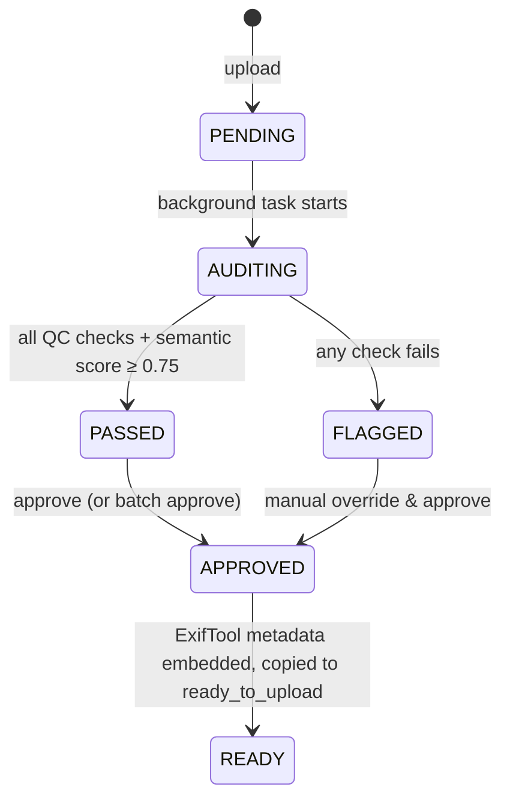

# Adobe Stock AI Image Studio

A local desktop application for managing, auditing, and preparing AI-generated images for Adobe Stock submission. Uses a Python FastAPI backend with automated quality control and a Next.js frontend dashboard.

## Quick Start

### Prerequisites

| Requirement | Version | Notes |
| --- | --- | --- |
| Python | 3.11+ | 3.11 or 3.12 recommended |
| Node.js | 20+ | Ships with npm |
| ExifTool | 12.70+ | Auto-detected on `PATH` or at `%LOCALAPPDATA%\Programs\ExifTool` |
| Tesseract OCR | 5.3+ | Auto-detected on `PATH` or at `C:\Program Files\Tesseract-OCR` |
| LLM gateway | — | OpenAI-compatible endpoint (see below) |

Install the two native tools with winget (no admin needed for ExifTool):

```powershell
winget install --id OliverBetz.ExifTool --exact
winget install --id UB-Mannheim.TesseractOCR --exact
```

Both are resolved automatically at startup — from `PATH` first, then from their
standard install directories — so a stale `PATH` won't break the pipeline.

### LLM gateway

Semantic QC and metadata generation go through any **OpenAI-compatible**
`/chat/completions` endpoint. The default targets a local multi-provider router
that routes by *virtual model name*:

```env
LLM_BASE_URL=http://localhost:4006/api/gateway/v1
LLM_MODEL=OpenRouter-Free-Endpoint
LLM_API_KEY=<pool gateway key>
LLM_TIMEOUT_SECONDS=240
LLM_IMAGE_MAX_DIM=1024
```

`LLM_IMAGE_MAX_DIM` downscales images before upload, keeping vision requests
small. Any OpenAI-compatible provider works — point `LLM_BASE_URL` at OpenAI,
OpenRouter, Groq, etc. and set `LLM_MODEL` to the model id.

### Backend

```bash
cd backend
python -m venv .venv
.venv\Scripts\activate          # Windows
# source .venv/bin/activate     # macOS / Linux
pip install -r requirements.txt
copy .env.example .env          # Windows (cp on macOS / Linux)
# then edit .env and set LLM_API_KEY
python -m uvicorn main:app --reload --port 8000
```

> `config.py` loads `.env` from either the repo root or `backend/` (the latter
> wins), so running the command above from `backend/` works as-is.

The API is then available at http://localhost:8000, with interactive docs at
http://localhost:8000/docs.

### Frontend

```bash
cd frontend
npm install
npm run dev
```

Open http://localhost:3000 in your browser.

### Tests

```bash
cd backend
.venv\Scripts\python.exe -m pytest -q
```

## API Reference

| Method | Path | Description |
| --- | --- | --- |
| `POST` | `/upload` | Upload a batch of JPEGs (multipart field `files`, max 50). |
| `GET` | `/api/records` | List records, newest first. Filters: `status`, `used` (`all`/`used`/`unused`), `queued`, `prompt_id`, `stage` (comma-separated pipeline stages), `search` (substring across title/description/keywords/filenames/category), `ids` (comma-separated), `limit` (≤500), `offset`. |
| `GET` | `/api/records/{id}` | Fetch a single record. |
| `POST` | `/api/records/{id}/approve` | Approve a record, optionally overriding title/description/keywords. |
| `PATCH` | `/api/records/{id}/used` | Mark one record as used/unused (`{"is_used": true}`). |
| `PATCH` | `/api/records/used` | Mark many records as used/unused (`{"record_ids": [...], "is_used": true}`). |
| `DELETE` | `/api/records/{id}` | Delete a record and all of its on-disk artifacts. |
| `POST` | `/api/records/bulk-delete` | Delete many records (`{"record_ids": [...]}`). |
| `GET` | `/api/records/{id}/download` | Download the staged, metadata-tagged file (READY only). |
| `POST` | `/api/records/download-zip` | ZIP archive of staged files (max 50 per request). |
| `POST` | `/api/upload-table` | Build copy/paste metadata rows for the selected records. |
| `POST` | `/api/assets/rename` | Set the Adobe upload filename for one or more records (blank clears the override). |
| `POST` | `/api/assets/rename-suggest` | Propose filenames derived from the generated titles, without writing. |
| `POST` | `/api/assets/apply-suggested-names` | Adopt the metadata model's proposed filenames (falls back to the title). |
| `POST` | `/api/assets/force-accept` | Force records past the acceptance gate, recording the reason. |
| `POST` | `/api/assets/csv` | Download the Adobe Stock CSV for a selection (`only_ready` defaults true). |
| `POST` | `/api/assets/csv/preview` | CSV text plus warnings, without downloading. |
| `POST` | `/api/assets/bundle` | ZIP the selected images **and** their CSV together. |
| `GET` | `/api/prompts` | List generation prompts. Filters: `status` (`all`/`used`/`unused`/`bound`/`unbound`/`archived`, alias `draft`). |
| `POST` | `/api/prompts` | Create a prompt (title derived from the body when blank). |
| `GET` | `/api/prompts/{id}` | Fetch one prompt with its binding count. |
| `PATCH` | `/api/prompts/{id}` | Partial update; also marks a prompt used/draft/archived by hand. |
| `DELETE` | `/api/prompts/{id}` | Delete a prompt, keeping and unbinding its images. |
| `POST` | `/api/prompts/{id}/bind` | Bind images to a prompt, or unbind (`{"record_ids": [...], "unbind": true}`). |
| `GET` | `/api/research/settings` | Prompt Research vocabulary: modes, the default style instruction, the house rules, and the confidence disclaimer. |
| `GET` | `/api/research/runs` | List research threads, newest first. |
| `POST` | `/api/research/runs` | Start a thread and run the first turn. `stream_first: true` creates it without running, so the caller can stream. |
| `GET` | `/api/research/runs/{id}` | One thread, with its stored transcript for replay. |
| `POST` | `/api/research/runs/{id}/messages` | Continue a thread (buffered). The confidence buttons post here. |
| `GET` | `/api/research/runs/{id}/stream` | Continue a thread, streamed as Server-Sent Events. |
| `POST` | `/api/research/runs/{id}/accept` | Push accepted prompts into the Prompt Library as drafts. |
| `DELETE` | `/api/research/runs/{id}` | Delete a thread; prompts already accepted are kept. |
| `GET` | `/thumbnails/{filename}` | Static thumbnail images. |
| `GET` | `/health` | Liveness probe. |

### Prompt filters: two independent axes
A prompt's *consumed* state and its *binding* state are different things — a
prompt can be used elsewhere without anything being collected here. The list
endpoint reports both, and they legitimately disagree:

| Axis | Filters | Reads |
| --- | --- | --- |
| Status | `used`, `unused`, `archived` | `Prompt.status` |
| Binding | `bound`, `unbound` | live count of linked `image_records` |

`unused` is the status twin of `used` (still a draft); "no image bound" is
`unbound`. `GET /api/prompts` returns `used`/`unused`/`archived` **and**
`bound`/`unbound` as separate totals, so they must not be summed.

## Pages

| Route | Purpose |
| --- | --- |
| `/` | Pipeline dashboard: upload, live QC status, batch approve. |
| `/gallery` | Masonry gallery of staged assets — usage filters, multi-select, ZIP download, bulk delete, and "Generate upload table". |
| `/research` | Prompt Research: an agentic chat workspace that researches a niche and writes generation prompts. |
| `/upload-table` | Copy/paste-ready title/description/keyword rows with image previews, opened in a new tab from the gallery. |

## Prompt Research

Reachable from the header on every route. It sits *before* Stage 1: the prompts it
produces are what the Collector's Prompt Library holds and what the images are
generated from.

| Mode | What it does |
| --- | --- |
| **Static** | A hint in, a fully specified prompt out. No web research. |
| **Batch** | A niche plus a count in, a set of prompts out — each describing a different image, with overlaps flagged before you save. |
| **Research** | The agent searches the web, checks how crowded the niche is, then writes researched prompts. |
| **Find ideas** | The agent proposes niches for you to choose from. It writes no prompts until you pick one. |

The agent is a small tool-using loop, not a single prompt:

| Tool | Purpose |
| --- | --- |
| `web_search` | General web search. |
| `fetch_page` | Read one page in full. |
| `market_overview` | How heavily a niche is already supplied — marketplace share and the catalogue figure printed on a marketplace page. |
| `check_restrictions` | Screen wording against Adobe's known-restrictions list. |
| `check_prompt_similarity` | Flag drafted prompts too alike to be worth generating separately. |
| `assess_validity` | Record the two confidence scores; the collective average is computed. |
| `list_categories` | Adobe Stock category codes. |

### The validity check

When it is on, the agent researches the idea, records a scorecard, and **stops** —
offering *Continue with these confidence rates* or *Research a better idea or
niche*. Both buttons send an ordinary chat message, so a button press and a typed
sentence take exactly the same path.

Two things are deliberate:

* **The gate suppresses prompt generation.** Asking for prompts while also asking
  the agent to stop and await a decision is a contradiction; the model resolves it
  badly. With the gate on there is no output-format block and no similarity tool,
  because nothing has been drafted yet.
* **The scores are labelled as a judgement, not a measurement.** Nothing in this
  app has access to keyword volume, download counts or sales data, and search
  results show what *already exists* rather than how many customers would buy it.
  The disclaimer is rendered with the scorecard, not hidden in a tooltip.

### The JSON output contract

Every prompt-producing run answers in **one JSON object**, not prose with
headings:

```json
{
  "summary": "one sentence describing what was produced",
  "prompts": [
    {
      "title": "short human label",
      "body": "the full generation prompt paragraph, ending with --ar 16:9",
      "tags": ["2-4 short topical tags"],
      "category": 1,
      "notes": "optional one-line note for the operator"
    }
  ]
}
```

A schema rather than a delimiter, for three reasons:

* **The fields arrive labelled.** The title, tags and category no longer have to
  be inferred from prose, and they are carried all the way into the Prompt
  Library when the prompt is accepted.
* **`json.dumps` escapes newlines.** The payload survives a stored transcript and
  an SSE frame without a second parsing convention.
* **A missing field is a missing key** rather than a silently truncated
  paragraph.

The parser reads the object by **brace matching**, not a regex, because `{` is
legitimate prompt text. A ```json fence, prose around the object, or a bare
string entry are all tolerated; an invented category code is dropped *and*
reported, because Adobe's CSV import rejects a code it does not know. If the
model ignores the contract entirely, the parser falls back to the older delimited
and paragraph paths — and **announces the fallback**, so a guess is never
presented as structured output.

Because the answer is a machine payload, the run stores a **rendered** version of
it (the summary plus the prompt bodies) rather than the raw JSON, and the live
transcript shows the reasoning and tool steps streaming while the payload itself
arrives as parsed cards.

The contract is enforced on the way back too. Protocol markup is **never**
streamed into the transcript, in any mode: a turn's content stops being streamed
the moment it reveals itself to be a tool call, with a short hold-back so a marker
split across two deltas cannot leak its first half. That check is mode-independent
because the validity gate makes `wants_prompts` false, and an earlier version tied
the streaming decision to that flag — so the flagship mode streamed its raw
`<tool_call>{…` markup as the agent's answer.

### Watching a run

A research turn can legitimately take a minute, so a bare spinner is not enough.
The transcript shows the model's reasoning (collapsed, and collapsible) and one
row per tool call with its arguments and result as they arrive; the composer
reports what is actually happening — *Thinking…*, *Running web_search — …*,
*Writing the answer…* — derived from the stream rather than from a timer.

Two details are worth knowing if you change this code:

* **The turn being streamed has no assistant message yet.** It is created only
  when the turn finishes, so live activity must render outside the message list.
  Rendering it only inside an assistant message hid the whole first turn.
* **A silent turn is retried, then finalised — not discarded.** A reasoning model
  routinely emits a thinking-only turn, and a run that already gathered evidence
  must not be thrown away because the final phrasing turn misbehaved. If nothing
  usable can be recovered from the transcript, the tools are withheld and the
  model is asked once more for a conclusion, because a run that shows its research
  and then ends in silence is the same defect as a stalled spinner.

Two storage details are worth knowing, because both fail *silently*:

* **`result` is a JSON column.** It must receive plain data. Storing the
  `ValidityView` dataclass that `validity.describe` returns raises
  `TypeError: … not JSON serializable` — and because that happens inside the
  stream's `finally` block, the turn is lost and the conversation stays `RUNNING`
  forever. It only bit the *success* path of the validity gate, because a run with
  no assessment stores `None`, which serialises fine.
* **A persistence failure is recorded, not swallowed.** The run is marked
  `FAILED` with the reason, so the thread shows what happened instead of claiming
  a turn is still running.

### Two search providers, because one is not enough

DuckDuckGo's lite front-end answers a scripted query, but it rate-limits
aggressively — a burst of eight queries got the anti-bot challenge on all eight,
and the block persisted. Google News RSS is tried as a fallback: no key, a stable
documented shape, and dated, attributed articles. A fallback result is **marked as
one** and the tool text says news coverage is not marketplace catalogue data.

A failure is never rendered as an empty result set. If every provider fails, the
model is told explicitly not to conclude that the niche has no competition —
otherwise a blocked search would look like an underserved market.

### How the agent calls tools

The configured gateway does not support OpenAI tool calling (verified: sending
`tools` returns `finish_reason: "stop"`, `tool_calls: null`, and the intended call
leaked into `content` as DeepSeek's internal `DSML` markup). So tool calls are
exchanged as **text** and parsed from three shapes: the requested
`<tool_call>{"name": …, "arguments": {…}}</tool_call>` envelope, fenced JSON, and
the DSML markup. Prose that merely mentions a tool is not read as a call — that
would stop the loop from ever terminating.

## Delivery: filenames, forced acceptance, CSV & ZIP

From **Metadata & CSV** onward the job changes from *processing* images to
*delivering* them, so the same three controls follow the record wherever it sits
— including the Gallery's published view:

| Control | Why it exists |
| --- | --- |
| **Use suggested names** | The metadata model names each asset while looking at it, so its proposal is usually better than a truncated title. One click applies it to the selection. |
| **Filenames** | Adobe matches each CSV row to an uploaded file **by filename**. Names are normalised to Adobe's rules (lower-case, hyphens, JPEG, ≤30 chars), and can be reviewed or rebuilt in bulk from the generated titles. |
| **Force accept** | The acceptance gate is a heuristic and the score is a *ranking* signal. The operator can override it; the **score and the scorer's issues are preserved** and the override is recorded with a reason, so it is never mistaken for a pass. |
| **CSV / ZIP + CSV** | Generated from the *current selection*. The ZIP contains the images **and** the CSV that names them, so the two cannot drift apart. |

Two rules the code enforces rather than trusting:

- **One name, everywhere.** `ImageRecord.upload_filename` is the single source of
  truth, read by the CSV, the ZIP entry, the download and the UI. `download_name`
  stores the name that will be used; when unset the name is derived from the
  title. `suggested_filename` holds the model's **proposal** and is never the
  delivered name until the operator applies it.
- **A name is derived from the title alone.** No record id, hash, or code is ever
  mixed into it — the filename is a deliverable the operator reads and uploads,
  not an internal key. Batch uniqueness is applied where the batch is known: a
  colliding row gets a readable `-2`, and its title is re-shortened so the marker
  fits rather than clipping an already-full name mid-word.
- **A CSV row must name a file that is actually delivered.** The bundle builds its
  CSV from the *staged* records, so an unpublished selection cannot produce a row
  for a file that is not in the archive. Because publishing is what stages that
  file, **Metadata & CSV offers the CSV but not the bundle** — the bundle appears
  on the Gallery, where the staged assets are.
- **Publishing stages the pipeline's quality copy** (`working_path` — the
  refined/upscaled output), falling back to the inbox original only when no
  working copy exists. Staging the raw upload would silently discard every
  stage's work.
- **Metadata generation is allowed below the threshold.** Only an `OCR_REJECTED`
  record is blocked, because embedded text is a content-policy violation rather
  than a quality judgement.

## Published gallery

The published gallery (`/gallery`) is the endpoint of the pipeline, so it is
reachable from the header on every route as well as from Stage 7.

| Filter | Reads | Notes |
| --- | --- | --- |
| **Search** | title, description, keywords, `filename`, `download_name`, `suggested_filename`, category | Debounced; matches a keyword that never made it into the title, and the delivered filename. |
| **Usage** | `is_used` | `unused` / `used` / `all` — independent of the stage scope. |
| **Scope** | `stage` | `Published` (default) or `All stages`. |

Scope is by **stage**, not by the legacy `status` column: `status` is the QC
verdict, so `status=READY` also matched records that were approved but not yet
published. An invalid `stage` value is a **400**, not an empty result — a filter
that silently matches nothing is indistinguishable from a broken one.

## Reported metrics describe the *delivered* file

`width`, `height`, `megapixels` and `file_size_bytes` used to be measured once at
ingestion, on the **inbox original**, and never refreshed. After an upscale the
two disagreed by 8x: a published asset whose delivered file is **3840x2143
(8.2 MP)** reported **1376x768 (1.06 MP)** — which reads as "publishing shrank my
image".

That was not cosmetic either: `low_resolution` is a **critical** acceptance issue
scored from the megapixels, so a stale 1.06 MP claimed a below-Adobe-floor
resolution for an asset that passes comfortably.

`services/record_metrics.py` owns the measurement, and every place that changes
`working_path` (upload conversion, upscale, refine, autofix) plus publish calls
it, so the reported geometry follows the file. `services/metric_repair.py`
re-measures existing records once at startup — it is self-limiting, so a second
boot does nothing.

## Published gallery

The published gallery (`/gallery`) is the endpoint of the pipeline, so it is
reachable from the header on every route as well as from Stage 7.

| Filter | Reads | Notes |
| --- | --- | --- |
| **Search** | title, description, keywords, `filename`, `download_name`, `suggested_filename`, category | Debounced; finds a keyword that never made it into the title, and the delivered filename. |
| **Usage** | `is_used` | `unused` / `used` / `all` — independent of the stage scope. |
| **Scope** | `stage` | `Published` (default) or `All stages`. |

Scope is by **stage**, not by the legacy `status` column: `status` is the QC
verdict, so `status=READY` also matched records that were approved but not yet
published. An invalid `stage` value is a **400**, not an empty result — a filter
that silently matches nothing is indistinguishable from a broken one.

## Reported metrics describe the *delivered* file

`width`, `height`, `megapixels` and `file_size_bytes` used to be measured once at
ingestion, on the **inbox original**, and never refreshed. After an upscale the
two disagreed by 8x: a published asset whose delivered file is **3840×2143
(8.2 MP)** reported **1376×768 (1.06 MP)** — which reads as "publishing shrank my
image".

That was not cosmetic either: `low_resolution` is a **critical** acceptance issue
scored from the megapixels, so a stale 1.06 MP claimed a below-Adobe-floor
resolution for an asset that passes comfortably.

`services/record_metrics.py` owns the measurement, and every place that changes
`working_path` (upload conversion, upscale, refine, autofix) plus publish calls
it, so the reported geometry follows the file. `services/metric_repair.py`
re-measures existing records once at startup — it is self-limiting, so a second
boot does nothing.

## Pipeline

Each upload enters a state machine and is processed by a background task:



Deterministic QC runs first (resolution, Laplacian-variance sharpness, colour
space, Tesseract OCR), then the LLM performs semantic QC and generates title,
description and keywords. Approval writes IPTC/XMP metadata with ExifTool and
copies the file into the ready-to-upload directory.

## Architecture

- **Backend**: FastAPI + SQLAlchemy + SQLite (WAL mode)
- **Frontend**: Next.js App Router + Tailwind CSS + Axios
- **AI**: OpenAI-compatible LLM gateway (vision + JSON mode) for semantic QC and metadata
- **QC**: OpenCV (sharpness), Pillow (resolution/color), Tesseract (OCR)

## Project Layout

| Path | Purpose |
| --- | --- |
| `backend/config.py` | Pydantic settings and all QC thresholds. |
| `backend/database.py` | SQLAlchemy engine, session factory, WAL pragmas. |
| `backend/models.py` | `ImageRecord` ORM model and `ImageStatus` enum. |
| `backend/schemas.py` | Pydantic request/response models. |
| `backend/routers/` | `upload`, `records`, `approve`, `gallery` API endpoints. |
| `backend/services/` | `qc_engine`, `llm_client`, `gemini_auditor`, `gemini_metadata`, `exiftool_embedder`, `storage`, `upload_table`, `migrations`. |
| `backend/tasks/` | `audit_orchestrator` background pipeline. |
| `backend/tests/` | Pytest suite (QC engine + API integration). |
| `frontend/src/lib/api.ts` | Typed API client. |
| `frontend/src/lib/clipboard.ts` | Clipboard helper with a non-secure-context fallback. |
| `frontend/src/lib/uploadTableStore.ts` | Cross-tab hand-off of the gallery selection. |
| `frontend/src/components/` | Shared UI: `NavBar`, `Dropzone`, `StatsBar`, `ImageGrid`, `InspectionModal`, `ConfirmDialog`, `CopyButton`. |
| `frontend/src/components/gallery/` | Gallery view, masonry grid, tile, toolbar, preview modal, hooks. |
| `frontend/src/components/uploadTable/` | Upload-table view, table, and row components. |
| `frontend/src/app/page.tsx` | Live polling dashboard. |
| `frontend/src/app/gallery/page.tsx` | Gallery route. |
| `frontend/src/app/upload-table/page.tsx` | Upload-table route. |
| `plan-document-series/` | Design and planning documents. |
| `storage/` | Runtime data: `inbox/`, `thumbnails/`, `ready_to_upload/`, SQLite DB. |

