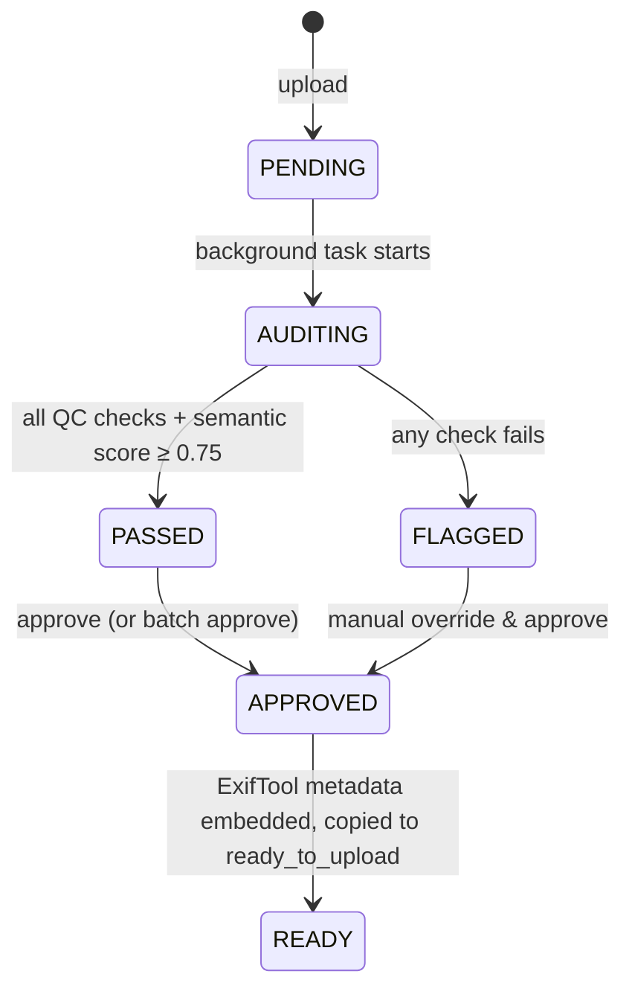

# Adobe Stock AI Image Studio

A local desktop application for managing, auditing, and preparing AI-generated images for Adobe Stock submission. Uses a Python FastAPI backend with automated quality control and a Next.js frontend dashboard.

## Quick Start

### Prerequisites

| Requirement | Version | Notes |
| --- | --- | --- |
| Python | 3.11+ | 3.11 or 3.12 recommended |
| Node.js | 20+ | Ships with npm |
| ExifTool | 12.70+ | Auto-detected on `PATH` or at `%LOCALAPPDATA%\Programs\ExifTool` |
| Tesseract OCR | 5.3+ | Auto-detected on `PATH` or at `C:\Program Files\Tesseract-OCR` |
| LLM gateway | — | OpenAI-compatible endpoint (see below) |

Install the two native tools with winget (no admin needed for ExifTool):

```powershell
winget install --id OliverBetz.ExifTool --exact
winget install --id UB-Mannheim.TesseractOCR --exact
```

Both are resolved automatically at startup — from `PATH` first, then from their
standard install directories — so a stale `PATH` won't break the pipeline.

### LLM gateway

Semantic QC and metadata generation go through any **OpenAI-compatible**
`/chat/completions` endpoint. The default targets a local multi-provider router
that routes by *virtual model name*:

```env
LLM_BASE_URL=http://localhost:4006/api/gateway/v1
LLM_MODEL=OpenRouter-Free-Endpoint
LLM_API_KEY=<pool gateway key>
LLM_TIMEOUT_SECONDS=240
LLM_IMAGE_MAX_DIM=1024
```

`LLM_IMAGE_MAX_DIM` downscales images before upload, keeping vision requests
small. Any OpenAI-compatible provider works — point `LLM_BASE_URL` at OpenAI,
OpenRouter, Groq, etc. and set `LLM_MODEL` to the model id.

### Backend

```bash
cd backend
python -m venv .venv
.venv\Scripts\activate          # Windows
# source .venv/bin/activate     # macOS / Linux
pip install -r requirements.txt
copy .env.example .env          # Windows (cp on macOS / Linux)
# then edit .env and set LLM_API_KEY
python -m uvicorn main:app --reload --port 8000
```

> `config.py` loads `.env` from either the repo root or `backend/` (the latter
> wins), so running the command above from `backend/` works as-is.

The API is then available at http://localhost:8000, with interactive docs at
http://localhost:8000/docs.

### Frontend

```bash
cd frontend
npm install
npm run dev
```

Open http://localhost:3000 in your browser.

### Tests

```bash
cd backend
.venv\Scripts\python.exe -m pytest -q
```

## API Reference

| Method | Path | Description |
| --- | --- | --- |
| `POST` | `/upload` | Upload a batch of JPEGs (multipart field `files`, max 50). |
| `GET` | `/api/records` | List records, newest first. Filters: `status`, `used` (`all`/`used`/`unused`), `ids` (comma-separated), `limit` (≤500), `offset`. |
| `GET` | `/api/records/{id}` | Fetch a single record. |
| `POST` | `/api/records/{id}/approve` | Approve a record, optionally overriding title/description/keywords. |
| `PATCH` | `/api/records/{id}/used` | Mark one record as used/unused (`{"is_used": true}`). |
| `PATCH` | `/api/records/used` | Mark many records as used/unused (`{"record_ids": [...], "is_used": true}`). |
| `DELETE` | `/api/records/{id}` | Delete a record and all of its on-disk artifacts. |
| `POST` | `/api/records/bulk-delete` | Delete many records (`{"record_ids": [...]}`). |
| `GET` | `/api/records/{id}/download` | Download the staged, metadata-tagged file (READY only). |
| `POST` | `/api/records/download-zip` | ZIP archive of staged files (max 50 per request). |
| `POST` | `/api/upload-table` | Build copy/paste metadata rows for the selected records. |
| `GET` | `/thumbnails/{filename}` | Static thumbnail images. |
| `GET` | `/health` | Liveness probe. |

## Pages

| Route | Purpose |
| --- | --- |
| `/` | Pipeline dashboard: upload, live QC status, batch approve. |
| `/gallery` | Masonry gallery of staged assets — usage filters, multi-select, ZIP download, bulk delete, and "Generate upload table". |
| `/upload-table` | Copy/paste-ready title/description/keyword rows with image previews, opened in a new tab from the gallery. |

## Pipeline

Each upload enters a state machine and is processed by a background task:



Deterministic QC runs first (resolution, Laplacian-variance sharpness, colour
space, Tesseract OCR), then the LLM performs semantic QC and generates title,
description and keywords. Approval writes IPTC/XMP metadata with ExifTool and
copies the file into the ready-to-upload directory.

## Architecture

- **Backend**: FastAPI + SQLAlchemy + SQLite (WAL mode)
- **Frontend**: Next.js App Router + Tailwind CSS + Axios
- **AI**: OpenAI-compatible LLM gateway (vision + JSON mode) for semantic QC and metadata
- **QC**: OpenCV (sharpness), Pillow (resolution/color), Tesseract (OCR)

## Project Layout

| Path | Purpose |
| --- | --- |
| `backend/config.py` | Pydantic settings and all QC thresholds. |
| `backend/database.py` | SQLAlchemy engine, session factory, WAL pragmas. |
| `backend/models.py` | `ImageRecord` ORM model and `ImageStatus` enum. |
| `backend/schemas.py` | Pydantic request/response models. |
| `backend/routers/` | `upload`, `records`, `approve`, `gallery` API endpoints. |
| `backend/services/` | `qc_engine`, `llm_client`, `gemini_auditor`, `gemini_metadata`, `exiftool_embedder`, `storage`, `upload_table`, `migrations`. |
| `backend/tasks/` | `audit_orchestrator` background pipeline. |
| `backend/tests/` | Pytest suite (QC engine + API integration). |
| `frontend/src/lib/api.ts` | Typed API client. |
| `frontend/src/lib/clipboard.ts` | Clipboard helper with a non-secure-context fallback. |
| `frontend/src/lib/uploadTableStore.ts` | Cross-tab hand-off of the gallery selection. |
| `frontend/src/components/` | Shared UI: `NavBar`, `Dropzone`, `StatsBar`, `ImageGrid`, `InspectionModal`, `ConfirmDialog`, `CopyButton`. |
| `frontend/src/components/gallery/` | Gallery view, masonry grid, tile, toolbar, preview modal, hooks. |
| `frontend/src/components/uploadTable/` | Upload-table view, table, and row components. |
| `frontend/src/app/page.tsx` | Live polling dashboard. |
| `frontend/src/app/gallery/page.tsx` | Gallery route. |
| `frontend/src/app/upload-table/page.tsx` | Upload-table route. |
| `plan-document-series/` | Design and planning documents. |
| `storage/` | Runtime data: `inbox/`, `thumbnails/`, `ready_to_upload/`, SQLite DB. |

