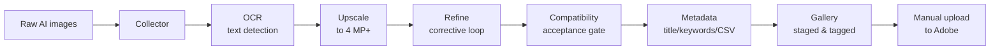
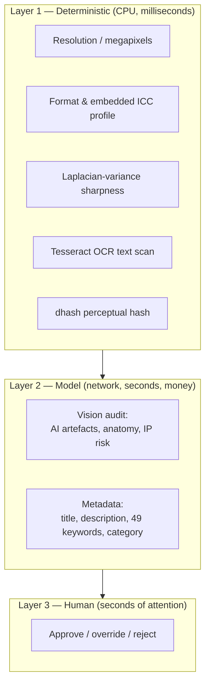
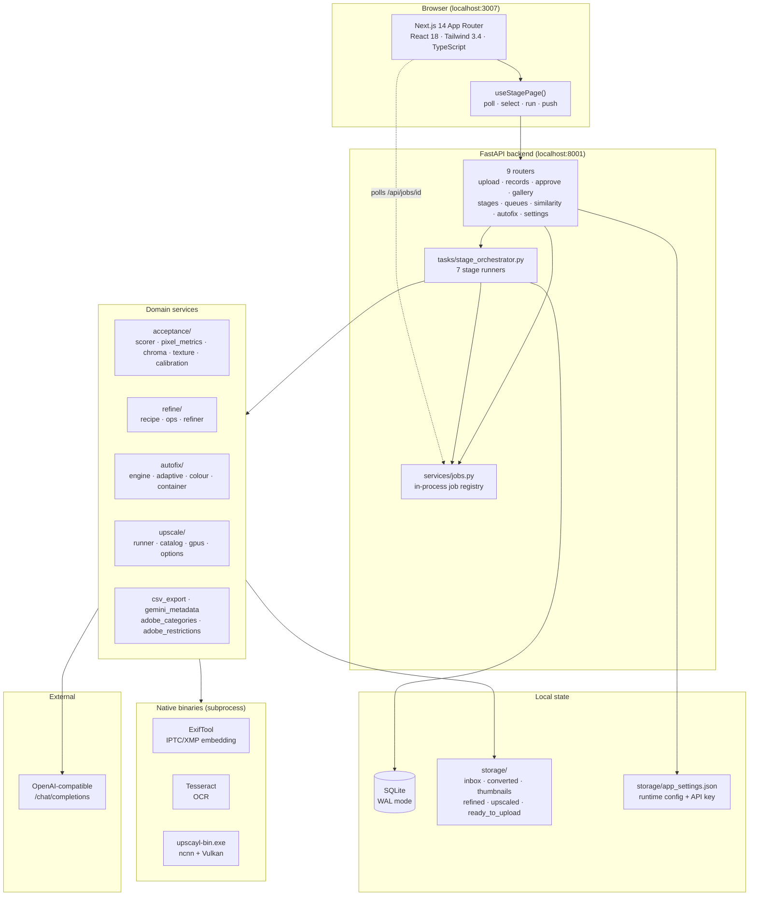
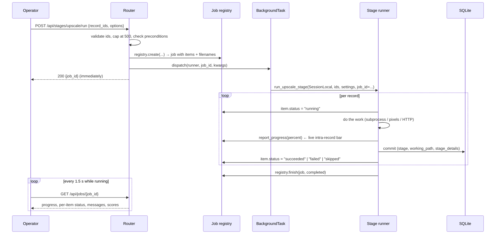
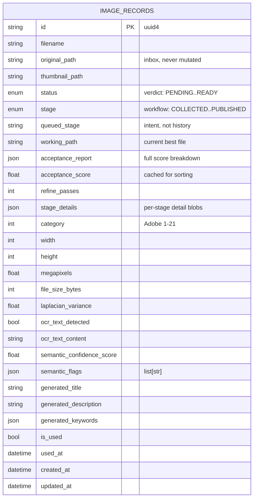
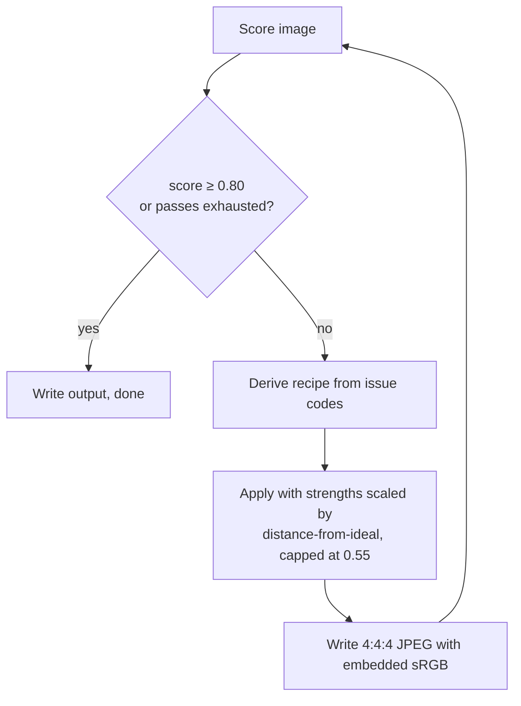
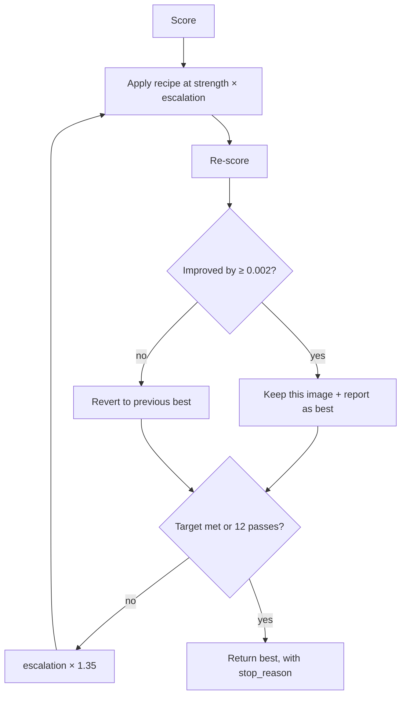
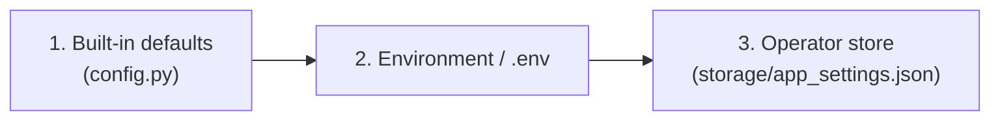

# Adobe Stock AI Image Studio — A Complete Explainer

> **What this document is.** A single readable walkthrough of the system: the idea behind it,
> how it is built, and an honest assessment of whether the design is efficient and *why*.
> It is written to be handed to someone who has never seen the repo. No prior context needed.
>
> **Repo:** `adobe_stock_ai_images_manager` · **Stack:** FastAPI + Next.js + SQLite · **Runs:** entirely on one machine.

---

## 0. The two-minute version

If you only read one section, read this one.

**The problem.** Selling AI-generated photos on Adobe Stock is a paperwork-and-rejection problem,
not an image-generation problem. Adobe rejects submissions for a long list of reasons — wrong
format, no embedded sRGB profile, under 4 megapixels, over-sharpening, visible chromatic
aberration, noise, hallucinated text baked into the image, branded logos, and above all
**"similar content"**. Rejections cost contributor reputation, and manual inspection does not
scale past a few dozen images.

**The idea.** Build a local production line that takes a folder of raw AI images and moves each
one through seven inspection and correction stations, using *cheap deterministic checks first* and
*an LLM only where judgement is genuinely required*, and then emit exactly the artefacts Adobe's
Contributor Portal accepts: JPEGs with embedded sRGB profiles and IPTC/XMP metadata, plus a CSV
that matches Adobe's column spec to the character.

**The shape.**



**The one-line answer on efficiency.** It is efficient *for the job it has* — a single-user,
single-machine tool processing tens to hundreds of images — because it pushes work to the cheapest
layer that can do it (math before ML, local binaries before network calls, skip-before-recompute),
and because almost every expensive stage is guarded by an idempotency check. It is deliberately
*not* efficient in the distributed-systems sense, and several choices (in-memory job state,
O(n²) duplicate detection, client-side record partitioning) are correct only at this scale. Those
limits are known, bounded, and documented below rather than hidden.

**Scale of the thing.** ~17,800 lines of Python across 93 files, ~9,400 lines of TypeScript across
75 files, 547 test functions (≈590 collected, all passing), 7 pipeline stages, 18 issue codes,
21 upscale models, 1 SQLite database, zero cloud services.

---

## 1. The idea, stated properly

### 1.1 The real problem is a *matching* problem

Adobe Stock is a moderated marketplace. Your image must simultaneously satisfy three independent
rulebooks, and failure in any one of them is a refusal:

| Rulebook | Nature | Examples | Who checks it |
|---|---|---|---|
| **Container** | Mechanical, exact | 4–100 MP, ≤45 MB, JPEG, *embedded* sRGB ICC profile | Code, cheaply |
| **Pixel quality** | Perceptual, thresholded | soft focus, clipped highlights, over-saturation, noise, fringing | Code, expensively |
| **Meaning & rights** | Semantic, judgemental | AI artefacts, anatomy, logos/trademarks, hallucinated text, "too similar to your own other uploads" | An LLM, and a human |

The naive approach is to throw every image at a vision model and ask "is this good?" That is slow,
costs money per image, and — importantly — is *worse* at the container rules than a five-line
Pillow check, because an LLM cannot reliably tell you whether an ICC profile is embedded.

So the architecture is organised around **routing each question to the cheapest layer that can
answer it reliably**:



That layering is the central design decision. Everything else follows from it.

### 1.2 Why a *pipeline* rather than a *script*

A one-shot script (`for img in folder: fix(img); upload(img)`) fails in a specific way: when
something goes wrong you cannot tell *where*, and you cannot re-run part of it. Because image
correction is destructive (each edit is lossy), the ability to say "re-run stage 4 on these twelve
images, leaving stage 3's output alone" is worth the structural cost.

So the system is a **state machine over records**, not a function over files. Each image is a row in
a database with two orthogonal coordinates:

- **`status`** — the *verdict*: `PENDING → AUDITING → PASSED | FLAGGED → APPROVED → READY`.
  This is what gates download and what the original dashboard filters on.
- **`stage`** — the *workflow position*: `COLLECTED → OCR_CLEAR | OCR_REJECTED → UPSCALED →
  REFINED → COMPATIBLE | INCOMPATIBLE → METADATA_READY → PUBLISHED`.
  This is what the seven stage pages operate on.

Keeping these separate matters. A record can be `FLAGGED` (bad verdict) and simultaneously sitting
in stage `INCOMPATIBLE` waiting for a human, and the operator can re-run *upscaling* on a record
that is already `METADATA_READY` without destroying its metadata. Collapsing them into one enum —
which an earlier version did — makes both of those impossible.

There is a third, deliberately separate field: **`queued_stage`**. Pushing a record into a stage
records *intent* without changing its real history. A push cannot rewrite `stage`, because `stage`
is an observed fact about the file, and `queued_stage` is a plan about the file. Conflating them
caused a bug where a record appeared in two stages at once (see §7.3).

---

## 2. Architecture

### 2.1 Component map



### 2.2 The seven stages, concretely

| # | Stage | Key | What it actually does | Can it reject? |
|---|---|---|---|---|
| 1 | **Collector** | `collector` | Multipart upload (≤50 files), validates extension, writes to `inbox/` under a **uuid4** name, normalises PNG→JPEG, generates a 400×400 thumbnail, creates a `COLLECTED` record | Yes (bad extension) |
| 2 | **OCR Detector** | `ocr` | Tesseract scan on a downscaled (1600 px) copy; classifies result as `none` / `gibberish` / `embedded_text`; per-word confidence reported | **Yes, terminally** → `OCR_REJECTED` |
| 3 | **Upscale** | `upscale` | `upscayl-bin.exe` neural upscale (default `4xNomos8kSC`, 4×, target 3840 px, GPU 0) → lossless PNG intermediate → Lanczos/INTER_AREA resize to the exact target long edge → 4:4:4 sRGB JPEG | No (enhancement only) |
| 4 | **Image Refiner** | `refine` | Scores the image, derives a corrective recipe from the reported issues, applies it, re-scores, repeats until it clears 80% or the pass budget runs out | No (improves, never gates) |
| 5 | **Compatibility Check** | `compatibility` | The full acceptance algorithm *with* the LLM semantic audit attached. The actual gate | **Yes, terminally** → `INCOMPATIBLE` |
| 6 | **Metadata & CSV** | `metadata` | Vision LLM generates title, description, up to 49 keywords, and an Adobe category code. Serialised with a 2 s pause to dodge rate limits | No |
| 7 | **Gallery** | `gallery` | Reuses the approval pipeline: copy to `ready_to_upload/`, embed IPTC/XMP with ExifTool, mark `PUBLISHED`/`READY` | No |

Notice the ordering logic: **the two stages that can terminally reject are #2 and #5, and they are
placed as early as possible.** OCR is nearly free, so it runs first and kills doomed images before
anything expensive touches them. The compatibility gate is deliberately *after* refinement, because
an image that fails only because it is soft should be corrected, not discarded — but it still runs
before metadata, so you never pay an LLM to write keywords for an image you are about to reject.

### 2.3 How a batch actually flows

Every stage follows the identical dispatch contract. This is the part worth understanding, because
it is the same code seven times:



Three properties are baked into that contract:

1. **The HTTP request never blocks on the batch.** The job is registered *before* dispatch so the
   response can carry a real, immediately-pollable job id.
2. **A per-record failure never aborts the batch.** Each record is wrapped individually; a broken
   file is marked `failed` with its exception message and the rest continue.
3. **Re-running is safe.** Every runner has a skip guard: `run_ocr_stage` skips already-scanned
   records, `run_upscale_stage` skips anything past Stage 3, `publish_records` skips
   already-published records. This is what makes the pipeline forgiving to operate.

### 2.4 Data model

One table, `image_records`, deliberately. This is a single-user tool; normalising stage history into
a child table would buy nothing and cost joins on every poll.



Two details in there are load-bearing:

- **`original_path` is never overwritten.** It always points at the untouched inbox original. Every
  correction writes a *new* file and moves `working_path`. This is what makes before/after
  comparison possible and what makes the whole pipeline non-destructive. There is a dedicated
  `_upscale_source_path()` helper whose only job is to make sure re-running upscaling does not feed
  a previous upscale back into the model.
- **`semantic_flags` is `list[str]`, not a dict.** It was typed as a dict once, which produced a
  hard 500 on `GET /api/records` for any record that had flags. A data contract that is *almost*
  right is worse than a missing one.

### 2.5 Storage layout

```
storage/
├── inbox/            raw uploads, uuid4-named, NEVER modified
├── converted/        PNG→JPEG normalised copies  (<record_id>.jpg)
├── thumbnails/       400×400 previews            (thumb_<uuid>.jpg)
├── refined/          Stage 4 output              (<record_id>-refined.jpg)
├── upscaled/         Stage 3 output              (<record_id>-upscaled.jpg)
├── ready_to_upload/  final tagged assets         (<record_id>.jpg)
├── adobe_stock.db    SQLite (+ -wal, -shm)
└── app_settings.json runtime config + masked API key
```

`storage/` is in `.gitignore`. That is intentional and matters: `app_settings.json` can hold a live
API key, and `adobe_stock.db` describes the user's entire portfolio. Neither should ever be
committed. Keeping the key in a separate JSON file rather than a database table means sharing the
`.db` file never leaks credentials.

---

## 3. The interesting part: how the acceptance score works

This is the piece of the system that took the most iteration, and it is the best illustration of
how the design thinks.

### 3.1 The score

`acceptance/scorer.py` computes a weighted mean over five deterministic sub-scores plus an optional
LLM semantic sub-score:

| Sub-score | Weight | What it measures |
|---|---|---|
| Technical & Format | 0.30 | JPEG, embedded sRGB, 4–100 MP, ≤45 MB |
| Exposure & Dynamic Range | 0.20 | clipped highlights, crushed shadows |
| Colour Balance | 0.15 | global saturation band, skin-tone cast, neon greens |
| Sharpness & Edge Integrity | 0.15 | Laplacian variance, edge halo, chromatic misalignment |
| Sensor Texture Realism | 0.10 | noise sigma in flat regions |
| Semantic Quality (AI Review) | 0.10 | LLM confidence + flags |

When the semantic component is unavailable, the weights are **renormalised** rather than the
sub-score being treated as zero. That single line is the difference between "the LLM is down so
everything scores 60%" and "the LLM is down so the score is computed from the five things we can
still measure."

### 3.2 The two structural caps

A plain weighted mean has a fatal flaw here: **one catastrophic failure gets averaged away.** A
29%-blown image still scored 83%, because five passing dimensions outvoted the one that mattered.

So the final score is capped twice:

$$\text{score} = \min\Big(\underbrace{\overline{w \cdot s}}_{\text{weighted mean}},\; \underbrace{0.55 + 0.45 \cdot s_{\text{worst}}}_{\text{worst-dimension ceiling}}\Big)$$

and, if *any* critical issue is present (wrong format, sub-4 MP, suspected IP):

$$\text{score} \le \text{threshold} - 0.05 = 0.75$$

The ceiling is what makes the number *mean* something: a single dimension at 0.0 pins the total at
0.55, which is below any sane threshold. This mirrors how Adobe's reviewers actually behave —
they check one box and stop at the first problem.

The subtlety, and it took a real bug to find: **the ceiling must use the worst *decisive* component
only, not the worst component period.** A mild advisory nitpick (slight fringing) must be able to
*lower* the score without being able to *cap* it. When advisory signals were allowed to cap, every
image in the corpus pinned at exactly 55.0% — which is how the bug was noticed, because a real
already-approved Adobe Stock photo scoring 55% is obviously wrong.

### 3.3 The refiner: a bounded, non-destructive correction loop



The design constraints here come straight from Adobe's *editing* guidance, which is unusually
blunt about over-editing:

- "Overprocessing with excessive contrast or HDR filters may lead to unnatural results."
- "Refrain from heavy color grading."
- Adding non-natural elements is a refusal reason.

So `MAX_CORRECTION_STRENGTH = 0.55` and `MAX_TOTAL_DESATURATION = 0.22` are hard ceilings. **Even a
wildly out-of-tolerance input gets a conservative correction**, because the loop can always run
another pass — whereas an over-edited frame cannot be un-edited. That asymmetry justifies the
caution.

### 3.4 The adaptive "Deep fix" loop — and why the naive version failed

The first auto-fix implementation was *idempotent*, and that is why it looked broken. Each correction
strength is a pure function of the measured issue, and then clamped. Re-running it on its own output
recomputes identical strengths and produces a **byte-identical image**. "Fixed 4 issues, 55% → 55%"
was a correct report of a useless operation.

`autofix/adaptive.py` fixes that by escalating:



Three hard-won rules are encoded in that loop:

- **Keep the best, never the last.** Escalation can make things *worse* — measured: `defringe(0.55)`
  produced a fringe ratio of 0.2132, `defringe(0.85)` produced 0.2190. A loop that returns its final
  state delivers a worse image than it started with.
- **Targets are per-dimension, not one number.** Because the overall score is capped by the worst
  dimension, chasing the total is meaningless; you have to push the lagging dimension.
- **Some plateaus are honest.** On a real 3840×3840 file, the fringe ratio was 0.344 against a
  `fringe_fail` of 0.15, and the maximum reachable was ~0.19. The sub-score formula is a *cliff*,
  not a gradient — it collapses to exactly 0.0 once the measurement passes `fail`, so a correction
  that improves the measurement without crossing back under the threshold earns **zero credit**. The
  correct output there is "this needs a re-shoot, not more pixel correction", and the loop says so.

### 3.5 Duplicate detection

Adobe's own guidance: *"Similar content is one of the top reasons we refuse content."* Two cheap
signals cover the two patterns an automated pipeline is most likely to *cause*:

- **Visual:** 64-bit `dhash` Hamming distance. ≤6 = near-identical, ≤12 = similar.
- **Metadata:** token-set Jaccard on title + keywords. ≥0.72 flags "different images, identical
  metadata" — which is exactly what happens when a generative model is asked for twenty variants of
  one prompt.

It is advisory by design: it returns *groups* and suggests keeping the strongest few, matching
Adobe's own "select your strongest three to five per subject". The choice of which frame to keep is
an editorial decision, not an algorithmic one. One trap is documented in code: **`dhash == 0` is an
"unreadable" sentinel, not a hash** — two undecodable files both hash to zero and must never be
paired as duplicates.

---

## 4. Is it efficient? A structured answer

"Efficient" needs a unit. Here are the four that matter for this system, answered honestly.

### 4.1 Cost efficiency — **yes, and this is the strongest claim**

The dominant recurring cost is LLM calls. The pipeline's job is to make as few of them as possible:

| Technique | Effect |
|---|---|
| Deterministic checks gate the model | Resolution/format/OCR failures never reach an API call |
| Images downscaled to 1024 px before vision calls | A vision request is billed in 512 px tiles; a full-res 3840 px photo would cost ~30× more for identical semantic judgement |
| Refinement reuses the stored semantic audit | `POST /api/records/{id}/autofix` does **not** re-call the LLM — the audit is a stored artefact |
| Stage 7 reuses Stage 6 metadata | Publishing calls `process_approval` with `override_metadata`, so no second metadata generation |
| Model output budget sized from the window | `llm_budget.py` converts the declared context window into a concrete `max_tokens`, clamped |
| OCR runs on a 1600 px copy | "roughly halves the runtime" for a task that does not benefit from full resolution |

The downscaling point deserves emphasis because it is counter-intuitive: OpenAI's vision scheme
rescales to a **768 px short side** before tiling, so any image ≥768 px costs roughly 765 tokens
*regardless of its size*. Downscaling to 1024 is therefore not a compromise on quality — it is
free. The only thing the context window actually constrains is the **reply**, not the image.

### 4.2 Runtime efficiency — **yes, with a caveat about the LLM**

```mermaid
gantt
    title Per-image wall time by stage (typical)
    dateFormat X
    axisFormat %s s
    section Cheap (CPU)
    Collector + thumbnail      :0, 1
    OCR (Tesseract)            :1, 3
    Score (OpenCV metrics)     :3, 5
    section Expensive
    Upscale (GPU, 4K target)   :5, 20
    Refine pass (score+write)  :20, 24
    Vision audit (LLM)         :24, 40
    Metadata (LLM, paced 2s)   :40, 50
```



The deterministic stages are effectively free. The two costs are the GPU upscale (bounded by
hardware, and it streams live percentage progress from the CLI so the UI shows a real bar) and the
LLM round-trips (bounded by the network, and *serialised with a 2 s pause on purpose* — the gateway
routes to free upstream models that rate-limit aggressively, and a burst of parallel requests is the
fastest way to get throttled).

That pacing is a genuine throughput sacrifice made deliberately. It is the right call for a free
endpoint and the wrong call for a paid one with high limits, which is why `delay_seconds` is a
per-run parameter rather than a constant.

### 4.3 Data efficiency — **yes**

- **SQLite in WAL mode** with `busy_timeout=5000` and `synchronous=NORMAL`. WAL lets the frontend's
  4-second polls read while a background stage is writing, without lock contention. For a
  single-writer workload this is strictly better than a client/server database.
- **Records are one table.** No joins on the hot polling path.
- **`acceptance_score` is denormalised** alongside the full `acceptance_report` JSON, so sorting and
  filtering by score never has to parse JSON.
- **Thumbnails are pre-generated** at upload, so a 500-image grid renders 500 small JPEGs instead of
  500 full-resolution originals.
- **`stage_details` is a single JSON column** per stage rather than a table per stage.

### 4.4 Where it is *deliberately* inefficient

These are the honest trade-offs. None of them is an oversight; each is a scale-bounded choice.

| Choice | The cost | Why it is correct here |
|---|---|---|
| **`BackgroundTasks`, not a real queue** | No crash recovery; a job in flight dies with the process | Single-user local tool. A Redis/Celery dependency would be pure overhead for a job whose useful lifetime ends when the process does — the module says so explicitly. |
| **Jobs are in memory** (`MAX_RETAINED_JOBS = 40`) | Job history lost on restart | Same reason. The *record state* is persisted in SQLite; only the transient progress report is volatile. |
| **Duplicate scan is O(n²)** | 400 records = ~80,000 comparisons | Capped at `MAX_SCAN_RECORDS = 400` to keep a careless request from pinning a worker. A real fix is a BK-tree; at n=400 a plain loop is faster than the setup. |
| **Frontend fetches 500 records and partitions client-side** | Wasted transfer as the corpus grows | Keeps the API contract simple (`status` filter only) while letting each page show drafts and verdicts side by side. The honest fix is a `stage` filter on the API — a known, easy change. |
| **Refinement is synchronous within the batch, autofix is a blocking HTTP call** | Autofix holds a request open | Autofix is sub-second and the modal is watching, so streaming progress would be worse UX than waiting. |
| **Whole-file copies at every stage** | Disk usage ≈ 4× per image | Non-destructiveness is the point. `original_path` must survive every stage for auditing and before/after comparison. Storage is cheap; a lost original is not. |
| **Seven near-identical stage runners** | Some structural repetition | The duplication is in the *loop skeleton*, not the logic. An abstraction was avoided because the per-record error handling and skip guards are where the real differences live. |

### 4.5 The verdict

> Efficient on cost, runtime, and data — because it routes every question to the cheapest layer that
> can answer it, and guards every expensive stage with a skip check. Deliberately not scalable
> horizontally, and several data paths are O(n²) or O(n) where O(log n) exists — all bounded, all
> correct at single-user scale, all documented in the code where the trade-off was made.

---

## 5. Engineering patterns worth naming

If you take patterns away from this codebase, take these seven. Each one was paid for with a bug.

### 5.1 Fail visibly, never silently

The worst class of bug in this system was not a wrong answer — it was a *hang*. A `TypeError` raised
inside a FastAPI `BackgroundTask` is logged while the HTTP request has already returned 200. The job
sat at `running` forever, every item stayed `pending`, and the UI showed nothing wrong.

The fix is `_run_stage_job()`, a wrapper that catches, logs, marks every unfinished item `failed`
with the exception name and message, and finishes the job as `FAILED`. Combined with
`tests/test_stage_runner_signatures.py` — which uses `inspect` to verify that every keyword the
dispatcher injects is actually accepted by the runner it is injected into — this class of bug is now
caught by the test suite rather than by the operator noticing nothing happened.

### 5.2 Prove detectors against synthetic ground truth

The chroma-fringe detector originally measured **colour contrast**, not chromatic aberration: it
Laplacian-filtered `R−G` and `B−G`, so any saturated object boundary registered as fringing. Proven
with synthetic frames where the right answer is known:

| Frame | Old detector | New detector |
|---|---|---|
| Clean photo | 0.3529 | 0.08 |
| **Real lateral CA** | **0.3040** ← lower than clean! | **0.87** |
| Over-sharpened | 0.7332 | 0.11 |
| Greyscale | 0.0 | 0.0 |

The old detector was both a false positive *and* non-monotonic — it could not rank severity at all.
The rule that came out of it: **synthesise frames where the right answer is known, then verify the
detector is monotonic and separates clean from defective. A detector that does not rise with the
defect's magnitude is broken regardless of its threshold.**

### 5.3 Distinguish requirements from guesses

`acceptance/calibration.py` tags every threshold with its provenance:

- `"adobe"` — published on Adobe's helpx pages (4–100 MP, ≤45 MB, JPEG + embedded sRGB, CSV row and
  character limits).
- `"internal"` — our own heuristic. **Every pixel-level threshold is internal, because Adobe
  publishes none** and says to judge at 100% zoom visually.

That distinction lets a future change tell a requirement from a guess. The same module records
`REFUTED_ASSUMPTIONS` — beliefs that were tested and disproved — so they are not reintroduced:
"clean = suspicious" (false), "add grain to pass" (false; Adobe forbids added grain), "CA is a
primary AI defect" (false; it is a minor nitpick), "AI photos need 16–24 MP" (vendor invention),
"upscaling is rejected" (video only; there is no photo rule).

And the honest framing that goes with it: **the score is a ranking signal, not a verdict.** Reviewer
variance exceeds any threshold's resolution — 37 files were rejected and then accepted unchanged.

### 5.4 Measurement cliff vs. gradient

Sub-scores use `1 − ramp(value, tolerance, fail)`, which **collapses to exactly 0.0** once the
measurement passes `fail`. A correction that improves the measurement without crossing back under
the threshold earns zero credit. That is not a bug, but it *looks* like one, and it explains the
"fixed 4 issues and the score didn't move" report. Recognising the difference between "the loop
failed" and "the metric is a cliff and we are on the wrong side of it" is the difference between
more work and the right work.

### 5.5 Idempotency as a first-class property

Every stage runner is safe to re-run. This is not incidental — it is what makes a batch tool
usable, because the operator's natural response to "that didn't work" is to press the button again.
The guards are specific and tested: skip if already scanned, skip if past Stage 3, skip if already
published, and never feed a stage's own output back into itself.

### 5.6 Security-shaped thinking in a local tool

Even for a localhost tool, the settings handling follows a deliberate contract:

- `read_public()` **never** returns a usable key — only a mask (`••••••••abcd`) plus an
  `api_key_set` flag.
- `update()` treats a blank value *or the mask itself* as "keep the stored key", so a UI that
  round-trips the masked value cannot accidentally blank a working key.
- `clear_api_key: True` **pops** the key so resolution falls back to `.env`; storing `""` would
  shadow an environment key, which is a subtle and nasty failure.
- `POST /api/settings/test` is **non-destructive** — it validates against a *copy* of the config.
  Earlier it called `update()`, so clicking "Test connection" on an untouched form silently pinned
  the `.env` defaults as stored overrides.
- Tests assert that the raw key never appears in a serialised response.
- `storage/` is gitignored so the key can never be committed.

### 5.7 Pin contracts with tests that can actually fail

Two tests exist purely to stop a specific class of regression, and both were verified by
reintroducing the bug and confirming they fail:

- `test_stage_runner_signatures.py` (12 tests) — pins the dispatcher's keyword tables against the
  runners' real signatures via `inspect`.
- `test_issue_vocabulary.py` — **parses the frontend TypeScript file** and fails if the frontend's
  notion of "auto-fixable" drifts from the backend's.

The second is worth dwelling on. A persisted `acceptance_report` is a *snapshot* — its
`refinable`/`refinable_codes` fields record what the code knew when they were written. Old reports
therefore hide new capabilities. The UI derives the badge from a TypeScript vocabulary instead, and
a test enforces that the two vocabularies agree. Without it, the two would silently diverge and the
operator would be told to hand-fix things the engine can do itself.

---

## 6. Technology choices and why

| Layer | Choice | Rationale |
|---|---|---|
| API | **FastAPI** | Async-capable, Pydantic validation for free, `BackgroundTasks` covers the batch-dispatch need without a queue |
| ORM | **SQLAlchemy 2.0** | Typed `Mapped[...]` declarative style; JSON columns for the report blobs |
| DB | **SQLite (WAL)** | Single user, single writer, zero setup, no server process. WAL is what makes concurrent reads during a batch write work |
| Image ops | **OpenCV** (headless) + **Pillow** | OpenCV for metrics (Laplacian, colour-space transforms); Pillow for I/O and ICC profile writing. **OpenCV cannot write an ICC profile** — hence the split |
| OCR | **Tesseract** (subprocess) | Local, free, and the classification of gibberish vs. readable text is a post-processing rule on confidence, not a model problem |
| Upscale | **upscayl-bin.exe** (ncnn/Vulkan) | Real neural upscaling, headless, GPU-accelerated, 21 bundled/outsourced models discovered dynamically (nothing hard-coded) |
| Metadata embedding | **ExifTool** (subprocess) | The only reliable way to write IPTC/XMP. Adobe requires the *profile and metadata* to be genuinely embedded, not sidecar'd |
| LLM | **Any OpenAI-compatible `/chat/completions`** | Not vendor-locked. Uses **only the standard library** (`urllib`) so the backend gains no extra dependency. Default targets a local multi-provider router by *virtual model name* |
| Frontend | **Next.js 14 App Router + React 18 + Tailwind** | File-based routing maps one route per stage; Tailwind keeps the seven near-identical stage pages consistent |
| HTTP client | **axios** in a single shared instance | One place to set the base URL and intercept errors |

### 6.1 A deliberate anti-choice: no vendor SDK

The LLM layer speaks raw HTTP with `urllib`. That means:

- Switching provider is an environment variable, not a code change.
- The operator can point at OpenAI, OpenRouter, Groq, or a local gateway without a redeploy.
- The backend's dependency list stays at nine packages.

The cost is that provider-specific niceties must be hand-rolled. The most important of those is
`LLMTruncatedError`, which exists because **reasoning models bill their chain of thought against
`max_tokens`**. Measured on this repo's real metadata prompt: one pass spent 2,503 reasoning tokens
to produce an 867-character JSON answer; another spent 8,054. With a small budget the reply comes
back with `finish_reason: "length"` and **empty content** — which reads exactly like a broken
endpoint. The client now detects that specific condition, retries with a 4× bigger budget, and
*preserves* the truncation error if retries are exhausted, so the operator sees a budget problem
rather than a credential problem.

---

## 7. Honest limitations, and what they cost

### 7.1 What this system does not do

- **No auto-upload.** The final step is manual, through Adobe's Contributor Portal. This is a
  stated non-goal, not a missing feature.
- **No image generation.** It is post-processing only.
- **Adobe-specific.** The thresholds, CSV shape, and category codes are Adobe Stock's.
- **No cloud, no multi-user, no accounts.** One person, one machine.
- **No vector handling.** Raster/JPEG only.

### 7.2 Known scale ceilings

| Ceiling | Value | Consequence |
|---|---|---|
| Upload batch | 50 files | Frontend splits larger selections |
| Stage batch | 500 records | `MAX_BATCH_SIZE` in the stages and queues routers |
| Similarity scan | 400 records | O(n²) pair comparison |
| Records per page | 500 | The stage pages fetch one page and partition client-side |
| Retained jobs | 40 | Older job reports are evicted |
| CSV export | 5,000 rows / 1 MB | Adobe's own hard limits, enforced locally so you never hand Adobe a file it silently rejects |

### 7.3 Bugs that shaped the design

These are worth listing because they are the actual reason several of the patterns above exist.

| Symptom | Root cause | What it taught |
|---|---|---|
| Metadata "never lands": job `running` forever, items `pending` | Dispatcher injected `use_semantic` into a runner that did not accept it → `TypeError` inside a `BackgroundTask`, logged after a 200 response | Background crashes must be caught and surfaced; dispatch signatures must be test-pinned |
| Every image scored exactly 55.0% | 55.0 is `ceiling_floor` — reachable only when a component is exactly 0.0. The chroma detector measured colour contrast (non-monotonic), and a "clean = suspicious" texture rule penalised low noise | Prove detectors against ground truth; tier defects into decisive vs. advisory |
| Every exported JPEG was untagged (no sRGB) | `ImageCmsProfile` has no `.save()` in Pillow 12; a broad `except` turned the `AttributeError` into a permanent `None` | **A green suite proves nothing about an untested path** — 345 tests passed while a shared service wrote untagged files. Never let a broad `except` swallow a programming error |
| "Deep fix" reported 4 issues fixed, score unchanged | The recipe is a pure function of the measurement, clamped — so re-running it is byte-identical. The score was also pinned by a structural cap the pixel work could not move | An "auto-fix" must escalate to make progress; and the honest output is sometimes "something else is blocking you" |
| A record appeared in two stages at once | A push set `queued_stage`, and the record then satisfied both the draft rule and its own verdict rule | Separate *intent* from *observed state*; `stageOrder(queued) > stageOrder(key)` excludes future-stage queues |
| Focus jumped out of the settings input while typing | A modal `useEffect` depended on `isBusy`/`onClose`, so its cleanup fired on every busy toggle and restored focus to the trigger | Dependency arrays in focus-management effects must contain only what changes the trap's identity |
| The settings modal rendered *behind* the page | `backdrop-filter` makes an element the containing block for `position: fixed` descendants — the overlay was clamped to the 56 px header box | Fixed-position overlays under a blurred ancestor need a portal |
| An image vanished from a batch with no error | A cleanup inferred file ownership from the filename, but inbox files are uuid4-named and unrelated to the record id | **Never infer ownership from a filename.** Ownership comes from the database |

That last one has a corollary worth stating plainly, because it is a policy not just a technique:
`storage/` is not recoverable — it is gitignored, has no backup, and `delete_record_files`
unlinks. Every file under it is treated as precious. When auditing, the system reports and asks; it
does not delete.

---

## 8. Running it

### 8.1 Prerequisites

| Requirement | Version | Notes |
|---|---|---|
| Python | 3.11+ | 3.11 or 3.12 recommended — avoid 3.14, OpenCV wheels are risky |
| Node.js | 20+ | Ships with npm |
| ExifTool | 12.70+ | Auto-detected on `PATH`, then at `%LOCALAPPDATA%\Programs\ExifTool` |
| Tesseract OCR | 5.3+ | Auto-detected on `PATH`, then at `C:\Program Files\Tesseract-OCR` |
| LLM gateway | — | Any OpenAI-compatible `/chat/completions` endpoint |

Both native tools resolve automatically at startup — `PATH` first, then standard install
directories — so a stale `PATH` does not break the pipeline. That fallback exists because it
happened.

### 8.2 The single entry point

```powershell
# from the repo root
.\start-dev.cmd
```

Opens two windows: backend on **8001**, frontend on **3007**. Ports live in the `BACKEND_PORT` /
`FRONTEND_PORT` block at the top of the file, and the script exports `CORS_ORIGINS` as JSON so the
backend's allowed origins stay in step. (A `.cmd` rather than a `.sh` because a bash script cannot
open separate CMD windows on Windows.)

By hand:

```powershell
# backend
cd backend
python -m venv .venv
.venv\Scripts\activate
pip install -r requirements.txt
copy .env.example .env      # then set LLM_API_KEY
python -m uvicorn main:app --reload --port 8001
```

```powershell
# frontend
cd frontend
npm install
npm run dev
```

### 8.3 Configuration layering

Three layers, later wins:



Layer 3 is what makes the Settings modal work: the LLM endpoint, model, key, and declared context
window are resolved **per request** through `app_settings.resolve()`, so changing them takes effect
with **no restart**. The store is a small JSON document rather than a database table, for the
secret-isolation reason described in §5.6.

### 8.4 Tests

```powershell
cd backend
.venv\Scripts\python.exe -m pytest -q
```

**547 test functions, ≈590 collected, all passing.** The suite is unusually behavioural for a
project this size — it encodes ground-truth calibration, signature contracts, and cross-language
vocabulary agreement, not just "does the function return a value".

---

## 9. Glossary

| Term | Meaning |
|---|---|
| **Stage** | A workflow position (1–7). `stage` is observed history; `queued_stage` is intent |
| **Status** | The QC verdict (`PENDING`…`READY`). Gates download |
| **Acceptance score** | Weighted 0–1 mean of six sub-scores, capped by the worst decisive dimension. A *ranking* signal, not a verdict |
| **Sub-score** | One dimension (technical, exposure, colour, detail, texture, semantic) |
| **Issue code** | One of 18 named problems (`soft_focus`, `not_srgb`, `possible_ip`…). Every code maps to exactly one corrective action or one manual instruction |
| **Decisive vs. advisory** | A decisive defect (soft focus, clipping, resolution) may *cap* the score; an advisory one (mild fringing) may only *lower* it |
| **Recipe** | The data-driven mapping from issue codes to pixel operations with scaled strengths |
| **Refine** | The bounded correction loop (Stage 4) |
| **Auto-fix / Deep fix** | Single-shot vs. adaptive escalating correction, invoked on demand from the inspection modal |
| **Job** | A tracked batch operation with per-item progress, held in memory, polled by the UI |
| **dhash** | 64-bit difference hash used for perceptual duplicate detection |
| **`working_path`** | The current best file for a record. `original_path` never changes |
| **ICC profile** | The embedded colour-space descriptor. Adobe requires sRGB specifically |

---

## 10. If you want to poke at it

The highest-value places to read, in order:

1. **`backend/services/acceptance/scorer.py`** — the scoring model, including both structural caps
   and the reasoning behind each threshold.
2. **`backend/services/acceptance/calibration.py`** — every threshold tagged with its provenance and
   the list of refuted assumptions. This is the design's conscience.
3. **`backend/tasks/stage_orchestrator.py`** — all seven stage runners and the shared contract they
   implement.
4. **`backend/services/autofix/adaptive.py`** — the escalating loop, with the reasoning for
   "keep the best, not the last" written out in the module docstring.
5. **`backend/services/jobs.py`** — the in-memory job registry, and a good example of a component
   whose scope is documented as deliberately limited.
6. **`plan-document-series/`** — 35 design documents written *before* the code, each a
   micro-specification for one component.

---

*Written 2026-09-21. Numbers (LOC, test counts, thresholds) reflect the repository at that date.*
