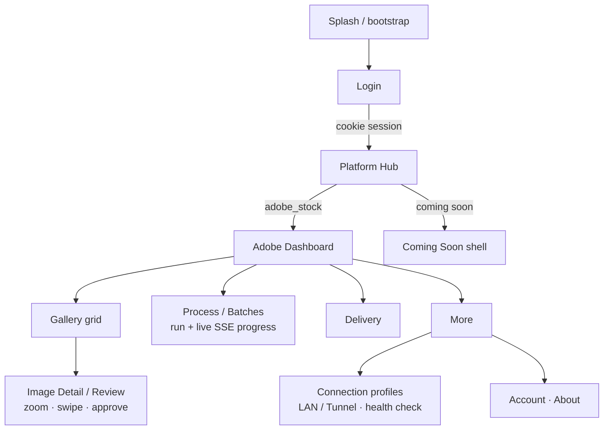
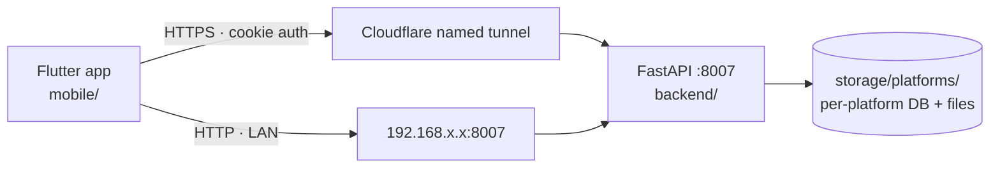

# 01 · Vision & Scope — AI Stock Studio Mobile

Date: 2026-10-15 · Status: **plan phase** (this directory is the implementation plan; the app itself will live at repo-root `mobile/`)

## 1. Why

The studio runs on a PC that stays on 24/7, but the operator is not always at the desk.
The mobile app turns the phone into a **remote control for the studio**: inspect the
gallery, review/approve images, kick off pipelines, and watch progress live — from
anywhere, as long as the PC is reachable.

Target reaction when demoed to friends: *"wow"* — a polished, dark, vintage-batch-studio
native app that clearly belongs to the same product family as the web UI, not a generic
CRUD client.

## 2. What we are building

| Aspect | Decision |
|---|---|
| Framework | **Flutter (Dart)** — one codebase, Android first (iOS build-ready later) |
| Backend | The **existing FastAPI server** (:8007) — the app talks to it directly; no new BFF |
| Reach | **Cloudflare named tunnel** for anywhere-access + **LAN profile** as low-latency fallback (see [06](./06-connectivity-cloudflare.md)) |
| Auth | Same simple cookie auth as the web (`studio_session` via `POST /api/auth/login`) — replayed per connection profile |
| Platforms | Platform Hub mirrors the web master page: **Adobe Stock available**, Freepik/Vecteezy/Dreamstime/123RF/Wirestock as Coming-Soon shells |
| Data isolation | Per-platform scoping preserved: `platformId` on API calls, no shared mutable state across platforms (same rule as backend) |
| UI | Dark-only MVP built on the web brand tokens (parchment/ink/brass/oxblood, Playfair/EB Garamond/Special Elite) — see [04](./04-ui-design-system.md) |

## 3. Non-goals (MVP)

- No new backend features beyond the small additions listed in [02](./02-api-integration-map.md) §Gaps.
- No offline editing — cached images/lists only; mutations require connectivity.
- No push notifications, iOS App Store release, or Cloudflare Access service tokens (documented as future hardening in [06](./06-connectivity-cloudflare.md)).
- No light theme (tokens support it later), no in-app file uploads (web keeps that role initially).

## 4. Product flow (mobile)

## 5. Architecture at a glance

- **Client-side layers:** presentation (screens/widgets) → controllers (Riverpod) →
  domain (entities/repository contracts) → data (Dio + repositories) — full detail in
  [03](./03-flutter-architecture.md).
- **Connection profiles** are a first-class app concept: named base URLs, health-check
  via `GET /health`, runtime switching, cookie stored per profile.

## 6. Plan document map

| Doc | Purpose | Owner |
|---|---|---|
| [README](./README.md) | Index, reading order, current status | coordinator |
| 01 · vision-scope.md | This document — why/what/non-goals | coordinator |
| [02](./02-api-integration-map.md) · api-integration-map.md | All 99 backend endpoints, MVP subset, gaps | subagent A |
| [03](./03-flutter-architecture.md) · flutter-architecture.md | Tech decisions, folder tree, layer contracts, testing | subagent C |
| [04](./04-ui-design-system.md) · ui-design-system.md | ThemeData, tokens, widgets, motion, a11y | subagent D |
| [05](./05-screen-inventory.md) · screen-inventory.md | Every screen/route/state/gesture, route tree | subagent D |
| [06](./06-connectivity-cloudflare.md) · connectivity-cloudflare.md | Tunnels, SSE behavior, Windows service, security | subagent B |
| [07](./07-implementation-roadmap.md) · implementation-roadmap.md | Phased milestones with file-level tasks + validation gates | subagent E |

## 7. Guiding constraints (carry into implementation)

1. **Modular, component-based** — new code goes into distinct feature files; never grow
   a monolithic `main.dart` or a 1000-line screen. Mirrors the repo's global rule.
2. **Follow the established folder structure** — app = `mobile/` (sibling of `backend/`,
   `frontend-new/`); plan artifacts stay in `mobile-plan/` until implementation starts.
3. **Same product, new form factor** — reuse brand tokens, motifs (stamp-in, hairline
   cards, label-caps), and terminology from the web app.
4. **Proven before pretty** — every phase has a validation gate (analyze/test/manual QA)
   before polish begins.
5. **The PC is the source of truth** — the app is a viewer/controller; no independent
   local database of records (only caches + connection profiles + session).
