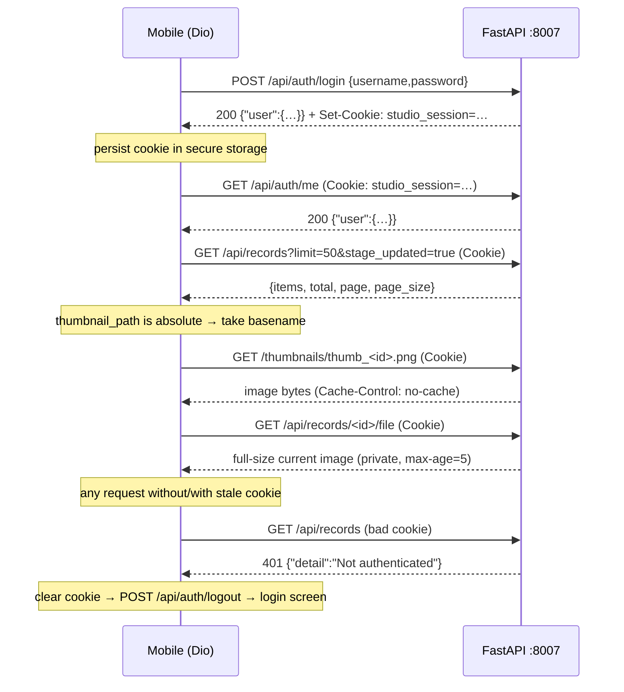

# 02 — API Integration Map (FastAPI backend → Flutter mobile)

Backend root: `backend/` (port **8007**). Every path below was verified by reading
`backend/main.py`, `backend/routers/*`, `backend/platforms/routers.py`, and the
Next.js consumers in `frontend-new/src/lib|hooks` (cross-reference column).

**Auth model:** cookie session (`studio_session`) enforced by
`backend/services/auth_middleware.py` on *every* route when `AUTH_ENABLED=True`,
including `/thumbnails` static files and `/api/auth/me`. Exempt: `POST
/api/auth/login`, `POST /api/auth/logout`, `GET /health`, `/docs`, `/redoc`,
`/openapi.json`, `/favicon.ico`, and all `OPTIONS` preflights. 401 shape is
always `{"detail": "Not authenticated"}`. Columns marked **✓ cookie** need the
cookie; **exempt** do not.

## Compact summary

| # | Domain | Router file | Endpoints | Cookie |
|---|--------|-------------|-----------|--------|
| 1 | Auth | `routers/auth.py` | 3 | 2 exempt, `/me` ✓ |
| 2 | Platforms | `platforms/routers.py` | 2 | ✓ |
| 3 | Gallery browse & review | `routers/records.py`, `gallery.py`, `gallery_files.py`, `approve.py`, `autofix.py` | 13 | ✓ |
| 4 | Image/thumbnail serving | `main.py` static + stages preview | 4 (1 static + 3 in §5/6) | ✓ |
| 5 | Stages / jobs / queues | `routers/stages.py`, `queues.py`, `similarity.py`, `promote.py` | 22 | ✓ |
| 6 | Batch pipeline v2 + profiles | `routers/batches.py`, `step_profiles.py` | 13 | ✓ |
| 7 | Delivery (CSV/ZIP/rename) | `routers/delivery.py` | 7 | ✓ |
| 8 | Settings | `routers/settings.py` | 4 | ✓ |
| 9 | Prompt library | `routers/prompts.py` | 7 | ✓ |
| 10 | Gallery groups (folders) | `routers/groups.py` | 5 | ✓ |
| 11 | Research + SSE | `routers/research.py` | 16 | ✓ (1 SSE) |
| 12 | Server setup/deps | `routers/setup.py` | 4 | ✓ |
| 13 | Upload | `routers/upload.py` | 1 | ✓ |
| 14 | Health | `main.py` | 1 | exempt |
| — | **Total** | | **99** (97 router + `/health` + `/thumbnails` mount) | |

---

## 1. Auth

| Method | Path | Purpose | Request | Response | Cookie |
|--------|------|---------|---------|----------|--------|
| POST | `/api/auth/login` | Exchange local account for signed session cookie | body `{username, password}` | `{"user":{"username"}}` + `Set-Cookie: studio_session=…` (HttpOnly, SameSite=Lax, max-age = `AUTH_SESSION_TTL_HOURS`×3600, default 24 h); 401 `{"detail":"Invalid credentials"}` | exempt |
| POST | `/api/auth/logout` | Clear cookie; always 200 even without session | — | `{"ok": true}` + cookie deletion | exempt |
| GET | `/api/auth/me` | Session probe (login screen vs app shell) | — | `{"user":{"username"}}` or 401 standard shape | ✓ |

Config (`backend/auth_config.py`): `AUTH_ENABLED` (default True, read **per
request**), `AUTH_USERNAME`/`AUTH_PASSWORD` (default `admin`/`admin`),
`AUTH_SECRET_KEY`, `AUTH_SESSION_TTL_HOURS=24`, `AUTH_COOKIE_NAME=studio_session`.

## 2. Platforms

| Method | Path | Purpose | Request | Response | Cookie |
|--------|------|---------|---------|----------|--------|
| GET | `/api/platforms/` | Full platform catalogue in display order | — | `[{id, name, tagline, status ("available"\|"coming_soon"), route}]` | ✓ |
| GET | `/api/platforms/{platform_id}` | One platform; 404 `Unknown platform` | — | same object | ✓ |

⚠️ The list route is registered as `"/"` under prefix `/api/platforms`, so the
canonical URL has a **trailing slash** (`/api/platforms/`); bare
`/api/platforms` relies on FastAPI's 307 redirect — use the trailing slash in Dio.

## 3. Gallery browse & review

### Records listing (`records.py`)

| Method | Path | Purpose | Key params | Response | Cookie |
|--------|------|---------|------------|----------|--------|
| GET | `/api/records` | Paginated gallery/home feed, newest first | `status`, `used=all\|used\|unused`, `ids` (CSV), `queued` (stage key or `none`), `prompt_id` (id or `none`), `stage` (CSV of `PipelineStage`, e.g. `PUBLISHED`), `search` (≤200 chars, matches title/desc/keywords/category/filenames), `stage_updated=bool`, `group_id` (id or `none`), `limit` (default 100, **max 500**, 0 ⇒ 100), `offset` | `{items: RecordResponse[], total, page, page_size}` | ✓ |
| GET | `/api/records/{record_id}` | Single record | — | `RecordResponse` | ✓ |

`RecordResponse` highlights (gallery-relevant): `id, filename, original_path`
(**absolute path**), `thumbnail_path` (**absolute path**), `status, width,
height, file_size_bytes, generated_title, generated_description,
generated_keywords[], download_name, suggested_filename, upload_filename,
is_used, used_at, stage, queued_stage, working_path` (absolute), `stage_updated_at,
acceptance_score, category, prompt_id, batch_id, group_id, created_at, updated_at`.

### Review mutations & downloads

| Method | Path | Purpose | Body / params | Response | Cookie |
|--------|------|---------|---------------|----------|--------|
| PATCH | `/api/records/{id}/used` | Mark one used/unused | `{is_used: bool}` | `BulkActionResult {updated, deleted, missing[], failed[]}` | ✓ |
| PATCH | `/api/records/used` | Bulk used flag (≤500) | `{record_ids[], is_used}` | `BulkActionResult` (+`missing`) | ✓ |
| DELETE | `/api/records/{id}` | Delete record + files | — | `BulkActionResult {deleted:1}` | ✓ |
| POST | `/api/records/bulk-delete` | Bulk delete (≤500) | `{record_ids[]}` | `BulkActionResult` (+`missing`, `failed`) | ✓ |
| GET | `/api/records/{id}/download` | Staged **READY-only** file (409 otherwise) | — | `FileResponse` (`image/jpeg`, delivery filename) | ✓ |
| POST | `/api/records/download-zip` | ZIP of staged READY files (≤50) | `{record_ids[]}` | `application/zip` | ✓ |
| POST | `/api/upload-table` | Copy/paste Adobe upload table (≤500) | `{record_ids[]}` | `{items:[{record_id, filename, title, description, keywords[], keywords_csv, thumbnail_url, download_url}], missing[]}` — URLs built from request `base_url`, **absolute** | ✓ |
| POST | `/api/records/{id}/approve` | Approve w/ optional metadata overrides | optional `{override_title?, override_description?, override_keywords?}` | `ApproveResponse {record_id, status, title, keywords_count}` | ✓ |
| POST | `/api/records/{id}/autofix` | Auto-repair metadata for one record | — | `AutoFixResponse` | ✓ |
| PATCH | `/api/records/{id}/metadata` | Manual metadata edit (in §5, stages router) | `{title?, description?, keywords?, category?}` | `RecordResponse` | ✓ |

## 4. Image & thumbnail serving (the actual URL patterns)

| Method | Path | What it serves | Notes | Cookie |
|--------|------|----------------|-------|--------|
| GET | `/thumbnails/{filename}` | Generated thumbnails (`thumb_{id}.png`, …) via `StaticFiles` mount in `main.py` | **Absolute-path quirk:** DB stores `thumbnail_path` as an absolute filesystem path; clients must take the **basename** and build `{base}/thumbnails/{basename}` — exactly what `frontend-new/src/lib/client.ts#thumbnailUrl()` does. Middleware forces `Cache-Control: no-cache` on `/thumbnails` (thumbs are rewritten in place). | ✓ (not exempt) |
| GET | `/api/records/{id}/file?download=0\|1` | Record's **current** working image (`working_path`, fallback `original_path`), inline viewer or attachment | correct media type via mimetypes; `Cache-Control: private, max-age=5`; 404 if no file yet | ✓ |
| GET | `/api/records/{id}/preview?variant=working\|original\|refined\|upscaled` | Pipeline-workspace preview (before/after compare) | `refined`/`upscaled` are fixed per-id filenames under `REFINED_DIR`/`UPSCALED_DIR`; served as `image/jpeg`; `private, max-age=5` | ✓ |
| POST | `/api/records/file-zip` | ZIP of *current* files (working/original) for a selection (≤200) | body `{record_ids[]}`, dedupes names, temp file cleaned after send | ✓ |

⚠️ `viewer` full image = `/api/records/{id}/file`; delivery image =
`/api/records/{id}/download` (READY only); thumbnail = `/thumbnails/{basename}`.

## 5. Stages, jobs, queues, similarity, promote

### Stages & jobs (`stages.py`)

| Method | Path | Purpose | Key request | Response | Cookie |
|--------|------|---------|-------------|----------|--------|
| GET | `/api/stages` | Static stage registry | — | `[{number, key, name, description, stages[], terminal}]` | ✓ |
| GET | `/api/categories` | Adobe category codes | — | `[{code, name…}]` | ✓ |
| GET | `/api/stages/summary` | **Dashboard stats**: counts per stage + headline metrics | — | `{counts:[{stage,number,name,count}], total, ready, rejected, incompatible, average_score}` | ✓ |
| POST | `/api/stages/{stage_key}/run` | Start a batch stage op → background job | `StageRunRequest {record_ids[] (≤MAX_BATCH_SIZE), delay_seconds?, use_semantic?, upscale?}` | immediate `JobResponse` handle | ✓ |
| GET | `/api/jobs` | Recent jobs (no items) | `limit` 1–50 (def 10) | `[JobResponse]` | ✓ |
| GET | `/api/jobs/{job_id}` | **Poll progress** (in-memory; 404 after restart) | — | `JobResponse` | ✓ |
| POST | `/api/jobs/{job_id}/cancel` | Cooperative cancel (409 if not running) | — | `JobResponse` | ✓ |
| GET | `/api/records/{id}/preview` | See §4 | `variant` | image | ✓ |
| GET | `/api/upscale/catalog` | Upscale models/presets | `refresh` | catalog object | ✓ |
| GET | `/api/upscale/options` | Default upscale options | — | dict | ✓ |
| GET | `/api/upscale/gpus` | Vulkan devices | `refresh` | `{gpus:[…]}` | ✓ |
| POST | `/api/upscale/estimate` | Predict output geometry | `{record_id? \| width,height, upscale?}` | estimate object | ✓ |
| PATCH | `/api/records/{id}/metadata` | Edit title/desc/keywords/category | `MetadataUpdateRequest` | `RecordResponse` | ✓ |
| POST | `/api/metadata/csv` | CSV download (metadata) | `CsvExportRequest {record_ids?, only_ready=true}` | CSV `Response` | ✓ |
| POST | `/api/metadata/csv/preview` | CSV text + warnings | same | `{csv_text, row_count, skipped, warnings}` | ✓ |
| POST | `/api/records/{id}/reset-stage` | Reset record's pipeline stage | — | `RecordResponse` | ✓ |

`JobResponse` (live progress shape): `{id, stage, kind, status, message,
progress_label, total, processed, succeeded, failed, skipped, progress (0–100
float), created_at, finished_at, duration_seconds, current_record_id,
items:[{record_id, filename, status, message, score, progress, detail, duration_seconds}]}`.

### Queues (`queues.py`)

| Method | Path | Purpose | Body / response | Cookie |
|--------|------|---------|-----------------|--------|
| POST | `/api/queues/{stage_key}/push` | Queue records for a stage | `{record_ids[]}` → `BulkActionResult` | ✓ |
| POST | `/api/queues/{stage_key}/remove` | Dequeue | `{record_ids[]}` → `BulkActionResult` | ✓ |
| GET | `/api/queues/summary` | Pending depth per stage key | `{counts:{stage: n}, total}` | ✓ |

### Similarity & promote

| Method | Path | Purpose | Body | Response | Cookie |
|--------|------|---------|------|----------|--------|
| POST | `/api/similarity/scan` | Duplicate scan | `{record_ids? (null = all w/ metadata), keep_per_group=5, …}` | `SimilarityScanResponse` | ✓ |
| POST | `/api/promote/check` | Pre-flight: what's missing to reach READY | `{record_ids[]}` | `{items:[{record_id, filename, stage, eligible, blocker, steps[]}], missing[]}` | ✓ |
| POST | `/api/promote/run` | Run missing steps + promote → job | `{record_ids[], use_semantic=false}` | `JobResponse` (poll `/api/jobs/{id}`) | ✓ |

## 6. Batch pipeline v2 + step profiles

| Method | Path | Purpose | Key request | Response | Cookie |
|--------|------|---------|-------------|----------|--------|
| GET | `/api/batches/steps` | Step catalog | `media_type?` (`raster\|png`) | catalog | ✓ |
| GET | `/api/batches` | List batches | `limit` 1–200 (def 50) | `{items:[BatchResponse], total}` | ✓ |
| POST | `/api/batches` | Create batch | `{name, media_type, steps:[{key, config}], profile_id?}` | `BatchResponse` 201 | ✓ |
| GET | `/api/batches/{id}` | **Batch detail + records** (poll target) | — | `BatchDetailResponse` = `BatchResponse` + `records: RecordResponse[]` | ✓ |
| PATCH | `/api/batches/{id}` | Rename / edit steps | `{name?, steps?}` | `BatchResponse` | ✓ |
| DELETE | `/api/batches/{id}` | Delete batch | — | — | ✓ |
| POST | `/api/batches/{id}/files` | Upload files into batch | multipart `files: UploadFile[]` | `UploadResult {record_ids, count, errors[]}` | ✓ |
| POST | `/api/batches/{id}/run` | **Start pipeline run** | — | `BatchResponse` (`status` flips to running) | ✓ |
| POST | `/api/batches/{id}/cancel` | Cancel running batch | — | `BatchResponse` | ✓ |
| GET/POST/PATCH/DELETE | `/api/step-profiles[/{id}]` | Saved step-order profiles | list `media_type?`; create `{name, steps…}`; patch `{…}` | `ProfileResponse`/list | ✓ |

`BatchResponse` progress fields: `status` (`pending|running|succeeded|failed|cancelled`, in-memory recovery on restart), `step_progress: {step_key: {…}} | null`, `error`, `record_count`.

**Frontend consumption:** `frontend-new/src/lib/batches.ts` + hook
`useBatchPolling.ts` poll `GET /api/batches/{id}` while running — this is the
reference pattern for mobile live progress.

## 7. Delivery (CSV / ZIP / naming)

| Method | Path | Purpose | Body | Response | Cookie |
|--------|------|---------|------|----------|--------|
| POST | `/api/assets/rename` | Bulk rename for upload (slugified, JPEG-forced) | `RenameRequest {items:[{record_id, name}], regenerate}` | `RenameResponse {items[], updated, failed}` | ✓ |
| POST | `/api/assets/rename-suggest` | Model-suggested names (dry run) | same | `RenameResponse` | ✓ |
| POST | `/api/assets/apply-suggested-names` | Apply suggestions | same | `RenameResponse` | ✓ |
| POST | `/api/assets/force-accept` | Override acceptance gate | `{record_ids[], reason}` | `ForcedAcceptResponse {items[], accepted, refused}` | ✓ |
| POST | `/api/assets/csv` | Adobe CSV download (pins names; 409 if no rows) | `CsvExportRequest {record_ids?, only_ready=true}` | CSV text `Response` | ✓ |
| POST | `/api/assets/csv/preview` | CSV text + warnings, no side effects | same | `{csv_text, row_count, skipped, warnings}` | ✓ |
| POST | `/api/assets/bundle` | ZIP of images + matching CSV (≤50; explicit ids required) | same | `application/zip` | ✓ |

Cross-ref: `frontend-new/src/lib/delivery.ts` (uses raw `fetch` with
`credentials:"include"`), `lib/downloads.ts`.

## 8. Settings

| Method | Path | Purpose | Request | Response | Cookie |
|--------|------|---------|---------|----------|--------|
| GET | `/api/settings` | App settings; API keys returned **masked** | — | `SettingsResponse` | ✓ |
| PUT | `/api/settings` | Update settings | `SettingsUpdateRequest` | `SettingsResponse` | ✓ |
| POST | `/api/settings/test` | Test connectivity (LLM/search) | `SettingsTestRequest \| null` | `SettingsTestResponse` | ✓ |
| POST | `/api/settings/reset` | Reset to defaults | — | `SettingsResponse` | ✓ |

Cross-ref: `frontend-new/src/lib/settings.ts`.

## 9. Prompt library

| Method | Path | Purpose | Key params/body | Cookie |
|--------|------|---------|-----------------|--------|
| GET | `/api/prompts` | List (paginated) | `status`, `q` (search), `group` | ✓ |
| GET | `/api/prompts/{id}` | One prompt | — | ✓ |
| POST | `/api/prompts` | Create (`PromptCreateRequest`) | 201 | ✓ |
| PATCH | `/api/prompts/{id}` | Update (`PromptUpdateRequest`) | — | ✓ |
| POST | `/api/prompts/group` | Assign prompts to groups | `PromptGroupAssignRequest` | ✓ |
| DELETE | `/api/prompts/{id}` | Delete | `{deleted, unbound}` | ✓ |
| POST | `/api/prompts/{id}/bind` | Bind prompt to records | `PromptBindRequest` | ✓ |

Cross-ref: `frontend-new/src/lib/prompts.ts`, `hooks/usePromptLibrary.ts`.

## 10. Gallery groups (folders)

| Method | Path | Purpose | Body | Cookie |
|--------|------|---------|------|--------|
| GET | `/api/groups` | List folders + image counts | — | ✓ |
| POST | `/api/groups` | Create | `GroupCreateRequest {name…}` | ✓ |
| PATCH | `/api/groups/{id}` | Rename | `GroupRenameRequest` | ✓ |
| DELETE | `/api/groups/{id}` | Delete (images ungrouped) | — | ✓ |
| PUT | `/api/groups/assign` | Move records into/out of a group | `GroupAssignRequest {record_ids, group_id?}` → `BulkActionResult` | ✓ |

Cross-ref: `frontend-new/src/lib/groups.ts`.

## 11. Research + SSE streaming

| Method | Path | Purpose | Key request | Response | Cookie |
|--------|------|---------|-------------|----------|--------|
| GET | `/api/research/settings` | Run settings (modes, budgets) | — | `ResearchSettingsResponse` | ✓ |
| GET/PUT | `/api/research/system-prompts` | Read/override system prompts | `SystemPromptUpdateRequest` | `SystemPromptsResponse` | ✓ |
| GET/POST/DELETE | `/api/research/sources` | Priority sources file (pass-through dict) | dict payload | dict | ✓ |
| GET | `/api/research/sources/template` | Downloadable template | raw `fetch` + credentials (`research.ts:388`) | file | ✓ |
| GET/DELETE | `/api/research/blocked` | Blocked URL list; delete `?url=` or all | — | dict | ✓ |
| GET | `/api/research/runs` | List conversations | `limit` 1–200 (def 50) | `{items:[summary], total}` | ✓ |
| POST | `/api/research/runs` | Create run; sync first turn unless `stream_first:true` | `ResearchRunRequest {mode, message, count?, validity_check?, stream_first?}` | `ResearchRunResponse` 201 | ✓ |
| GET | `/api/research/runs/{run_id}` | Run + transcript (replay) | — | `ResearchRunResponse` (includes `events[]`) | ✓ |
| POST | `/api/research/runs/{run_id}/messages` | Sync follow-up turn | `ResearchFollowUpRequest {message, count?, validity_check?}` | `ResearchRunResponse` | ✓ |
| **GET** | **`/api/research/runs/{run_id}/stream`** | **SSE: live turn** | query `message?` (≤8000), `count?`, `validity_check?` | `text/event-stream` | ✓ |
| POST | `/api/research/runs/{run_id}/accept` | Push accepted prompts to library (≤`MAX_PROMPTS`) | `{prompts[], tags?, negative_prompt?, details?}` | `ResearchAcceptResponse` | ✓ |
| DELETE | `/api/research/runs/{run_id}` | Delete conversation | — | dict | ✓ |

**SSE format** (verified `backend/services/research/events.py` +
`frontend-new/src/hooks/useResearchStream.ts`): frames are
`data: {json}\n\n`; JSON has a `type` field; terminal frame is literally
`event: done\ndata: {}\n\n`. Event types (`lib/research.ts:112-140`):
`run_started {mode?, count?}`, `thinking {text}`, `message {text}`,
`tool_call {name, arguments, summary}`, `tool_result {name, summary, ok?,
duration_seconds?}`, `sources {sources[]}`, `prompts {prompts[], summary?}`,
`validity {validity, follow_up_actions?}`, `context`, `notice {text}`,
`error {text}`, `run_finished {status, answer?}`.

⚠️ **Do not use a plain `EventSource`**: this GET *starts* work, and
EventSource auto-reconnects after a normal end-of-stream, re-running the agent.
The web client uses `fetch` + `ReadableStream` with `AbortController`, header
`Accept: text/event-stream`, `credentials: "include"` (see
`useResearchStream.ts`). Mirror this in Dio/`HttpClient` (see §16).

## 12. Server setup / dependencies

| Method | Path | Purpose | Request | Cookie |
|--------|------|---------|---------|--------|
| GET | `/api/setup/dependencies` | Installed/missing dependency groups + install job state | → `SetupStatus` (has `job` progress) | ✓ |
| POST | `/api/setup/dependencies/install` | Start install (202) | `InstallRequest` | ✓ |
| POST | `/api/setup/dependencies/cancel` | Cancel install | — | ✓ |
| POST | `/api/setup/dependencies/probe` | Probe a single dependency | payload → `ProbeResult` | ✓ |

Cross-ref: `frontend-new/src/lib/setup.ts`, `hooks/useSetupStatus.ts` (polls).

## 13. Upload & health

| Method | Path | Purpose | Request | Response | Cookie |
|--------|------|---------|---------|----------|--------|
| POST | `/upload` | Batch file upload (note: **no `/api` prefix**) | multipart `files: UploadFile[]` | `UploadResponse {record_ids, count}` | ✓ |
| GET | `/health` | Liveness | — | `{"status":"ok"}` | exempt |

---

## 14. Frontend cross-reference (frontend-new)

| Consumer file | Endpoints |
|---|---|
| `lib/client.ts` | axios singleton, `baseURL = NEXT_PUBLIC_API_BASE_URL \|\| http://localhost:8007`, `withCredentials: true`, timeout 120 s; 401 interceptor (except on `/api/auth/login`) → `POST /api/auth/logout` + redirect to `/login`; exports `thumbnailUrl()` (basename → `/thumbnails/{basename}`) |
| `lib/auth.ts` + `components/auth/AuthProvider.tsx` | login/logout/`GET /api/auth/me` on mount and after stale-401 |
| `middleware.ts` | purely checks presence of cookie `studio_session` for route gating (not security) |
| `lib/records.ts`, `hooks/useRecords.ts`, `hooks/useInfiniteRecords.ts` | `GET /api/records` (`limit`/`offset` + filters; home polls `stage_updated=true` every 8 s via `LatestGrid`), bulk-delete, bulk used |
| `lib/groups.ts` | groups CRUD + assign; consumed by `app/adobe-stock/gallery/page.tsx` |
| `lib/batches.ts`, `hooks/useBatchPolling.ts` | full batch lifecycle incl. run + cancel + detail polling |
| `lib/promote.ts`, `components/gallery/PromoteDialog.tsx` | promote check/run + `GET /api/jobs/{id}` polling |
| `lib/delivery.ts` | `/api/assets/csv`, `/api/assets/bundle` via raw `fetch` + credentials |
| `lib/downloads.ts` | `GET /api/records/{id}/file?download=1`, `POST /api/records/file-zip` |
| `lib/research.ts`, `hooks/useResearchStream.ts`, `lib/researchStream.ts` | runs CRUD + SSE stream via `fetch` reader; reducer folds events |
| `lib/settings.ts`, `lib/setup.ts`, `lib/prompts.ts`, `lib/profiles.ts`, `lib/steps.ts` | settings, setup, prompts, step profiles, step catalog |
| `lib/platforms.ts` | ⚠️ **static mirror** of the registry — the web app never calls `/api/platforms`; the endpoints exist but are unconsumed by frontend-new |
| *not consumed by frontend-new* | `GET /api/stages/summary`, `POST /api/stages/{key}/run`, `GET /api/jobs` (list), queues, similarity, metadata CSV, upload-table, `/upload`, `/api/records/{id}/preview`, approve, autofix, reset-stage — legacy/other-UI surfaces, still live and verified |

## 15. Mobile MVP subset

Minimum set for login → platform list → gallery review → pipeline run with live
progress → dashboard:

| Feature | Endpoints |
|---|---|
| Login/session | `POST /api/auth/login`, `GET /api/auth/me`, `POST /api/auth/logout`, `GET /health` |
| Platform list | `GET /api/platforms/` (trailing slash), `GET /api/platforms/{id}` |
| Gallery browse | `GET /api/records` (limit/offset, `stage`, `stage_updated`, `search`, `used`, `group_id`), `GET /api/records/{id}` |
| Images | `GET /thumbnails/{basename}` (grid), `GET /api/records/{id}/file` (full view), `GET /api/records/{id}/preview?variant=…` (optional) |
| Review actions | `PATCH /api/records/used` (bulk used), `PATCH /api/records/{id}/metadata`, `POST /api/records/{id}/approve`, `POST /api/records/bulk-delete` (optional) |
| Pipeline run + live progress | Batch v2: `POST /api/batches`, `POST /api/batches/{id}/files`, `POST /api/batches/{id}/run`, poll `GET /api/batches/{id}`, `POST /api/batches/{id}/cancel`; **or** stage jobs: `POST /api/stages/{stage_key}/run` → poll `GET /api/jobs/{job_id}` (+ `POST …/cancel`) |
| Dashboard stats | `GET /api/stages/summary`, `GET /api/queues/summary`, `GET /api/records?limit=1` (total) |
| Folders (nice-to-have) | `GET /api/groups`, `PUT /api/groups/assign` |

## 16. Gaps & proposed additions for mobile (signatures only — no code)

| # | Gap | Proposed addition |
|---|-----|-------------------|
| 1 | Thumbnails are one-size; grid on mobile wants small payloads | `GET /thumbnails/{filename}?w=160\|320\|640` → on-the-fly resized WebP, `Cache-Control: public, max-age=86400, immutable` (filenames never change) |
| 2 | `GET /api/records` returns full metadata (~KBs/row); mobile feed wants a light payload | `GET /api/records?fields=list` → `{items:[{id, stage, is_used, status, thumb: "/thumbnails/x.png", generated_title, width, height}], total, page, page_size}` |
| 3 | `limit` max 500 with no cursor; infinite scroll re-fetches pages | add `after_id`/`cursor` pagination: `GET /api/records?cursor=<id>&limit=50` → `{items, next_cursor}` |
| 4 | No single round-trip dashboard payload | `GET /api/dashboard/summary` → `{stages: StageSummaryResponse, queues: {counts,total}, batches: {running, total}, recent_jobs: [JobResponse]}` |
| 5 | Bulk review requires N calls (one per record) for per-record overrides | `POST /api/records/bulk-approve` body `{items:[{record_id, override_title?, override_keywords?}], …}` → `{approved, failed:[{record_id, detail}]}` |
| 6 | No unread/"needs review" flag — mobile triage wants a queue | `GET /api/records/review-queue?limit=50&cursor=…` (records in a defined review stage, `Accept: application/json` only) |
| 7 | Job/batch polling is chatty on mobile radio | `GET /api/jobs/{id}/events?since=<seq>` long-poll (25 s) or SSE `{status, progress, current_record_id, seq}` — same frame style as research (`data:{json}\n\n`, terminal `event: done`) |
| 8 | Jobs are in-memory (404 after restart) — mobile resumes and loses state | `GET /api/jobs?active=true` returning surviving/failed-on-restart jobs; persist job rows server-side |
| 9 | `/api/platforms/` trailing-slash redirect costs a round trip and breaks naive clients | register `@router.get("")` alias (or document the slash; mobile must use `/api/platforms/`) |
| 10 | Full-size `/file` for viewer; mobile wants a medium step to avoid multi-MB transfers | `GET /api/records/{id}/file?width=1280` → downscaled JPEG, else current behavior |
| 11 | Bulk delete/zip caps (500/50/200) undocumented in response | return `413` with `{detail, max}` consistently, or a `GET /api/limits` → `{max_bulk, max_zip, max_zip_files, max_search}` |
| 12 | No server-side sort options (always newest-first) | `GET /api/records?sort=created_at\|acceptance_score\|stage_updated_at&order=asc\|desc` |
| 13 | Upload returns bare ids; mobile wants inline validation feedback | extend `UploadResponse` with `rejected:[{filename, reason}]` (additive) |
| 14 | No review **reject** action (mobile detail screen wants a one-thumb reject loop; today only approve + reset-stage exist) | `POST /api/records/{id}/reject` body `{note?}` → moves record to a rejected/needs-work state; until implemented, mobile hides Reject (see 05 §2.6) |

## 17. Auth notes for a native client (Dio)

1. **Persist the cookie from `Set-Cookie`.** `POST /api/auth/login` returns
   `Set-Cookie: studio_session=<token>; HttpOnly; SameSite=Lax; Max-Age=86400;
   Path=/`. Dio does not store cookies: parse `set-cookie` from
   `response.headers.value('set-cookie')`, persist name+value (and Max-Age) in
   secure storage, and attach `Cookie: studio_session=<token>` manually on
   **every** subsequent request via an interceptor.
2. **Cookie must reach image requests too.** `/thumbnails/...` and
   `/api/records/{id}/file` are behind auth — for `Image.network`/cached
   image widgets, either proxy through Dio (`DioImage`-style loaders) or add a
   header-injecting `HttpClient` override; a bare URL will 401.
3. **SSE with a cookie:** use Dio's `GET …/stream` with
   `ResponseType.stream` and headers `Accept: text/event-stream`,
   `Cache-Control: no-cache`, and the `Cookie` header; parse `data:` frames
   yourself (split on `\n\n`, JSON per frame) and treat
   `event: done\ndata: {}` as terminal. Explicitly close the subscription to
   stop the turn (backend stops on client disconnect) — never auto-reconnect
   (GET restarts the agent turn).
4. **On 401 `{"detail":"Not authenticated"}`** everywhere except login: clear
   the stored cookie, call `POST /api/auth/logout` best-effort (it is exempt
   and always 200), and route to the login screen — this mirrors the axios
   interceptor in `lib/client.ts`. On 401 from login itself: show "invalid
   credentials" (body is `{"detail":"Invalid credentials"}`).
5. **Exempt routes** (work without cookie): `POST /api/auth/login`,
   `POST /api/auth/logout`, `GET /health`, `/docs`, `/redoc`,
   `/openapi.json`, `/favicon.ico`, and every `OPTIONS`. Everything else —
   including `GET /api/auth/me` and `/thumbnails/*` — 401s without a valid,
   unexpired cookie (TTL `AUTH_SESSION_TTL_HOURS`, default 24 h; renewal only
   by logging in again — there is no refresh endpoint).
6. **Base URL:** `http://<host>:8007` (backend CORS `allow_credentials=True`
   for the web origin; a native app is not browser-restricted). When
   `AUTH_ENABLED=False` (tests/dev), all routes pass without a cookie —
   probe `GET /api/auth/me` to detect the auth mode.
7. **Session shape:** login/me return `{"user":{"username"}}`; there are no
   roles/permissions — a single local account gates the whole API.

### Auth + image fetch flow

