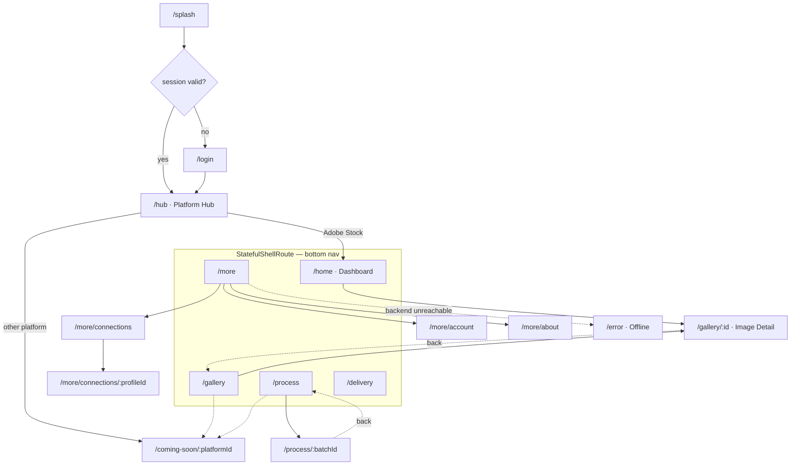

# 05 — Screen Inventory & Navigation

> Part of the AI Stock Studio mobile plan. Every screen lists: go_router path,
> purpose, layout regions, components (from `04-ui-design-system.md`), states,
> navigation, backend endpoints, gestures. Mobile parity targets the web app in
> `frontend-new/` (routes there: `/login`, `/` platform picker, `/adobe-stock`,
> `/adobe-stock/gallery`, `/adobe-stock/batch/[id]`, `/adobe-stock/settings`,
> `/adobe-stock/prompts`, plus coming-soon shells).

---

## 1. App shell

### 1.1 Bottom navigation (≤5 tabs)

| # | Tab | Route root | Icon (Lucide) |
|---|-----|-----------|-----------------|
| 1 | Home | `/home` (Dashboard) | `house` |
| 2 | Gallery | `/gallery` | `layout-grid` |
| 3 | Process | `/process` | `factory` |
| 4 | Delivery | `/delivery` | `send` |
| 5 | More | `/more` | `ellipsis` |

- Each tab is a `StatefulShellRoute` branch with its **own navigator** (back
  button returns within tab history before exiting).
- Tab bar per spec 1.4: leather bg, double-hairline top, brass sliding
  indicator + `lightImpact` tick, `labelCaps` labels, selected = `fill` icon.
- Tabs hide on: Login, Splash, ComingSoon push, Detail/Viewer (immersive),
  full-screen Error. `ConnectionProfileBanner` (spec 2) sits directly under the
  AppBar **inside** each tab root, not over the tab bar.

### 1.2 Route tree

Notes: `/hub` is pushed over the shell (choosing a platform is a global act);
tabs re-enter the shell afterward. Deep links (e.g. notification → batch) enter
the shell directly after bootstrap.

---

## 2. Screens

### 2.1 Splash / bootstrap

- **Route**: `/splash` (initialLocation; never returned to)
- **Purpose**: restore session, load platform catalog + connection health,
  pre-warm image cache dirs; decide Login vs Hub.
- **Layout**: full-screen leather + grain; centered StampBadge logo (stamp-in
  once), `LiveDot`-style tiny spinner in `labelCaps` "OPENING THE STUDIO…";
  bottom: version caption.
- **Components**: StampBadge, ProgressBar (indeterminate brass, ≤120 dp wide),
  labelCaps.
- **States**: *loading* (default); *error* → inline ErrorState + "Retry"
  bootstrap (not full-screen yet); if backend unreachable after retry →
  `/error`.
- **Nav out**: replace → `/login` or `/hub`. Timed max ~2.5 s then proceed
  with degraded data.
- **Endpoints**: `GET /api/auth/me`, `GET /api/platforms/`, `GET /api/settings`
  (fire-and-forget, partial success OK).
- **Gestures**: none.

### 2.2 Login

- **Route**: `/login`
- **Purpose**: local-session sign-in (single seat, mirrors web LoginForm).
- **Layout**: safe-area column; centered StampBadge logo with **wow #1
  stamp-in**; eyebrow labelCaps "LOCAL SESSION · ONE SEAT"; form card
  (AppCard) with username/password fields; PrimaryButton "Enter the studio";
  footer caption (server URL + version).
- **Components**: AppCard, LabelCaps, PrimaryButton, TextField (crisp 4 dp
  radius, `parchment-600` focus border), ErrorState (inline under form),
  ToastException.
- **States**: *loading* (button spinner, fields disabled) · *error* (inline
  rust message "Those keys didn't fit" + specific server message) ·
  *offline* (ConnectionProfileBanner full variant, disable submit).
- **Nav out**: replace → `/hub`. No back (guards prevent shell entry).
- **Endpoints**: `POST /api/auth/login`, `GET /api/auth/me` (verify).
- **Gestures**: keyboard "done" submits; no swipe.

### 2.3 Platform Hub

- **Route**: `/hub` (pushed above shell)
- **Purpose**: pick marketplace — parity with web `/` PlatformPicker.
- **Layout**: AppBar-free scroll; hero AppCard ("Where are today's images
  going?" + script ✦ corners); 1-column card list (2-col ≥720dp width) of
  platforms: Adobe Stock (available), Freepik, Vecteezy, Dreamstime, 123RF,
  Wirestock (coming-soon shells).
- **Components**: PageHeader hero, AppCard + FlourishCorners, PlatformCard
  rows (name Playfair, tagline body, StatusChip "OPEN" olive / "COMING SOON"
  brass), SkeletonLoader while catalog loads, EmptyState/ErrorState.
- **States**: *loading* (hero + 3 card skeletons, mirrors web) · *empty* ·
  *error* (inline) · *offline*.
- **Nav in**: splash/login, or "Switch platform" from More. **Out**: available
  → replace into shell `/home`; coming-soon → push `/coming-soon/:id`; back
  → system back (to Login only if unauthenticated).
- **Endpoints**: `GET /api/platforms/`.
- **Gestures**: card tap; pull-to-refresh catalog.

### 2.4 Adobe Dashboard (Home tab)

- **Route**: `/home`
- **Purpose**: parity with web `/adobe-stock` — hero + quick actions + latest
  processed images + stage/queue stats.
- **Layout**: CustomScrollView — (1) hero AppCard: eyebrow labelCaps "A LOCAL
  PIPELINE FOR ADOBE STOCK", Playfair title with script "batches" accent,
  PrimaryButton "New batch" + SecondaryButton "Open gallery"; (2) stats row:
  2×2 grid of compact stat cards (Records total, Ready to publish,
  Queue depth `GET /api/queues/summary`, Running jobs); (3) "Latest" grid
  (2-col, 8 tiles) linking to Detail. `ConnectionProfileBanner` above hero.
- **Components**: PageHeader, AppCard, LabelCaps, StatusChip (stat cards),
  HeroImageFrame tiles, PrimaryButton/SecondaryButton, SkeletonLoader,
  EmptyState ("No images yet — start a batch"), ProgressBar (running-job card
  with LiveDot).
- **States**: *loading* (hero + tile skeletons) · *empty* · *error* (each card
  fails independently with inline ErrorState; page shell survives) ·
  *offline* (banner + cached last stats marked with stamp "CACHED").
- **Nav in**: shell tab / hub. **Out**: New batch → push `/process/new`
  wizard-style sheet; Open gallery → Gallery tab; tile → Detail
  (hero transition); stat card → Process tab.
- **Endpoints**: `GET /api/stages/summary`, `GET /api/queues/summary`,
  `GET /api/jobs`, `GET /api/records?limit=8` (server default = newest-first;
  `sort` arrives later — 02 §16 gap 12).
- **Gestures**: pull-to-refresh (all stats); long-press tile → quick actions
  (Download / Mark used).

### 2.5 Gallery

- **Route**: `/gallery` (tab root); folder scope `/gallery?group=<id>`
- **Purpose**: parity with web gallery — filtered responsive image grid,
  folders (groups), multi-select, download/delete/promote.
- **Layout**: AppBar ("Gallery" + selection-mode toggle + filter icon) ·
  FilterBar row (horizontally scrollable StatusChips: stage filter default
  `METADATA_READY,PUBLISHED`; used: all/unused/used; search field) ·
  folder cards strip (GroupCard, horizontal) · image grid: 2-col ≥360dp,
  3-col ≥600dp, 4-col ≥900dp, aspect 1:1 tiles with HeroImageFrame +
  corner status stamp · infinite-scroll sentinel · bottom SelectionToolbar
  (floating above tab bar when selection active).
- **Components**: FilterBar chips, GalleryTile, GroupCard, SkeletonLoader
  (tile shimmer), EmptyState, ErrorState, ToastException, SelectionToolbar
  (count + Download/Delete/Group/Promote), DashedDivider.
- **States**: *loading* (12-tile skeleton) · *loadingMore* (3-tile footer
  skeleton + spinner) · *empty* (per filter: "Nothing matches this lens") ·
  *empty-all* (EmptyState → New batch CTA) · *error* (inline at grid top,
  grid keeps stale items) · *offline*.
- **Nav in**: tab / dashboard tile / search. **Out**: tile tap → push
  `/gallery/:id` with Hero; group card tap → scoped query (Web: `?group=`,
  back pops scope — same on mobile via `pop` handling); back exits to previous
  tab selection.
- **Endpoints**: `GET /api/records` (paged: search, stage, used, group_id,
  offset/limit), `GET /api/groups`, `POST /api/records/download-zip`,
  `PATCH /api/records/used`, `PATCH /api/groups/assign`,
  `POST /api/records/bulk-delete`, `POST /api/promote/run`,
  `GET /api/records/{id}/file?download=1` (per-image download).
- **Gestures**: tap → detail; pull-to-refresh; infinite scroll; long-press →
  enter selection mode, subsequent taps toggle; swipe a selected tile
  horizontally → quick "Mark used/unused" (mobile-specific, undo toast).

### 2.6 Image Detail / Review

- **Route**: `/gallery/:recordId`
- **Purpose**: fullscreen review + **approve-first** loop (the operator's core
  mobile act); metadata parity with web ViewerModal + InfoPanel.
- **Layout**: immersive (AppBar overlays image, auto-hides): `PageView`
  horizontal swipe between images of current filtered set · zoomable image
  (spec 5.5) · bottom draggable metadata sheet (2 snap points: 28% / 75%)
  containing: postmark metadata card — filename stamp, title/description
  preview, keywords as small chips, category, StampBadge stage/status ·
  action bar pinned: **Approve** (PrimaryButton, oxblood) · overflow (Download,
  Mark used, Reset stage, Delete). *Reject* is **deferred** until backend gap
  #14 lands (02 §16) — MVP offers Reset stage as the "needs work" path.
  Approval stamp-in overlay (wow #4).
- **Components**: HeroImageFrame, StampBadge (stage postmark), AppCard
  (metadata sheet), StatusChip keywords, PrimaryButton/SecondaryButton,
  ToastException (with Undo), StampIn wrapper, ProgressBar (full-res load).
- **States**: *loading* (blur-thumbnail placeholder + brass ProgressBar) ·
  *full-res error* (inline retry, thumb stays) · *record error* (ErrorState in
  sheet) · *offline* (review actions disabled with banner; cached metadata
  viewable) · *already approved* (stamp pre-set, action becomes "Reprocess").
- **Nav in**: Gallery/Dashboard tile (Hero). **Out**: back → Gallery (pops
  with restore); swipe past last → returns (no dead-end blank).
- **Endpoints**: `GET /api/records/{id}`,
  `GET /api/records/{id}/preview` (full-res) / `GET /api/records/{id}/file`,
  `POST /api/records/{id}/approve` (optional metadata overrides
  `{override_title?, override_description?, override_keywords?}` — no reject
  param exists; see 02 §3/§16 gap 14), `PATCH /api/records/{id}/used`,
  `PATCH /api/records/{id}/metadata`, `POST /api/records/{id}/reset-stage`,
  `POST /api/records/{id}/autofix`, `DELETE /api/records/{id}`.
- **Gestures**: horizontal swipe = next/prev (wins only at zoom 1.0);
  pinch/double-tap zoom; drag sheet up/down; double-tap image toggles chrome;
  long-press image → compare with original (future).

### 2.7 Process / Pipeline

Two levels, mirroring web `/adobe-stock` (list) and `/adobe-stock/batch/[id]`.

#### 2.7.1 Pipeline list — `/process` (tab root)

- **Purpose**: batches overview, create, resume, monitor at a glance.
- **Layout**: AppBar "Process" · summary strip (running jobs with LiveDot +
  ProgressBar) · batch list (AppCard rows: name, record count, step chips,
  StatusChip running/finished/draft, last-run caption) · PrimaryButton
  "New batch" (floating, above tab bar, right).
- **Components**: AppCard rows, StatusChip, ProgressBar, LiveDot,
  SkeletonLoader, EmptyState ("No batches yet"), ErrorState, ConfirmDialog
  (delete).
- **States**: *loading* · *empty* · *error* · *offline* (view cached, run
  disabled).
- **Nav out**: row → `/process/:batchId`; New batch → bottom-sheet wizard
  (MediaType → Steps → Profile, mirroring web NewBatchModal steps) then push
  detail. **Endpoints**: `GET /api/batches`, `POST /api/batches`,
  `DELETE /api/batches/{id}`, `GET /api/jobs`, `GET /api/stages/summary`.
- **Gestures**: pull-to-refresh; long-press batch → Run / Delete; swipe row
  left → Delete (with confirm).

#### 2.7.2 Batch detail / run — `/process/:batchId`

- **Purpose**: parity with web batch page — steps, upload, run, live
  per-step progress.
- **Layout**: header (batch name + StatusChip + record count) · upload zone
  (dashed AppCard — tap to pick, shows per-file ProgressBar) · step timeline:
  vertical StepCard list with reorder handles, per-step config disclosure,
  completed steps get an olive check stamp, active step gets LiveDot +
  brass ProgressBar · sticky bottom bar: **Stop** (confirm) when running,
  **Run batch** (PrimaryButton) when idle.
- **Components**: StepCard, UploadZone, RecordStrip (mini thumbnails),
  ProgressBar, LiveDot, ConfirmDialog, StampIn on completion, ToastException.
- **States**: *loading* (header + 3 step skeletons) · *empty* (no images yet —
  upload zone emphasized) · *error* (inline per region: steps fail / progress
  fails independently) · *offline* (run/stop disabled + banner) ·
  *completed* (final "DONE" stamp-in over timeline).
- **Nav in**: list row / dashboard quick action. **Out**: back → list; on
  completion CTA "Open gallery" → Gallery tab with results filter.
- **Endpoints**: `GET /api/batches/{id}` (polled every 1.5 s while running —
  mirrors web `useBatchPolling`), `GET /api/batches/steps`,
  `POST /api/batches/{id}/files` (multipart, upload progress), `PATCH
  /api/batches/{id}` (step reorder/config), `POST /api/batches/{id}/run`,
  `POST /api/batches/{id}/cancel`, `POST /api/step-profiles*`.
  **Live stream**: prefer SSE `text/event-stream` job events where the backend
  exposes them (pattern: `POST /api/research/runs/{id}/stream`); fall back to
  polling automatically; **LiveDot** reflects whichever transport is live.
- **Gestures**: drag-reorder steps; tap step → config sheet; pull-to-refresh.

### 2.8 Delivery

- **Route**: `/delivery` (tab root)
- **Purpose**: rename, CSV metadata, ZIP bundle — parity with web delivery
  dialogs (`lib/delivery.ts` + `routers/delivery.py`).
- **Layout**: AppBar "Delivery" · summary of deliverable set (count,
  selected stage filter chips) · action cards: Rename (suggest/apply),
  CSV preview + export, ZIP bundle, Force-accept, each as AppCard with
  icon + description + chevron · history list of recent exports (caption +
  stamp status). Result panel (modal sheet) shows outcome summary.
- **Components**: AppCard action rows, StatusChip (success/fail), ProgressBar
  (bundle build), EmptyState ("Nothing to deliver yet"), ErrorState,
  ToastException, StampBadge on results ("EXPORTED" olive).
- **States**: *loading* (3 action-card skeletons) · *empty* (no eligible
  records → link to Gallery filter) · *error* (inline per action) ·
  *offline* (all actions disabled + banner).
- **Nav in**: tab / Gallery selection toolbar "Deliver". **Out**: results →
  share sheet (native share of file/CSV) or Gallery.
- **Endpoints**: `POST /api/assets/rename-suggest`,
  `POST /api/assets/apply-suggested-names`, `POST /api/assets/rename`,
  `POST /api/assets/csv/preview`, `POST /api/assets/csv`,
  `POST /api/assets/bundle`, `POST /api/assets/force-accept`.
- **Gestures**: pull-to-refresh; tap action → options sheet → run.

### 2.9 More (Settings root)

- **Route**: `/more`
- **Purpose**: settings hub — nav rows, not a form dump.
- **Layout**: list sections in AppCards: **Connections** (rows → profiles),
  **Account** (session: user, sign out), **App** (reduced-motion toggle,
  cache size + clear, default gallery filter), **About** (version, backend
  URL, health), plus platform switch row (→ `/hub`).
- **Components**: AppCard row groups, StatusChip (health: olive/rust),
  LabelCaps section headers, GhostButton (Sign out), ToastException.
- **States**: *loading* (row skeletons) · *error* (health check fails →
  rust chip, inline retry) · *offline*.
- **Endpoints**: `GET /api/settings`, `GET /api/auth/me`.
- **Gestures**: standard push navigation.

#### 2.9.1 Connection profiles — `/more/connections`

- **Purpose**: manage FastAPI endpoint profiles (local/LAN/Tunnel) with health
  check — foundation of the offline story.
- **Layout**: list of profile AppCards (name, base URL caption, StatusChip
  healthy/degraded + latency caption, radio = active) · each card:
  "Test connection" SecondaryButton (runs health check with inline spinner →
  olive "OK 24 ms" / rust error text) · PrimaryButton "Add profile" · swipe
  left → Delete (confirm; cannot delete active).
- **Edit**: `/more/connections/:profileId` — form (name, base URL, timeout),
  Test + Save; inline validation errors.
- **Endpoints**: local profile store (secure storage) + probe
  `GET /health` and/or `GET /api/auth/me` for verification.
- **Gestures**: swipe-delete; tap card → edit; radio tap → activate
  (requires successful health check; else inline ErrorState).

#### 2.9.2 Account / credentials — `/more/account`

- Signed-in user, seat note ("Local session · one seat"), credentials for the
  metadata gateway via `GET/PUT /api/settings`, `POST /api/settings/test`
  ("Test gateway" → ToastException), `POST /api/settings/reset`.
- Destructive reset behind ConfirmDialog; sensitive fields obscured with
  reveal toggle (eye icon, semantic label "Show API key").

#### 2.9.3 About — `/more/about`

- Version/build, backend URL + version, credits, licenses (show open-source
  licenses via `LicensePage`), Diagnostics (copy button → ToastException).

### 2.10 ComingSoon (generic)

- **Route**: `/coming-soon/:platformId`
- **Purpose**: shell for Freepik, Vecteezy, Dreamstime, 123RF, Wirestock —
  parity with web `PlatformComingSoon`.
- **Layout**: centered AppCard with large dashed StampBadge "IN THE WORKS",
  platform name (Playfair), tagline, brass flourish corners, SecondaryButton
  "Back to platforms".
- **Components**: AppCard, StampBadge, StampIn entrance, SecondaryButton.
- **States**: *loading* (catalog lookup) · *unknown id* → inline error +
  back. **Endpoints**: `GET /api/platforms/{platform_id}`.
- **Nav**: push from Hub; back pops (no tab bar).

### 2.11 Error / Offline full-screen

- **Route**: `/error` (with query `?reason=offline|server`)
- **Purpose**: last-resort screen when bootstrap can't reach any profile or a
  fatal client error occurs.
- **Layout**: centered EmptyState-variant: rust StampBadge "NO SIGNAL" /
  "OUT OF ORDER" (stamp-in), Playfair headline, body explaining recovery,
  PrimaryButton "Retry connection", GhostButton "Choose another profile"
  → `/more/connections`.
- **Endpoints**: `GET /health` retry loop (backoff 2/5/10 s, LiveDot shows
  attempts). **Nav**: replace from Splash or on fatal API errors; success →
  replace `/hub`. No tab bar; back exits app.

---

## 3. Cross-cutting state matrix

| Concern | Everywhere rule |
|---------|-----------------|
| Loading | SkeletonLoader matching final layout (never bare spinner on content screens); buttons show inline progress |
| Empty | EmptyState with headline + explanation + primary next action |
| Error | Inline ErrorState near the failed region; ToastException only for transient action feedback; full-screen only per §2.11 |
| Offline | `ConnectionProfileBanner` under every tab AppBar (degraded = rust, offline = persistent strip); destructive/running actions disabled with explanatory caption |
| Refresh | Pull-to-refresh on every scrollable list/grid root (RefreshIndicator, brass spinner) |

## 4. Mobile-specific UX decisions

- **Pull-to-refresh** everywhere (web has none — mobile expectation).
- **Swipe actions**: gallery "mark used", process delete, connections delete —
  all with visible alternative in overflow menu (discoverability + a11y) and
  Undo via ToastException where non-destructive.
- **Long-press = context/selection** (matches web marquee intent without
  pointer drag).
- **Bottom sheets** instead of web modals: filters, step config, metadata
  detail (2 snap points) — thumb-reachable, iOS/Android idiomatic.
- **Hero transitions** gallery→detail replace web's modal open; shared-axis
  between tab roots.
- **Infinite scroll** (sentinel, page size 120 → consider 60 for mobile
  bandwidth) with `ScrollMetrics`-guarded load-more.
- **Approve-first loop optimized for one thumb**: actions pinned bottom,
  opposing corners, ≥48 dp, haptic + stamp-in confirmation, sequential
  auto-advance to next reviewable image after 600 ms (opt-out via toast).
- **No emoji**; icons strictly Lucide (spec 04 §6).

## 5. Endpoint → screen traceability

| Endpoint group | Screens |
|---|---|
| `auth/*` | Splash, Login, More/Account |
| `platforms/*` | Hub, ComingSoon |
| `records*`, `groups`, `promote`, `autofix` | Gallery, Detail, Dashboard |
| `approve` | Detail |
| `batches*`, `stages`, `jobs`, `queues`, `step-profiles`, `upload` | Dashboard, Process list/detail |
| `delivery` (`assets/*`), `metadata/csv` | Delivery, Detail |
| `settings*` | More/Account, first-run setup (future) |
| `health` | Splash, Connections, Error/Offline |
