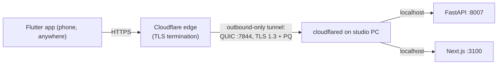

# 06 — Connectivity: Cloudflare Tunnels

> Part of the AI Stock Studio mobile plan. Decides how the Flutter app reaches the
> home studio (FastAPI `:8007`, Next.js `:3100`) from outside the LAN, documents
> the exact Windows setup, and defines the app-side "connection profiles" model.
> All facts verified against Cloudflare/FastAPI docs as of Oct 2026 (links in §8).

---

## 1. Recommendation (read this first)

**Use a named Cloudflare Tunnel (locally-managed, `cloudflared` as a Windows
service) with a stable subdomain — e.g. `studio.example.com` → backend `:8007`
and `web.example.com` → Next.js `:3100`.** Keep a **quick tunnel** in your back
pocket only for ad-hoc demos.

Why named wins for "PC always on, phone anywhere":

| | Quick tunnel (`trycloudflare.com`) | Named tunnel (account + DNS route) |
|---|---|---|
| Account / domain needed | **None** | Cloudflare account + a domain on CF DNS |
| URL | Random `random-words.trycloudflare.com`, **new every run** | Stable hostname you choose, forever |
| Survives reboot | URL changes each restart → app must re-discover it | Same URL forever; run as Windows service |
| **SSE / streaming** | **Not supported** — docs: "Quick Tunnels do not support Server-Sent Events" | Supported (see §3 caveats) |
| In-flight requests | Capped at **200**, then `429` | No such cap |
| Uptime guarantee | **None** ("for testing and development") | Production-grade; 4 replicas/failover possible |
| Access control | `--allowed-mail` email OTP only (since `cloudflared` 2026.9.3); interactive-browser only, **useless for a native API client** | Full **Cloudflare Access** (Zero Trust) policies in front, incl. Service Token for native apps |
| Exposes origin IP | No (outbound-only connection) | No (outbound-only connection) |
| Cost | Free | Free (Zero Trust free tier: up to 50 users) |
| Latency path | Phone → CF edge → tunnel → PC | Same |

The random-URL churn of quick tunnels alone disqualifies them for a phone app
that must remember an endpoint, and the **no-SSE limitation** disqualifies them
for pipeline progress streams. Named tunnel requires a one-time ~15-minute setup
(§2.2) and a cheap/free domain.



Origin stays dark: `cloudflared` dials **out** to Cloudflare; no inbound port is
opened on the home router (no port-forwarding, no DDNS).

---

## 2. Windows setup — both variants

### 2.0 Install `cloudflared` (shared step)

```powershell
winget install --id Cloudflare.cloudflared -e
# package id: Cloudflare.cloudflared (Apache-2.0, ~2026.10.x)
# reopen the terminal so PATH updates; verify:
cloudflared --version
```

Manual alternative: download the Windows binary from the Cloudflare downloads
page and rename it `cloudflared.exe`.

### 2.1 Quick tunnel (smoke test — do this first, 2 minutes)

1. Start the backend (and optionally the web UI) locally.
2. In a terminal:

   ```powershell
   # backend only
   cloudflared tunnel --url http://localhost:8007

   # or publish both — quick tunnels accept repeated --url only via one origin,
   # so simplest is to proxy one port and reach the other through the app;
   # for both UIs at once, use a named tunnel (two ingress rules) instead.
   ```

3. `cloudflared` prints a random URL — `https://something-random.trycloudflare.com`.
   Open it from the phone; verify `GET <url>/health` returns 200.
4. **The URL dies when the process stops and is different next run.** Nothing to
   uninstall: Ctrl+C.

Optional email gate (browser-only, not usable by the Flutter HTTP client):

```powershell
cloudflared tunnel --url http://localhost:8007 --allowed-mail you@example.com
```

**Reboot survival for a quick tunnel is not worth doing**: Task Scheduler can run
`cloudflared tunnel --url ...` at boot (schtasks /create /sc onstart ...), but the
URL changes every start, so the phone can't rely on it. If you insist for testing,
parse the printed URL from the log and push it to the phone manually — this is
exactly the friction named tunnels remove.

### 2.2 Named tunnel (the real thing)

Prereqs: a Cloudflare account with a domain whose nameservers are on Cloudflare.

```powershell
# 1. Authenticate (opens browser, saves cert.pem in %USERPROFILE%\.cloudflared\)
cloudflared tunnel login

# 2. Create the tunnel → writes <UUID>.json credentials file
cloudflared tunnel create studio

# 3. Point a hostname at it (creates CNAME → <UUID>.cfargotunnel.com)
cloudflared tunnel route dns studio studio.example.com
cloudflared tunnel route dns studio web.example.com   # optional: Next.js UI

# 4. Config: %USERPROFILE%\.cloudflared\config.yml
```

```yaml
# %USERPROFILE%\.cloudflared\config.yml
tunnel: <Tunnel-UUID>
credentials-file: C:\Users\<You>\.cloudflared\<Tunnel-UUID>.json
ingress:
  - hostname: studio.example.com
    service: http://localhost:8007     # FastAPI backend
  - hostname: web.example.com
    service: http://localhost:3100     # Next.js UI (optional)
  - service: http_status:404           # catch-all (required, must be last)
logfile: C:\Cloudflared\cloudflared.log
```

```powershell
# 5. Validate + foreground test
cloudflared tunnel ingress validate
cloudflared tunnel run studio

# 6. Make it survive reboots — install as Windows service (admin CMD)
cloudflared service install
#    → creates the "cloudflared" Windows service (start type: automatic);
#      it reads %USERPROFILE%\.cloudflared\config.yml by default. Check:
sc query cloudflared
# Later config changes: sc stop cloudflared && sc start cloudflared
```

**Windows service gotchas (from the official Windows-as-a-service page):**

- The service runs as **Local System**, whose profile is
  `C:\Windows\System32\config\systemprofile`, *not* your user profile. If the
  service can't find `cert.pem`/credentials, either use absolute paths in
  `config.yml` (as above) or copy
  `%USERPROFILE%\.cloudflared\*.json` to
  `C:\Windows\System32\config\systemprofile\.cloudflared\`.
- If `service install` points the service at the wrong config, edit
  `HKLM\SYSTEM\CurrentControlSet\Services\cloudflared\ImagePath` to
  `C:\Program Files (x86)\cloudflared\cloudflared.exe tunnel run --config C:\path\config.yml studio`
  (exact path depends on installer; no stray spaces).
- Alternative to the service: **Task Scheduler** task "At startup", action
  `cloudflared tunnel run studio`, highest privileges — equivalent for our
  purposes; the service is cleaner.
- `cloudflared` needs outbound **TCP 7844** (QUIC/UDP 7844 preferred) to
  Cloudflare; home routers allow this by default.

Also make **FastAPI and Next.js themselves** auto-start (Task Scheduler / NSSM /
`start-dev.cmd` wrapped in a scheduled task) — the tunnel is useless if the
origin is down, and that is failure #1 in §6.

---

## 3. SSE & long-lived streaming through the tunnel

**Verdict: works on named tunnels, impossible on quick tunnels — with one header
contract.**

- Official troubleshooting doc: *"Proxied traffic through Cloudflare Tunnel is
  buffered by default **unless** the origin server includes the
  `Content-Type: text/event-stream` response header. This header tells
  `cloudflared` to stream data as it arrives instead of buffering the entire
  response."*
- Therefore any FastAPI streaming endpoint must really emit
  `Content-Type: text/event-stream` (SSE). A `StreamingResponse` with some other
  media type (e.g. `application/x-ndjson`, plain `application/octet-stream`) may
  be **buffered until complete** — pipeline logs/progress should use SSE, not
  raw chunked JSON, or you'll see "everything arrives at the end".
- **FastAPI does the right thing out of the box**: since 0.135.0,
  `EventSourceResponse` (`fastapi.sse`) sends `Content-Type: text/event-stream`,
  `Cache-Control: no-cache`, the anti-buffering header **`X-Accel-Buffering: no`**,
  and a `: ping` keep-alive comment **every 15 s** — precisely to stop proxies
  from closing/buffering idle streams. If you hand-roll a `StreamingResponse`,
  set those headers yourself:

  ```python
  return StreamingResponse(gen(), media_type="text/event-stream", headers={
      "Cache-Control": "no-cache",
      "X-Accel-Buffering": "no",   # honored by nginx-style proxies; harmless via cloudflared
      "Connection": "keep-alive",
  })
  ```

- **Timeouts** (Cloudflare connection limits, client↔edge and edge↔origin):
  keep-alive/idle ≈ 400 s (client side), **Proxy Read Timeout 125 s → HTTP 524**
  if the *origin sends nothing at all*, Proxy Idle 900 s → 520. An SSE stream
  that emits a heartbeat ≤ every 15–30 s never trips these; a silent stream for
  >125 s without headers/bytes is at risk. FastAPI's 15 s ping covers it.
- `X-Accel-Buffering: no` matters only if you later put **nginx** in front of
  FastAPI (not in the tunnel path today) — keep it anyway, it's free insurance
  and documented FastAPI practice.
- Caveat: quick tunnel limitation is absolute — don't build the app's progress
  UI against a quick-tunnel URL and expect it to work.

---

## 4. Security analysis

The tunnel **hides the origin IP and opens no inbound ports**, but it *does*
publish the app to the whole internet — anyone who guesses/finds the URL hits
your FastAPI. Threat model checklist:

1. **Keep `AUTH_ENABLED = true` in the backend, always.** The tunnel makes
   "only reachable from LAN" false; app-level auth becomes the primary gate.
   Never ship a build that disables it "just for the tunnel".
2. **Strong credentials**: long unique password for `POST /api/auth/login`,
   rate-limit login (slowapi or middleware), consider lockout after N failures.
3. **Quick tunnel URL = mild obscurity only.** Random words, but shared links
   leak (browser history, logs, referrers) and the URL is the *only* barrier —
   plus no SSE and no Access. Fine for a 10-minute demo; wrong for a permanent
   studio endpoint.
4. **Named tunnel + Cloudflare Access (Zero Trust) = recommended layering.**
   - Zero Trust **Free plan: up to 50 users, $0** — Access, ZTNA, tunnel
     connector all included. One operator (you) fits comfortably.
   - Access policy on `studio.example.com` (Allow: your email → One-time PIN or
     your IdP) blocks anonymous traffic **before it reaches your PC**, giving a
     second independent gate behind/next to app auth.
   - **Native-app caveat**: Access's interactive redirect login doesn't fit a
     pure API client. Options: (a) put Access on the **web UI** hostname only,
     keep the API hostname protected by app auth + (optionally) an Access
     **Service Token** (CF-Access-Client-Id / CF-Access-Client-Secret headers,
     free tier supported) attached by Flutter; (b) skip Access for the API and
     rely on strong app auth. Start with (a)-lite: Access on UI, app auth on API.
5. **Cookie auth over HTTPS.** cloudflared terminates TLS at the edge → the app
   talks `https://` even though the origin is plain HTTP `localhost:8007`, so a
   `Secure` session cookie is fine **on the tunnel profile**. Implications:
   - `POST /api/auth/login` returns `Set-Cookie: studio_session=...`. If the
     backend sets `Secure`, remember that `Secure` cookies are **rejected over
     plain `http://`** — so on the LAN profile (`http://192.168.x.x:8007`)
     either (a) don't mark the cookie `Secure`, or (b) let Flutter ignore cookie
     jar semantics and attach the cookie manually (recommended: the app stores
     the cookie value and sends `Cookie:` header itself — then `Secure`/
     `SameSite` are browser concerns that don't apply to raw HTTP calls).
   - `SameSite=Lax/Strict` matters only to browsers/WebViews; the Flutter HTTP
     client sends whatever `Cookie:` header you set. Still set `SameSite=Lax`
     server-side so a browser hitting the web UI behaves safely.
   - Practical rule: **Flutter captures the session cookie from the login
     response and replays it explicitly**; per-profile storage (§5) keeps
     LAN-vs-tunnel sessions independent.
6. **TLS everywhere remotely**: never expose the origin directly; only the
   tunnel. Quick/named tunnels both get TLS 1.3 edge certificates
   automatically (named: Universal SSL for your hostname).

---

## 5. Mobile client: connection profiles

The app must not hardcode one base URL. Model a **`ConnectionProfile`** list
(2 presets + user-editable):

```dart
class ConnectionProfile {
  final String id;          // "lan" | "tunnel" | custom
  final String label;       // "Local network", "Tunnel"
  final Uri baseUri;        // http://192.168.1.23:8007  |  https://studio.example.com
  final bool isHttps;
  // credentials: per-profile session cookie / token stored in secure storage
}
```

| Profile | Base URL | When used |
|---|---|---|
| **Local network** | `http://192.168.x.x:8007` (fixed LAN IP or mDNS `studio.local`) | Same Wi-Fi — lowest latency for gallery thumbnails & big payloads |
| **Tunnel** | `https://studio.example.com` (named) or the current `*.trycloudflare.com` (quick) | Away from home |
| *(custom)* | user-entered | testing, hotspot, etc. |

Behavior rules:

- **Health check on switch**: `GET {baseUri}/health` with a ~3 s timeout; on 200
  mark profile *reachable* and switch the active profile; on timeout/5xx show the
  failure reason (§6) and keep the previous profile. Run the same probe for all
  profiles on app resume and offer a "fastest reachable" toggle (prefer LAN).
- **LAN fallback**: when on the studio Wi-Fi, prefer the LAN profile — no
  tunnel round-trip, no bandwidth through CF, and it keeps working if the
  internet is down.
- **Secure storage**: keep profile list (non-secret) in normal prefs; keep each
  profile's session cookie/password in `flutter_secure_storage`
  (Keychain/Keystore), keyed by profile id. Clear a profile's cookie on 401.
- **Platform notes**: iOS ≥14 shows the **Local Network** permission prompt on
  first LAN request (Info.plist usage string; see Apple TN3179) — handle the
  denial by falling back to the tunnel profile. Android 9+ blocks cleartext
  `http://` by default → add a network-security config permitting cleartext
  **only** to RFC1918/private hosts, or restrict `usesCleartextTraffic`.
- **URL is per-request**: build every request from the active profile's
  `baseUri`; never bake a hostname into stored endpoints. The cookie from login
  on profile A is not valid on profile B — store per profile.

---

## 6. Troubleshooting

| Symptom | Likely cause | Fix |
|---|---|---|
| Tunnel URL loads → 502/503 | **Origin down** (FastAPI/Next not running, wrong port) | Start backend first; check `cloudflared.log`; `curl http://localhost:8007/health` on the PC |
| "Your tunnel is not reachable" / `ERR_TUNNEL_NOT_FOUND` | `cloudflared` service stopped or crashed after reboot | `sc start cloudflared`; check Event Viewer / `cloudflared.log`; re-`service install` if ImagePath wrong |
| Old quick-tunnel URL dead, new one different | **Quick tunnel URL is per-run** (by design) | Move to named tunnel (§2.2) |
| API works, Next.js assets/requests fail with mixed content / CORS | Web UI loaded over `https://` calling `http://` or wrong origin | Serve UI through its own tunnel hostname; make the app call same-origin `/api` or configure CORS for the tunnel origin in FastAPI |
| SSE/pipeline progress shows nothing, then dumps at the end | **cloudflared buffering** — response lacks `Content-Type: text/event-stream` | Emit SSE media type + `X-Accel-Buffering: no`; never quick tunnel (SSE unsupported) |
| SSE connects then drops after ~1–2 min | Idle stream vs Proxy Read/Idle timeouts (125 s/900 s) or origin restart | 15 s heartbeat comments (FastAPI default), verify origin stays up |
| Intermittent `429` on quick tunnel | 200 in-flight-request cap | Named tunnel, or reduce concurrent image fetches (grid pagination) |
| Images slow/fail on tunnel profile | Large payloads through CF edge + mobile; timeouts on multi-MB thumbnails | Generate small thumbnails server-side; paginate; prefer LAN profile for heavy ops; raise client timeout to ~30 s for image bytes |
| Login succeeds but next request 401 | Cookie not replayed / `Secure` cookie over `http://` LAN profile | Attach `Cookie` header manually per profile (§4.5); don't rely on automatic jar across schemes |
| LAN profile unreachable though internet works | Phone on different subnet/guest Wi-Fi, or iOS Local Network denied | Check same SSID/IP range; grant iOS local-network permission; fall back to tunnel |
| `cloudflared` won't authenticate (1033 / cert errors) | `cert.pem`/credentials missing for service account | Re-`tunnel login`, copy creds to service profile dir (§2.2 gotchas) |

---

## 7. Decision summary

- **Primary: named tunnel** as a Windows service, two hostnames (`studio` → API,
  `web` → UI), app auth always on, Cloudflare Access on the UI hostname (free
  tier), stable URL baked into the app's "Tunnel" profile.
- **Secondary: LAN profile** for same-Wi-Fi low-latency work (incl. offline use).
- **Quick tunnel**: throwaway demos only — no SSE, no stable URL, no Access.

## 8. Sources

- [Quick Tunnels — Cloudflare docs (updated Sep 30, 2026)](https://developers.cloudflare.com/tunnel/get-started/quick-tunnels/) — no-SSE, 200-request cap, per-run URL, `--allowed-mail`
- [Protected Quick Tunnels — Cloudflare blog (2026)](https://blog.cloudflare.com/protected-quick-tunnels/) — email OTP since `cloudflared` 2026.9.3
- [Create a locally-managed tunnel — Cloudflare docs](https://developers.cloudflare.com/tunnel/features/locally-managed-tunnels/create-local-tunnel/) — `login` / `create` / `route dns` / `config.yml` / `run`
- [Configure cloudflared as a Windows service — Cloudflare docs](https://developers.cloudflare.com/cloudflare-one/networks/connectors/cloudflare-tunnel/do-more-with-tunnels/local-management/as-a-service/windows/) — `service install`, SYSTEM profile, registry ImagePath
- [Configuration file — Cloudflare docs](https://developers.cloudflare.com/tunnel/features/locally-managed-tunnels/configuration-file/) — ingress rules, catch-all 404
- [Tunnel troubleshooting — Cloudflare docs](https://developers.cloudflare.com/tunnel/troubleshooting/) — buffering unless `Content-Type: text/event-stream`; 502 causes
- [Connection limits — Cloudflare docs (Jul 23, 2026)](https://developers.cloudflare.com/fundamentals/reference/connection-limits/) — 125 s Proxy Read (524), 900 s idle (520), 400 s keep-alive
- [Error 524 — Cloudflare support](https://developers.cloudflare.com/support/troubleshooting/http-status-codes/cloudflare-5xx-errors/error-524/)
- [SSE — FastAPI docs](https://fastapi.tiangolo.com/tutorial/server-sent-events/) — 15 s ping, `X-Accel-Buffering: no`, `Cache-Control: no-cache` out of the box
- [Cloudflare SASE / Zero Trust pricing](https://www.cloudflare.com/plans/sase-zero-trust/) — Free plan ≤50 users, Access included
- [Cloudflare Tunnel overview — outbound-only connections](https://developers.cloudflare.com/tunnel/)
- [winget package: Cloudflare.cloudflared](https://winget.run/pkg/Cloudflare/cloudflared)
- [Set-Cookie — MDN](https://developer.mozilla.org/en-US/docs/Web/HTTP/Reference/Headers/Set-Cookie) and [Secure cookie guide — MDN](https://developer.mozilla.org/en-US/docs/Web/Security/Practical_implementation_guides/Cookies) — `Secure` requires HTTPS, `SameSite=None` needs `Secure`
- [Apple TN3179 — Understanding local network privacy](https://developer.apple.com/documentation/technotes/tn3179-understanding-local-network-privacy) — iOS LAN permission prompt
