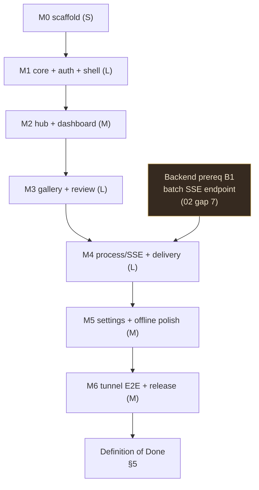

# 07 — Implementation Roadmap — AI Stock Studio Mobile

> Part of the AI Stock Studio mobile plan. Execution document for the **single
> implementer (coordinator agent)**: milestones M0→M6, file-level task
> checklists, backend touchpoints, risk register, Definition of Done, and the
> final validation command block. Sources: [01](./01-vision-scope.md)–[06](./06-connectivity-cloudflare.md);
> system overview in repo-root `ARCHITECTURE.md`.
>
> **Status:** planning complete · **App location:** `mobile/` (does not exist yet) ·
> **Backend:** `backend/` (FastAPI :8007, tests `backend/tests/`, pytest.ini sets `testpaths=tests`)
> **Terminology rule:** routes per [05](./05-screen-inventory.md), files per
> [03](./03-flutter-architecture.md), endpoints per [02](./02-api-integration-map.md),
> tokens/motion per [04](./04-ui-design-system.md), profiles per [06](./06-connectivity-cloudflare.md).
> Where the docs conflict, see §7 (report-only — coordinator resolves; do not silently pick).

---

## 1. Strategy — milestone overview

| # | Milestone | Goal | Size |
|---|-----------|------|------|
| **M0** | Environment & project scaffold | `mobile/` created, pinned SDK, deps, lints, CI-ready `flutter analyze` | **S** |
| **M1** | Core layer + auth + shell | Theme from tokens, connection profiles, Dio + cookie auth, router shell, splash, login | **L** |
| **M2** | Platform Hub + Dashboard | Catalogue picker, 5-tab shell, Adobe dashboard with stats + latest grid | **M** |
| **M3** | Gallery + Image review | Grid, filters, infinite scroll, detail with zoom/swipe, approve-first review (reject = gap #14, deferred) — **SSE-free** | **L** |
| **M4** | Process/batches + live SSE + Delivery | Batch lifecycle with live progress (SSE w/ polling fallback), delivery CSV/ZIP/rename | **L** |
| **M5** | Settings/account/offline polish | Connection-profile UI, account, about, coming-soon, offline/error states, lifecycle | **M** |
| **M6** | Tunnel E2E + perf/a11y + release | Named tunnel on a physical phone, performance & accessibility pass, APK | **M** |



Rules carried into every milestone (01 §7): modular feature files — no screen
>400 lines, no datasource >200 lines; every gate is **analyze + tests + a manual
QA checklist** before polish; **M3 is deliberately SSE-free** (ship review loop
on plain REST, add streaming only in M4); backend changes stay **minimal and
additive** (§3).

---

## 2. Milestones

### M0 — Environment & project scaffold (S)

**Goal:** a green, CI-ready Flutter skeleton at `mobile/` with the pinned toolchain
and the folder tree from [03 §2](./03-flutter-architecture.md) — no features yet.

**Entry:** Flutter **stable ≥ 3.47.x** installed (Dart ≥ 3.13); repo clean.

**Tasks:**

- [ ] `flutter create --org com.aistockstudio --project-name ai_stock_studio --platforms android,ios mobile` (from repo root; Android is the MVP target, iOS stays build-ready)
- [ ] `mobile/pubspec.yaml` — pin `environment: sdk: ^3.13.0`; add deps per 03 §1: `flutter_riverpod ^3.4.3`, `go_router ^18.1.0`, `dio ^5.11.1`, `dio_cookie_manager ^3.5.0`, `cookie_jar ^4.0.9`, `flutter_secure_storage ^11.2.0`, `cached_network_image ^4.0.4`, `google_fonts ^9.0.0`, `lucide_flutter ^1.47.0`, `shared_preferences ^2.5.6`; dev: `flutter_lints ^6.0.0`, `mocktail ^1.0.5` (re-verify pins: `flutter pub upgrade --dry-run`, 03 §7.5)
- [x] Reconcile UI deps — **Resolved (§7 C1/C3):** [04 §9](./04-ui-design-system.md) now matches [03 §1](./03-flutter-architecture.md): `google_fonts ^9.0.0`, `lucide_flutter ^1.47.0`, `cached_network_image ^4.0.4`; `phosphor_flutter`/`shimmer`/`flutter_animate` dropped (animations + skeletons via Flutter primitives)
- [ ] `mobile/analysis_options.yaml` — `flutter_lints` + local rules: `prefer_single_quotes`, `require_trailing_commas`, `unawaited_futures`, `prefer_final_locals`, `always_declare_return_types`, `avoid_print`
- [ ] Create folder skeleton exactly as 03 §2: `mobile/lib/app/{bootstrap,router,lifecycle_observer}.dart`, `mobile/lib/app/theme/`, `mobile/lib/core/{config,network,storage,utils,widgets}/`, `mobile/lib/features/{auth,platforms,dashboard,gallery,process,delivery,settings}/` each with `data/ domain/ presentation/`, `mobile/test/` mirroring `lib/` 1:1, `mobile/integration_test/`
- [ ] `mobile/lib/main.dart` — `runApp(ProviderScope(child: App()))`; `mobile/lib/app/bootstrap.dart` stub; placeholder `App` widget pumping a token-colored screen
- [ ] Replace generated `mobile/test/widget_test.dart` with a smoke test pumping `App`
- [ ] Add `mobile/` entries to repo `.gitignore` defaults (Flutter `.dart_tool/`, `build/`) — do **not** touch other files beyond what's needed
- [ ] README: add stub "Mobile app" section pointing at `mobile-plan/` (finalized in M6)

**Exit / validation gate:**

```powershell
cd E:\My_GitHub_Repos\adobe_stock_ai_images_manager\mobile
flutter --version        # Flutter 3.47.x / Dart 3.13.x
flutter pub get
flutter analyze          # No issues found!
flutter test             # smoke test green
```

**Manual QA:** `flutter run` on emulator shows the placeholder app; no analyzer
warnings; `git status` shows only `mobile/` + intended doc/README edits.

---

### M1 — Core layer: theme, connectivity, auth, router shell, login (L)

**Goal:** every cross-cutting concern from [03 §3–4](./03-flutter-architecture.md)
exists and login works end-to-end against a running backend.

**Entry:** M0 gate green; backend running locally (`backend/` → `http://localhost:8007`,
`GET /health` → 200).

**Tasks — theme (04):**

- [ ] `mobile/lib/app/theme/tokens.dart` — colors/spacing/radii ported verbatim from web `tailwind.config.ts` (location `lib/app/theme/` per 03 §4 — C2 resolved)
- [ ] `mobile/lib/app/theme/typography.dart` — Playfair/EB Garamond/Special Elite/Pinyon via `google_fonts` text themes per 04 §1.2
- [ ] `mobile/lib/app/theme/theme.dart` — `ThemeData.from(ColorScheme.dark())` per 04 §1.1 role mapping, `surfaceTintColor: transparent`, dark-only (`themeMode: ThemeMode.dark`, 04 §7)

**Tasks — core (03):**

- [ ] `mobile/lib/core/config/app_config.dart` + `mobile/lib/core/config/env.dart` (`APP_ENV` dart-define; dev default `http://localhost:8007`)
- [ ] `mobile/lib/core/storage/secure_store.dart` (flutter_secure_storage wrapper) + `mobile/lib/core/storage/prefs_store.dart` (KV only)
- [ ] `mobile/lib/features/settings/domain/connection_profile.dart` — `{id, label, baseUrl, lastStatus, lastCheckedAt}`; seeds: **Local network** (`http://localhost:8007`, hint `10.0.2.2` for emulator) + **Tunnel** (placeholder, 06 §5)
- [ ] `mobile/lib/features/settings/data/profile_store.dart` — `profiles_v1` / `active_profile_v1` JSON in shared_preferences; cookie **per profile id** in secure storage (06 §4.5)
- [ ] `mobile/lib/core/network/dio_factory.dart` — builds Dio with interceptors, kDebugMode-only `mobile/lib/core/network/api_logger.dart` (redact `Cookie`/`password`)
- [ ] `mobile/lib/core/network/base_url_interceptor.dart` — rewrites `o.baseUrl` from active profile per request (03 §3.2)
- [ ] `mobile/lib/core/network/auth_cookie_jar.dart` — `SecureCookieJar` (captures `studio_session` from `Set-Cookie`, persists encrypted) + `mobile/lib/core/network/auth_interceptor.dart` (401 → one idempotent `forceLogout`, never on `/api/auth/login`)
- [ ] `mobile/lib/core/utils/{app_exception,ui_message,formatters,platform_paths}.dart` — sealed exceptions + `mapDioError()`; `platformPath('adobe_stock', rest)` → `/api/$rest`, else `/api/platforms/$id/$rest` (single legacy-vs-scoped seam, 03 §3.5)
- [ ] `mobile/lib/core/widgets/` base set from 04 §2: `app_card.dart`, `label_caps.dart`, `stamp_badge.dart`, `stamp_in.dart`, `dashed_divider.dart`, `primary_button.dart`, `secondary_button.dart`, `ghost_button.dart`, `status_chip.dart`, `skeleton_loader.dart`, `toast_exception.dart`, `empty_state.dart`, `error_view.dart`, `async_view.dart`, `thumbnail.dart`, `connection_profile_banner.dart`
- [ ] `mobile/android/app/src/main/AndroidManifest.xml` + `res/xml/network_security_config.xml` — cleartext **only** to RFC1918/private hosts (03 §7.3, 06 §5); iOS `NSLocalNetworkUsageDescription` stub in `Info.plist`

**Tasks — auth + shell + splash/login screens (05 §2.1–2.2):**

- [ ] `mobile/lib/features/auth/data/auth_api.dart` + `auth_repository_impl.dart`; `domain/auth_repository.dart` + `user_session.dart`
- [ ] `mobile/lib/features/presentation` split as 03: `auth/presentation/{login_screen,login_form,auth_controller}.dart` — stamp-in logo, inline "Those keys didn't fit" error, loading/offline states
- [ ] `mobile/lib/app/splash_screen.dart` (**additive to 03 tree** — see §7 C4) — `GET /api/auth/me`, `GET /api/platforms/`, `GET /api/settings` fire-and-forget, 2.5 s cap, routes Login vs Hub
- [ ] `mobile/lib/app/router.dart` — GoRouter + auth `redirect` with `refreshListenable`; routes `/splash`, `/login`, `/hub` per 05 §2; shell route stub for M2
- [ ] `mobile/lib/app/lifecycle_observer.dart` — resume: `GET /health` + `GET /api/auth/me`, invalidate providers; paused: cancel streams (03 §4)
- [ ] Connection health: `mobile/lib/features/settings/data/health_api.dart` (`GET /health`, `GET /api/auth/me`) behind a `healthProvider`

**Exit / validation gate:**

```powershell
cd mobile
flutter analyze    # clean
flutter test test\core\network\auth_interceptor_test.dart test\core\network\secure_cookie_jar_test.dart test\core\utils\platform_paths_test.dart test\features\auth test\app\router_test.dart
```

**Tests expected:** `test/core/network/auth_interceptor_test.dart` (exactly one
`forceLogout` per 401, none for login), `test/core/network/secure_cookie_jar_test.dart`
(save/load round-trip with mocked storage), `test/core/utils/platform_paths_test.dart`
(legacy vs scoped), `test/features/auth/auth_repository_impl_test.dart`
(`DioException → AppException` table), `test/features/auth/login_screen_test.dart`
(loading/error/offline states), `test/app/router_test.dart` (redirect matrix).

**Manual QA:** login with wrong password → inline error; correct password →
`/hub`; kill backend → banner/offline state; `platform_paths` unit output
matches real backend (`curl http://localhost:8007/api/records` 200 with cookie).

---

### M2 — Platform Hub + Dashboard (M)

**Goal:** catalogue picker and the Adobe Dashboard (Home tab) with live stats —
first screens that touch real data.

**Entry:** M1 gate green; backend up with seeded records (or empty-state is acceptable).

**Tasks:**

- [ ] `mobile/lib/features/platforms/data/{platform_api,platform_repository_impl}.dart` — **use `GET /api/platforms/` with the trailing slash** (02 §2 gotcha; never rely on the 307)
- [ ] `mobile/lib/features/platforms/domain/{platform,platform_repository}.dart`
- [ ] `mobile/lib/features/platforms/presentation/{platform_hub_screen,platform_card,platforms_controller}.dart` — hero AppCard, `OPEN`/`COMING SOON` chips, skeletons, pull-to-refresh (05 §2.3)
- [ ] `mobile/lib/features/platforms/presentation/coming_soon_screen.dart` (**additive**, 05 §2.10) — `GET /api/platforms/{platform_id}`, "IN THE WORKS" stamp
- [ ] `mobile/lib/app/shell.dart` (**additive**) — `StatefulShellRoute` 5-tab scaffold (Home/Gallery/Process/Delivery/More), per 05 §1.1 tab bar spec (leather bg, double-hairline, brass indicator, `lightImpact` tick)
- [ ] `mobile/lib/features/dashboard/data/{dashboard_api,dashboard_repository_impl}.dart` — compose `GET /api/stages/summary`, `GET /api/queues/summary`, `GET /api/jobs?limit=10`, `GET /api/records?limit=8` (no `sort=` param exists — gap 12, C5 resolved; **gap 4 dashboard summary deferred**, §3)
- [ ] `mobile/lib/features/dashboard/domain/{dashboard_stats,dashboard_repository}.dart`
- [ ] `mobile/lib/features/dashboard/presentation/{dashboard_screen,stat_tile,dashboard_controller}.dart` — hero card, 2×2 stat grid, 8-tile Latest, per-card independent inline `ErrorState`, running-job card with `LiveDot` + `ProgressBar` (05 §2.4)
- [ ] `mobile/lib/core/widgets/thumbnail.dart` wired — DB `thumbnail_path` is absolute → take **basename**, build `{baseUrl}/thumbnails/{basename}`, attach session cookie (image loader must go through Dio/cookie-aware client, 02 §4/§17.2)
- [ ] Platform-scoped providers: every dashboard/gallery/process controller is `Riverpod .family(platformId)`; switching platforms invalidates the old key (03 §3.5)

**Exit / validation gate:**

```powershell
cd mobile
flutter analyze
flutter test test\features\platforms test\features\dashboard test\core\widgets\thumbnail_test.dart test\golden
```

**Tests expected:** `platform_api_test.dart` pins the **trailing-slash path** and
thumbnail basename rule against captured JSON; `platforms_controller_test.dart`,
`dashboard_repository_impl_test.dart`, `dashboard_screen_test.dart`
(loading/empty/error/offline), `test/golden/platform_hub_test.dart`.

**Manual QA:** splash → hub lists 6 platforms; Adobe Stock → dashboard shows real
stage/queue counts matching the web UI; Freepik → coming-soon; airplane mode →
inline errors, shell survives; pull-to-refresh updates stats.

---

### M3 — Gallery + Image review (L) — SSE-free

**Goal:** the operator's core loop — browse, filter, open, zoom, approve —
over plain REST only.

**Entry:** M2 gate green; backend has records to show (run a web-side batch if needed).

**Tasks:**

- [ ] `mobile/lib/features/gallery/data/record_dto.dart` — `fromJson`/`toEntity()` pinned by a **captured real JSON fixture** (`test/features/gallery/fixtures/record_response.json`); absolute `thumbnail_path`/`working_path` → basename/URL handling
- [ ] `mobile/lib/features/gallery/data/{gallery_api,gallery_repository_impl}.dart` — `GET /api/records` (`limit`≤500, `offset`, `search`≤200, `stage`, `used`, `group_id`, `stage_updated`), `GET /api/records/{id}`; **no `sort` param** (gap 12 deferred)
- [ ] `mobile/lib/features/gallery/domain/{record,gallery_query,gallery_repository}.dart`
- [ ] `mobile/lib/features/gallery/presentation/{gallery_screen,gallery_grid,record_card,gallery_filter_bar,gallery_controller}.dart` — responsive 2/3/4-col grid, stage/used chips, folder strip, infinite scroll (page size 60, sentinel-guarded), skeleton tiles, empty/error/offline per 05 §2.5 + §3
- [ ] `mobile/lib/features/gallery/presentation/gallery_selection_toolbar.dart` (**additive**) — long-press selection; bulk actions `PATCH /api/records/used`, `POST /api/records/bulk-delete`, `POST /api/records/download-zip`, `POST /api/promote/run`, groups `GET /api/groups` + `PUT /api/groups/assign`
- [ ] `mobile/lib/features/gallery/presentation/gallery_detail_screen.dart` (**additive**, 05 §2.6) — `PageView` swipe, `InteractiveViewer` zoom (1.0–4.0, double-tap 2.0; horizontal swipe wins only at zoom 1.0), 2-snap metadata sheet, hero transition, auto-hiding chrome
- [ ] Review actions: `POST /api/records/{id}/approve` (approve-only, optional metadata overrides — **no reject endpoint**; reject deferred to gap #14, C6 resolved), `PATCH /api/records/{id}/used`, `PATCH /api/records/{id}/metadata`, `POST /api/records/{id}/autofix`, `POST /api/records/{id}/reset-stage`, `DELETE /api/records/{id}`
- [ ] Stamp-in "APPROVED"/"REJECTED" overlay (04 §8.4) + `HapticFeedback.mediumImpact` + 600 ms auto-advance with opt-out toast (05 §4)
- [ ] Full-res image: `GET /api/records/{id}/file` via cookie-aware loader; blurred-thumb placeholder → 200 ms cross-fade; `memCacheWidth: 320` for grid (04 §5)
- [ ] Offline rules: review actions (approve/delete) disabled with `ConnectionProfileBanner` explanation (05 §2.6)

**Exit / validation gate:**

```powershell
cd mobile
flutter analyze
flutter test test\features\gallery test\golden\gallery_grid_test.dart
```

**Tests expected:** `record_dto_test.dart` (fixture contract incl. absolute-path
fields), `gallery_repository_impl_test.dart` (query params, error mapping),
`gallery_controller_test.dart` (**family isolation**: seeding
`galleryControllerProvider('adobe_stock')` must not affect another key),
`gallery_screen_test.dart` + `gallery_detail_screen_test.dart` (states, gesture
smoke), golden `test/golden/gallery_grid_test.dart`.

**Manual QA:** grid scrolls 500+ records without jank; search/filter/folder scope;
tap → hero detail; pinch/zoom/swipe; approve → stamp + haptic + auto-advance;
mark-used undo toast; long-press multi-select → zip download; kill backend mid-scroll →
inline error with stale grid retained.

---

### M4 — Process/batches with live SSE + Delivery (L)

**Goal:** run a pipeline from the phone with **live progress** (SSE with automatic
polling fallback), then deliver results (CSV/ZIP/rename). Backend prerequisite
**B1** lands first (§3).

**Entry:** M3 gate green; B1 merged and green (`pytest tests/test_batch_events_api.py`).

**Backend prereq (do first, minimal + additive):**

- [ ] `backend/routers/batches.py` — add `GET /api/batches/{batch_id}/events` SSE: mirror `backend/routers/research.py` (`StreamingResponse(media_type="text/event-stream")`), plus `Cache-Control: no-cache`, `X-Accel-Buffering: no`, `Connection: keep-alive`, ~15 s ping comments; frames `data:{json}\n\n` in the `JobResponse`/`BatchResponse` shape; terminal frame then close; auth cookie applies (not exempt)
- [ ] `backend/tests/test_batch_events_api.py` — frames content-type, cookie enforcement (401 w/o session), terminal frame on completion, ping cadence; keep `backend/tests/test_batch_pipeline.py` green

**Client tasks — SSE + process:**

- [ ] `mobile/lib/core/network/sse_parser.dart` — split on `\n\n` (handle frames split across chunks + CRLF), JSON per `data:` frame, terminal `event: done`; **never auto-reconnect** (GET restarts the turn, 02 §17.3)
- [ ] `mobile/lib/features/process/data/process_stream.dart` — Dio `ResponseType.stream`, `Accept: text/event-stream`, `Cache-Control: no-cache`, cookie header; emits `Stream<ProcessEvent>`; explicit close on cancel
- [ ] `mobile/lib/features/process/data/{process_api,process_repository_impl}.dart` — batches CRUD, `POST /api/batches`, `POST /api/batches/{id}/files` (multipart + upload progress), `POST /api/batches/{id}/run|cancel`, `GET /api/batches/{id}`, `GET /api/batches/steps`, `POST /api/step-profiles*`, `GET /api/stages/summary`, `GET /api/jobs`
- [ ] `mobile/lib/features/process/domain/{queue_summary,process_event,process_repository}.dart`
- [ ] `mobile/lib/features/process/presentation/process_screen.dart` + `queue_tile.dart` + `process_controller.dart` — summary strip with `LiveDot`, batch rows, New-batch bottom-sheet wizard (MediaType → Steps → Profile), swipe-to-delete w/ confirm (05 §2.7.1)
- [ ] `mobile/lib/features/process/presentation/batch_detail_screen.dart` (**additive**, 05 §2.7.2) + `step_card.dart`, `upload_zone.dart` — step timeline, per-step `ProgressBar`, sticky Run/Stop, DONE stamp-in
- [ ] **Transport fallback:** subscribe SSE; on stream error/timeout → poll `GET /api/batches/{id}` every 1.5 s (web `useBatchPolling` pattern); `LiveDot` reflects live transport (05 §2.7.2)
- [ ] **Restart resilience:** `GET /api/jobs/{id}` or batch poll returning **404** (in-memory loss, 02 §16.8) → friendly "job lost to restart" state, never a crash; polling interval backoff when app backgrounded

**Client tasks — delivery:**

- [ ] `mobile/lib/features/delivery/data/{delivery_api,delivery_repository_impl}.dart` — `POST /api/assets/{rename,rename-suggest,apply-suggested-names,csv/preview,csv,bundle,force-accept}` (caps: bundle ≤50 → surface backend 413/detail as toast)
- [ ] `mobile/lib/features/delivery/domain/{delivery_job,delivery_repository}.dart`
- [ ] `mobile/lib/features/delivery/presentation/{delivery_screen,csv_sheet,delivery_controller}.dart` — action cards, result sheet, native share of CSV/ZIP, empty/error/offline per 05 §2.8

**Exit / validation gate:**

```powershell
cd E:\My_GitHub_Repos\adobe_stock_ai_images_manager\backend
.venv\Scripts\python -m pytest tests\test_batch_events_api.py tests\test_batch_pipeline.py -q
cd ..\mobile
flutter analyze
flutter test test\core\network\sse_parser_test.dart test\features\process test\features\delivery
```

**Tests expected:** `sse_parser_test.dart` with **golden fixtures from
`backend/routers/research.py`** (multi-frame, split-chunk, CRLF, `event: done`),
`process_stream_test.dart` (fallback to polling on stream failure),
`process_controller_test.dart`, `batch_detail_screen_test.dart`,
`delivery_repository_impl_test.dart`, `delivery_screen_test.dart`.

**Manual QA:** create batch → upload → run → `LiveDot` + per-step progress updates
≤2 s over **LAN**; Stop cancels (409 handled when already finished); restart
backend mid-run → graceful lost-job state; delivery: CSV preview → share sheet,
ZIP bundle of ≤50, rename-suggest/apply; approve states visible in gallery after run.

---

### M5 — Settings / account / coming-soon polish + offline & error states (M)

**Goal:** connection-profile management (the offline story's foundation), account,
about, and the full state matrix from 05 §3 applied everywhere.

**Entry:** M4 gate green.

**Tasks:**

- [ ] `mobile/lib/features/settings/data/settings_repository_impl.dart` + `domain/settings_repository.dart` — `GET/PUT /api/settings`, `POST /api/settings/test|reset` (masked keys, eye-toggle reveal, ConfirmDialog on reset)
- [ ] `mobile/lib/features/settings/presentation/settings_screen.dart` — `/more` root: AppCard row groups (Connections, Account, App, About), platform-switch row → `/hub` (05 §2.9)
- [ ] `mobile/lib/features/settings/presentation/connection_editor_sheet.dart` — profile list + editor route `/more/connections[/:profileId]`: health check on switch (`GET /health` ~3 s timeout, latency caption), activation requires success, swipe-delete (cannot delete active), placeholders `192.168.x.x` / `studio.example.com` / emulator `10.0.2.2` (06 §5)
- [ ] `mobile/lib/features/settings/presentation/account_screen.dart` + `about_screen.dart` (**additive**, 05 §2.9.2–2.9.3) — seat note, gateway test/reset, `LicensePage`, diagnostics copy
- [ ] `mobile/lib/app/error_screen.dart` (**additive**, 05 §2.11) — `/error?reason=offline|server`, retry loop 2/5/10 s backoff, "Choose another profile"
- [ ] Profile switch semantics: update `activeProfileProvider` → `ref.invalidate` feature providers + health; **per-profile cookie** isolation; 401 on profile B must not nuke profile A's stored session (06 §4.5)
- [ ] Apply offline matrix (05 §3) audit across all screens: skeletons, inline errors, disabled destructive/running actions, `ConnectionProfileBanner` under every tab AppBar, pull-to-refresh on every list root
- [ ] Reduced-motion toggle + `mediaQuery.disableAnimations` handling (04 §3); cache size + clear via `flutter_cache_manager` (500 MB / 7-day LRU, 04 §5)
- [ ] Semantics pass: icon-only buttons labeled, images `semanticLabel`, `LiveDot` liveRegion, no color-only status, ≥48 dp targets (04 §4)

**Exit / validation gate:**

```powershell
cd mobile
flutter analyze
flutter test test\features\settings test\app\lifecycle_observer_test.dart
```

**Tests expected:** `profile_store_test.dart` (JSON round-trip, per-profile
cookies), `settings_controller_test.dart` (switch → invalidation → health),
`settings_screen_test.dart`, `connection_editor_sheet_test.dart` (validation
errors, delete guard), `error_screen_test.dart` (backoff attempts).

**Manual QA:** add a bogus profile → health fails, previous stays active; switch
Local ↔ Tunnel → cookie follows profile, gallery refetches; sign out → login;
reduced-motion on → no stamp animation; backend down → banner + disabled actions
+ `/error` reachable; every screen matches 05 §3 state matrix.

---

### M6 — Tunnel end-to-end + performance/a11y + release build (M)

**Goal:** the Definition of Done on a **physical phone** over both transports,
with perf/a11y polish and a build artifact.

**Entry:** M5 gate green; Cloudflare account + domain on CF DNS (06 §2.2).

**Tasks — connectivity (ops, per 06):**

- [ ] Quick-tunnel smoke test first: `cloudflared tunnel --url http://localhost:8007` → phone `GET {url}/health` (2 min; remember: **no SSE on quick tunnels**, URL churns)
- [ ] Named tunnel: `cloudflared tunnel login` → `create studio` → `route dns studio studio.example.com` → `%USERPROFILE%\.cloudflared\config.yml` (ingress + required 404 catch-all) → `ingress validate` → `run` → `service install` (watch SYSTEM-profile gotchas, 06 §2.2); verify backend + Next.js auto-start
- [ ] App: add **Tunnel** profile `https://studio.example.com` (real URL); confirm `Secure` cookie works over edge-TLS and LAN `http://` profile still replays cookie manually (risk R2)

**Tasks — hardening:**

- [ ] Bundle fonts: ship Playfair/EB Garamond/Special Elite(+Pinyon) as `mobile/assets/fonts/` assets so `google_fonts` never fetches at runtime (03 §7.5 — **offline/tunnel failure otherwise**)
- [ ] Perf: `ImageCache` sizing + `memCacheWidth` hints everywhere; gallery page size 60; image timeout ~30 s on tunnel profile; concurrent grid fetches capped (avoid edge 429 pressure, 06 §6)
- [ ] SSE-over-tunnel verification: batch run progress flows live through `studio.example.com` (needs B1 + `Content-Type: text/event-stream`); if buffered → confirm fallback polling engages and report (R1)
- [ ] A11y sweep per 04 §4: contrast spot-checks (ink-400-on-parchment-300 ❌ → ink-600 etc.), 130% text scale, screen-reader order, haptics only per motion spec
- [ ] `mobile/integration_test/mock_backend.dart` — loopback `HttpServer` with canned `/health`, login + `Set-Cookie`, `/api/platforms/`, `/api/records`, SSE endpoint
- [ ] `mobile/integration_test/app_flow_test.dart` — login → hub → gallery → process headless
- [ ] Finalize README "Mobile app" section (run instructions, profiles, tunnel pointer, validation commands)

**Exit / validation gate = full DoD (§5) + §6 command block green.**

**Manual QA (DoD script):** on a **physical phone**, once via **tunnel** and once
via **LAN**: boot splash → login → Platform Hub → dashboard stats → gallery
scroll + search → open detail → approve (stamp/haptic) → create/run batch with
**live progress** → stop/restart handling → switch connection profile with health
check → `/error` recovery after airplane mode.

---

## 3. Backend touchpoints

Backend changes must stay **minimal and additive**; everything not listed as a
prerequisite is deferred. Client handles the rest.

### (b) Small prerequisites — implement first

| ID | Gap (02 §16) | Change (files) | Pytest target |
|----|--------------|----------------|---------------|
| **B1** | **#7** job/batch polling is chatty; no SSE for runs | Add `GET /api/batches/{batch_id}/events` in `backend/routers/batches.py`, mirroring `backend/routers/research.py` `StreamingResponse(media_type="text/event-stream")` + `X-Accel-Buffering: no`, `Cache-Control: no-cache`, 15 s pings; frames reuse `BatchResponse`/`JobResponse` JSON; terminal frame closes stream; auth middleware applies (401 w/o cookie) | `backend/tests/test_batch_events_api.py` (new); regression: `backend/tests/test_batch_pipeline.py` |
| **B2** *(optional, one line)* | **#9** `/api/platforms` 307 redirect | `@router.get("")` alias in `backend/platforms/routers.py` | `backend/tests/test_platforms_api.py` (existing) |

**If and only if** B1 lands, run the backend subset in §6. B1 is required for
M4's *live* SSE; M4 still ships polling fallback, so a delayed B1 degrades M4 to
polling rather than blocking it.

### (a) Deferred gaps (no backend work in this plan)

| Gap | Addition | Why deferred |
|-----|----------|--------------|
| #1 | `GET /thumbnails/{f}?w=160\|320\|640` resized WebP | Client `memCacheWidth` + disk cache is enough for MVP |
| #2 | `GET /api/records?fields=list` light payload | Full records acceptable at page size 60 |
| #3 | cursor pagination | `limit/offset` (≤500) suffices |
| #4 | `GET /api/dashboard/summary` | Dashboard composes 3–4 calls (M2) |
| #5 | `POST /api/records/bulk-approve` | Review loop is per-record on mobile |
| #6 | `GET /api/records/review-queue` | Stage filters cover triage |
| #8 | persist jobs / `GET /api/jobs?active=true` | Client handles 404-after-restart gracefully (M4) |
| #10 | `/api/records/{id}/file?width=1280` | Full-res lazy-load + thumb placeholder OK |
| #11 | consistent 413 `{detail,max}` / `GET /api/limits` | Client maps known caps (500/50/200) |
| #12 | `sort`/`order` params | Newest-first default is fine |
| #13 | `UploadResponse.rejected[]` | Upload is web-first (MVP non-goal, 01 §3) |
| #9 | trailing-slash alias | **Client uses `/api/platforms/`** (B2 optional) |

### Client-side gotchas (mandatory handling, zero backend work)

1. **Trailing slash:** always call `GET /api/platforms/` (bare path → 307 round
   trip; some clients don't replay redirects/headers). Pin it in a repo test.
2. **`POST /upload` has no `/api` prefix** (mounted bare in `backend/main.py`;
   `APIRouter(tags=["upload"])`, `@router.post("/upload")`). Any upload call must
   use path `/upload` directly — never `platformPath()`-compose it as
   `api/upload`. (MVP doesn't upload from the phone; if wired later, this is the trap.)
3. **Thumbnail/absolute paths:** DB stores absolute `thumbnail_path`/
   `original_path`; client takes the **basename** → `{baseUrl}/thumbnails/{basename}`
   and sends the session cookie (thumbnails are **behind auth**).
4. **401 everywhere except login:** clear profile cookie → best-effort
   `POST /api/auth/logout` (exempt, always 200) → route `/login`; login's own
   401 is a form error (no redirect loop) — mirrors `frontend-new/src/lib/client.ts`.
5. **Jobs are in-memory:** `GET /api/jobs/{id}` 404 after backend restart — map
   `NotFoundException` to a "job lost" state, not an error screen.

---

## 4. Risk register

| # | Risk | Likelihood → Impact | Mitigation | Owner (milestone) |
|---|------|---------------------|------------|-------------------|
| R1 | **SSE buffered/stalled over Cloudflare tunnel** — progress dumps at the end or never | Medium → High | B1 must emit `Content-Type: text/event-stream` + `X-Accel-Buffering: no` + 15 s pings (06 §3); **named tunnel only** (quick tunnels forbid SSE); client auto-falls back to 1.5 s polling; verify live on real tunnel before ship | M4 (client) / M6 (verify) |
| R2 | **`Secure` cookie rejected over LAN `http://`** → login OK, next request 401 | High → Medium | App stores cookie value per profile and replays `Cookie:` header itself (06 §4.5; `SecureCookieJar` per-profile key); never rely on jar scheme semantics across profiles; QA both transports in M5/M6 | M1 (store) / M5 (per-profile) / M6 (verify) |
| R3 | **`google_fonts` runtime HTTP fetch fails** offline / inside tunnel → default font flash or crash | Medium → Medium | Bundle used families as `assets/fonts/` before beta (03 §7.5); disable fetch in tests by loading bundled bytes in `setUpAll` | M6 (bundle) / M0–M5 (tests) |
| R4 | **Legacy-vs-platform path migration seam** — scoped `/api/platforms/{id}/…` routers land later; ad-hoc string concat breaks silently | Medium → High | All paths through `core/utils/platform_paths.dart` only (03 §3.5); unit tests pin legacy `adobe_stock` vs scoped output; flip one switch when ARCHITECTURE.md §6 migration happens | M1 (seam) + all feature milestones |
| R5 | **In-memory jobs/batches lost on backend restart** → mobile shows 404 mid-monitor | High → Medium | Handle `NotFoundException` as terminal "job lost to restart" state (02 §16.8); refetch lists on resume; defer server persistence (gap #8) | M4 |
| R6 | **Android cleartext `http://` blocked** (LAN profile dead on device) | High → Low | Network-security config permitting cleartext **only** to RFC1918 hosts (never global `usesCleartextTraffic`); iOS ATS + Local-Network permission strings | M1 (config) / M6 (device verify) |
| R7 | **Cross-doc spec conflicts** (icons, theme path, dep versions — §7) cause rework | High → Medium | Coordinator resolves C1–C3 **before** M2 UI code lands; until then write icon/theme references behind thin wrappers (`core/widgets`) so a swap is one file | Before M2 (report §7) |
| R8 | **Full-res image payloads over tunnel** — slow gallery, timeouts, edge throttling | Medium → Medium | Thumb tier for grid, lazy full-res for detail, `memCacheWidth`, 30 s image timeout, page size 60, prefer LAN profile for heavy ops (06 §6) | M3 (grid/detail) / M6 (perf pass) |
| R9 | **Session TTL 24 h, no refresh endpoint** — long-lived app hits expired cookie | Medium → Low | 401 interceptor → forced logout → login screen; resume revalidates via `GET /api/auth/me` (02 §17.5) | M1 / M5 |
| R10 | **Upload caps / undocumented limits** (500/50/200) surface as raw backend errors | Low → Low | Map `ApiException.detail` verbatim (web parity) + known caps in client copy; gap #11 deferred | M3/M4 |

---

## 5. Definition of Done (global MVP)

On a **physical phone**, via **named tunnel AND via LAN**:

1. App boots (splash) → **login** with local account → Platform Hub.
2. **Browse gallery**: scroll ≥500 records, filter, search, open detail, zoom, swipe.
3. **Approve an image** (stamp-in + haptic; visible in web gallery afterwards).
4. **Run a pipeline with live progress** (SSE `LiveDot` active; polling fallback
   verified); Stop works; backend-restart mid-run handled gracefully.
5. **Switch connection profile** (Local network ↔ Tunnel) with health check;
   session cookie follows the profile; bogus profile rejected with inline error.
6. Offline/airplane → `ConnectionProfileBanner` + degraded actions + `/error`
   recovery — no crashes anywhere.
7. `flutter analyze` clean · full test suite green (files listed per milestone;
   at minimum: `auth_repository_impl`, `auth_interceptor`, `secure_cookie_jar`,
   `platform_paths`, `record_dto`, `gallery_repository_impl` +
   `gallery_controller` (family isolation), `sse_parser`, `process_stream`,
   `profile_store`, `router`, login/gallery/dashboard/error widget tests,
   `test/golden/*`, `integration_test/app_flow_test.dart`).
8. Backend untouched except B1 (+optional B2); if touched, its pytest subset green.
9. Docs updated: repo `README.md` mobile section (how to run, profiles, tunnel
   pointer, validation commands); `mobile-plan/README.md` status → *implementation
   complete*.

---

## 6. Final validation command block

Run **exactly this sequence** at the end (PowerShell, repo root):

```powershell
# --- 1. Flutter: static analysis ---
cd E:\My_GitHub_Repos\adobe_stock_ai_images_manager\mobile
flutter --version                # expect Flutter 3.47.x / Dart 3.13.x
flutter pub get
flutter analyze                  # must print "No issues found!"

# --- 2. Flutter: unit + widget + golden tests ---
flutter test                     # must exit 0

# --- 3. Flutter: headless integration flow (mock backend) ---
flutter test integration_test    # app_flow_test.dart: login → hub → gallery → process

# --- 4. Build artifact ---
flutter build apk --debug        # optional for CI; flutter build apk --release for hand-off

# --- 5. Backend pytest subset (ONLY if M4/B1 backend files were touched) ---
cd E:\My_GitHub_Repos\adobe_stock_ai_images_manager\backend
.venv\Scripts\python -m pytest tests\test_batch_events_api.py tests\test_batch_pipeline.py tests\test_platforms_api.py -q

# --- 6. Manual DoD script ---
# physical phone, twice: (a) https://<tunnel-host> profile, (b) http://<lan-ip>:8007 profile
# boot → login → hub → gallery scroll/search → detail → approve →
# batch run with live progress → stop → switch profile (health check) → airplane-mode recovery
```

Stop conditions: any non-zero exit or a failed DoD step → fix and re-run from
step 1 (never hand off with a red gate).

---

## 7. Cross-doc inconsistencies spotted (RESOLVED — retained for traceability)

| ID | Conflict | Where |
|----|----------|-------|
| C1 | **Icon family:** 03 §1 + `mobile-plan/README.md` choose **Lucide** (`lucide_flutter`, parity with web's `lucide-react`); 04 §6 + 05 §1.1/§4 mandate **Phosphor** (`phosphor_flutter`, named icons `house`, `squares-four`, …) and "icons strictly Phosphor" | 03 vs 04/05 |
| C2 | **Theme location:** 03 §4 puts theme in `lib/app/theme/{theme,tokens,typography}.dart`; 04 §1.1/§9 use `lib/core/theme/app_colors.dart` ("final APIs live in `lib/core/theme/`") | 03 vs 04 |
| C3 | **Dependency pins:** 03 §1 (verified on pub.dev) → `google_fonts ^9.0.0`, `cached_network_image ^4.0.4`, no `shimmer`/`flutter_animate` (animations via primitives); 04 §9 → `google_fonts ^6.x`, `cached_network_image ^3.x`, `phosphor_flutter ^2.x`, plus `shimmer` + `flutter_animate` | 03 vs 04 |
| C4 | **Missing screen files:** 05 requires splash, gallery detail, batch detail, coming-soon, error/offline, account, about screens — none appear in 03 §2's folder tree (roadmap marks them **additive**) | 03 vs 05 |
| C5 | **Dashboard query:** 05 §2.4 uses `GET /api/records?limit=8&sort=recent`, but 02 §5/§16.12 state there is **no `sort` param** today | 05 vs 02 |
| C6 | **Approve/reject contract:** 05 §2.6 describes Reject + approve body `accept/reject + note`; 02 §3 documents only `POST /api/records/{id}/approve` with optional metadata overrides — no reject endpoint/param | 05 vs 02 |
| C7 | **Wrong endpoint in 05 §2.5:** lists `POST /api/records/file` for per-image download; actual route is `GET /api/records/{id}/file` (02 §4) | 05 vs 02 |
| C8 | **Cookie storage scope:** 06 §4.5/§5 requires **per-profile** session storage; 03 §3.3's `SecureCookieJar` snippet uses a single global key `'studio_session_cookie'` | 06 vs 03 |
| C9 | **Screen count:** 01/README say "**13 screens**"; 05 enumerates 15 numbered screen sections (incl. connection-edit sub-route and `/error`) | 01/README vs 05 |

**Resolutions (coordinator, 2026-10-15):**

- **C1** → **Lucide everywhere** (verified: web ships `lucide-react`); 04 §6/§9 + 05 §1.1/§4 rewritten (Lucide tab names `house`, `layout-grid`, `factory`, `send`, `ellipsis`).
- **C2** → **`lib/app/theme/`** authoritative (03 tree); 04 §1.1 comment + §9 footer updated.
- **C3** → 03 §1 pins authoritative: `google_fonts ^9.0.0`, `cached_network_image ^4.0.4`, `lucide_flutter ^1.47.0`; `shimmer`/`flutter_animate` dropped — animations and skeletons use Flutter primitives (04 §9 rewritten).
- **C4** → note added at top of 03 §3: additive screen files listed; **05 authoritative for screen→file names**.
- **C5** → 05 §2.4 now `GET /api/records?limit=8` (newest-first default; sort = gap #12).
- **C6** → 05 §2.6 is **approve-first**; Reject deferred until new **gap #14** (02 §16: `POST /api/records/{id}/reject`) lands; Reset stage is the MVP "needs work" path; approve body corrected to metadata overrides.
- **C7** → 05 §2.5 now `GET /api/records/{id}/file?download=1`.
- **C8** → 03 §3.3 jar is profile-scoped (`studio_session_cookie:<profileId>`, one jar per profile, swapped on switch).
- **C9** → hard counts removed from README (no screen total asserted); 05 §1.2 route tree is the canonical enumeration.

*End of 07 · implementation-roadmap.md*
