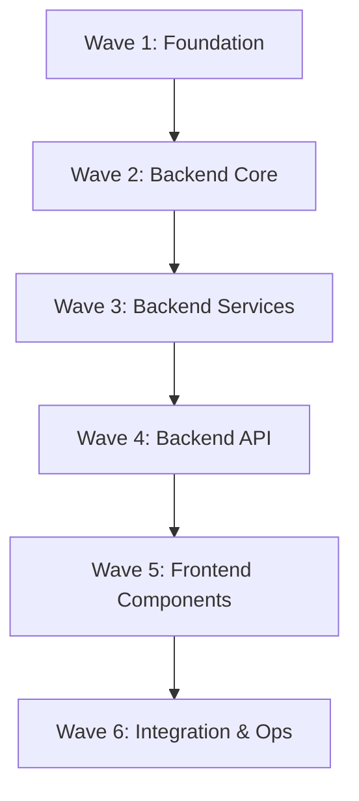

# Development Roadmap

This roadmap organizes the 34 plan documents into directional implementation waves for AI agent-driven development. Each wave builds on the previous one. Agents working on a given wave should read only the documents listed in that wave plus any documents from prior waves they depend on.

> **Constraints:** Maximum 10 documents per wave. Waves are strictly sequential — do not begin Wave N+1 until Wave N is complete and verified. No code snippets appear in this document or in any referenced plan document.

---

## Wave 1: Foundation & Architecture

**Goal:** Establish project scope, architecture, directory layout, dependencies, and Adobe Stock constraints before writing any implementation.

| # | Document | Rationale |
|---|----------|-----------|
| 1 | `project-vision-and-scope.md` | Defines goals, non-goals, and success metrics. Must be understood first. |
| 2 | `system-architecture-overview.md` | High-level component diagram and data flow. Informs all subsequent decisions. |
| 3 | `directory-structure-plan.md` | File tree with purpose annotations. Agents need this to know where to create files. |
| 4 | `tech-stack-and-dependencies.md` | Exact library versions and system prerequisites. Required before environment setup. |
| 5 | `adobe-stock-baselines.md` | Commercial acceptance thresholds. Every QC decision derives from these numbers. |
| 6 | `file-format-constraints.md` | JPEG-only rules, sRGB normalization, dimension formulas, file size caps. |
| 7 | `data-flow-pipeline.md` | Six-stage lifecycle overview. Maps the sequence agents will implement across waves. |
| 8 | `state-machine-spec.md` | Formal state transitions (PENDING → AUDITING → PASSED/FLAGGED → READY). Core invariant. |
| 9 | `cross-origin-and-security.md` | CORS config, loopback binding, secret management. Must be in place before any endpoint. |
| 10 | `error-handling-strategy.md` | Cross-cutting error behavior. Agents apply these patterns in every subsequent wave. |

**Wave 1 Exit Criteria:** Project scaffold exists, dependencies install cleanly, all agents share consistent terminology and state definitions.

---

## Wave 2: Backend Core Infrastructure

**Goal:** Implement configuration, database, ORM model, Pydantic schemas, and storage management — the foundation every backend service depends on.

| # | Document | Rationale |
|---|----------|-----------|
| 1 | `backend-core-config.md` | Centralized env vars, paths, and thresholds. Every other backend module imports this. |
| 2 | `backend-database-setup.md` | SQLite engine, WAL mode, session factory, get_db dependency. Required before any query. |
| 3 | `backend-model-image-record.md` | SQLAlchemy ORM entity with all columns, indexes, and JSON fields. |
| 4 | `backend-schema-payloads.md` | Pydantic request/response contracts used by all endpoints. |
| 5 | `storage-manager.md` | Directory creation, thumbnail naming conventions, file copy semantics. |
| 6 | `thumbnail-generation-spec.md` | Pillow-based 400x400 preview generation. Called during upload in Wave 3. |

**Wave 2 Exit Criteria:** Database initializes on startup, tables created, config loads without errors, storage directories exist, thumbnails generate correctly from test images.

---

## Wave 3: Backend Services & Pipeline

**Goal:** Implement the four core services and the background orchestrator that drives the automated QC pipeline.

| # | Document | Rationale |
|---|----------|-----------|
| 1 | `service-qc-engine.md` | Deterministic heuristics (resolution, Laplacian variance, OCR gibberish detection). Runs first in pipeline. |
| 2 | `service-gemini-auditor.md` | Semantic visual audit via Gemini 2.5 Flash. Runs second, only if QC engine passes. |
| 3 | `service-gemini-metadata.md` | Title and keyword generation via Gemini 2.5 Flash. Runs on human approval. |
| 4 | `service-exiftool-embedder.md` | IPTC/XMP metadata injection. Final automated step before READY state. |
| 5 | `background-audit-orchestrator.md` | Coordinates QC engine → Gemini auditor sequence in background tasks. |

**Wave 3 Exit Criteria:** Upload a test image, background task runs both QC stages, record transitions to PASSED or FLAGGED correctly, approval triggers metadata generation and ExifTool embedding, file lands in ready_to_upload.

---

## Wave 4: Backend API Layer

**Goal:** Expose REST endpoints that connect frontend actions to backend services.

| # | Document | Rationale |
|---|----------|-----------|
| 1 | `backend-api-upload-endpoint.md` | POST /upload — batch ingestion, validation, background dispatch. |
| 2 | `backend-api-records-endpoint.md` | GET /api/records — filtered/paginated listing for dashboard polling. |
| 3 | `backend-api-approve-endpoint.md` | POST /api/records/{id}/approve — triggers metadata + embedding pipeline. |

**Wave 4 Exit Criteria:** All three endpoints respond correctly via manual HTTP testing. Upload returns record IDs. Records endpoint returns proper filtered lists. Approve transitions state to READY.

---

## Wave 5: Frontend Components

**Goal:** Build isolated, reusable UI components before composing them into pages.

| # | Document | Rationale |
|---|----------|-----------|
| 1 | `frontend-api-client.md` | HTTP client wrapping all backend endpoints. Components depend on this. |
| 2 | `component-dropzone.md` | Drag-and-drop upload zone. First interaction point for users. |
| 3 | `component-stats-bar.md` | Dashboard header metrics and batch approve button. |
| 4 | `component-image-grid.md` | Responsive card grid with status borders, confidence badges, filter tabs. |
| 5 | `component-inspection-modal.md` | Full-screen review modal for human-in-the-loop overrides of FLAGGED items. |

**Wave 5 Exit Criteria:** Each component renders in isolation with mock data. Dropzone uploads trigger API client. ImageGrid displays all five states correctly. InspectionModal opens/closes and fires approve callback.

---

## Wave 6: Frontend Integration & Operations

**Goal:** Compose components into the dashboard page, define operational workflows, and establish testing/deployment procedures.

| # | Document | Rationale |
|---|----------|-----------|
| 1 | `dashboard-page-layout.md` | Page composition, state management, 3-second polling lifecycle, dark theme. |
| 2 | `local-development-workflow.md` | Prerequisites, terminal startup sequence, verification steps. |
| 3 | `daily-production-protocol.md` | Six-phase operator workflow from image generation through stock upload. |
| 4 | `deployment-and-packaging.md` | Virtual environment, Uvicorn, Next.js dev server, health checks. |
| 5 | `testing-strategy.md` | Unit tests for QC/services, integration tests for pipeline, component rendering tests. |

**Wave 6 Exit Criteria:** Full application starts with documented commands. Dashboard polls backend and reflects real-time state changes. Operator can complete end-to-end daily protocol. Tests pass.

---

## Dependency Graph

---

## Agent Assignment Guidelines

- **One agent per wave** is recommended for complex waves (3, 5). Simpler waves (2, 4) can be handled by a single agent reading multiple documents.
- An agent assigned to Wave N must read all documents in Wave N and may reference Wave N-1 documents for interface contracts.
- Do not assign parallel agents to the same wave unless their document scopes are completely non-overlapping (e.g., two agents splitting Wave 5 components).
- After each wave completes, validate exit criteria before dispatching the next wave's agent.

</parameter=>
</invoke>