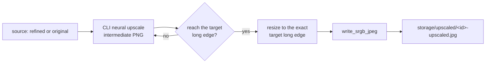

# Service Specification: Stage 3 Neural Upscaler

| Field | Value |
|---|---|
| Document ID | SVC-UPSCALE-001 |
| Component | Upscayl CLI Driver, Model Catalog, Run Options |
| Status | IMPLEMENTED |
| Last Updated | 2026-09-19 |
| Layer | Backend Services |

## Purpose

Raise a cleared image to a chosen output capacity using a neural super-resolution
network, then hand the result to the export path as an sRGB-tagged JPEG. This is
Stage 3 of the pipeline: OCR has already removed images containing text, so the
remaining work is purely geometric.

The stage is deliberately configurable, because the right capacity and model
depend on the source material rather than on a fixed house rule.

## Module Layout

| Module | Responsibility |
|---|---|
| `services/upscale/catalog.py` | Discover installed ncnn models and describe them for the UI |
| `services/upscale/options.py` | Validate, clamp, and serialise one run's configuration |
| `services/upscale/runner.py` | Drive the CLI, stream progress, post-process the output |
| `services/upscaler.py` | Stable facade re-exporting the above (keeps older callers working) |
| `routers/stages.py` | `GET /api/upscale/catalog`, `GET /api/upscale/options`, `POST /api/upscale/estimate` |
| `tasks/stage_orchestrator.py` | `run_upscale_stage` - batch execution and job reporting |

## Neural Backend

The headless binary is bundled with the app:

```
backend/upscayl-2.15.0/resources/bin/upscayl-bin.exe
```

`Upscayl.exe`, at the app root, is the Electron GUI. It ignores every command
line flag and reports a fake success, so it must never be used as the CLI.
`runner.CLI_REJECTED_NAMES` enforces this; the original implementation probed
only the GUI, which meant every run silently degraded to Lanczos resampling.

Resolution order for the executable:

1. `settings.UPSCAYL_EXE`, when it names a real file that is not a rejected name
2. `settings.UPSCAYL_APP_DIR / resources/bin/upscayl-bin.exe`
3. `upscayl-bin`, `upscayl-ncnn`, `realesrgan-ncnn-vulkan` on `PATH`

When none is found the runner degrades to Lanczos and reports
`backend = "lanczos-resample"`, and the UI shows an amber warning rather than
pretending the neural model ran.

### CLI flags used

| Flag | Value | Notes |
|---|---|---|
| `-i` / `-o` | source / intermediate PNG | The intermediate is always PNG |
| `-m` / `-n` | model directory / model name | The pair must both exist |
| `-z` | `2`, `3`, or `4` | The model's own scale factor |
| `-g` | GPU id | `0` is the dedicated card |
| `-c` | `0-100` | Compression factor |
| `-j` | `load:proc:save` | `1:2:2` default |
| `-f` | `png` | Lossless intermediate; the final encode is ours |
| `-t` | `>= 32`, or omitted | Omitted means ncnn chooses |
| `-x` | flag | TTA, disabled by default |
| `-v` | flag | Mandatory - the only source of progress |

`-w` (width) is used for the final geometry rather than `-r WxH`, because `-r`
would force an aspect ratio the source may not have.

### Two probed behaviours that shape the design

**The process exits with code 1 even on success.** It prints
`Upscayled Successfully!` and then exits 1. Success is therefore decided by
whether a decodable output file appeared, never by `returncode`.

**`-v` streams bare percentages to stdout.** These are parsed into real progress.
ncnn reports per tile, so values repeat and can dip mid-run; only forward
movement is forwarded, which keeps the UI bar monotonic.

## Model Catalog

Models are discovered from disk, never hard-coded, so dropping a new pair into a
folder makes it selectable without a code change.

| Source | Directory |
|---|---|
| `bundled` | `UPSCAYL_APP_DIR/resources/models` |
| `outsourced` | `UPSCAYL_APP_DIR/Outsourced_models/models` |
| `custom` | Each entry in `UPSCAYL_MODEL_DIRS` |

A model is offered only when **both** its `.bin` and `.param` halves exist; a
lone `.bin` cannot be loaded and is excluded. Duplicate names are reported once,
with the first folder in scan order winning. The scan is cached for 5 seconds
(`catalog.clear_cache()` / `refresh=true` bypasses it).

Scale is inferred from the filename, covering all three naming conventions in
circulation (`4xNomos8kSC`, `realesr-animevideov3-x2`, `digital-art-4x`), with 4x
as the fallback. The default model is the configured `UPSCAYL_MODEL` when it is
installed, otherwise the first available entry of `_FALLBACK_ORDER`, so a
checkout without the outsourced folder still upscales instead of failing.

## Run Options

| Option | Default | Range | Meaning |
|---|---|---|---|
| `model` | `4xNomos8kSC` | any installed model | Unknown names fall back to the default |
| `model_scale` | `4` | 2, 3, 4 | Must match the model |
| `target_long_edge` | `3840` | 1024-12000 | Presets: 2560, 3840, 5120, 6144, 7680 |
| `gpu_id` | `0` | any enumerated device | 0 is dedicated, 1-3 integrated |
| `tta` | `false` | bool | ~8x slower for a small quality gain |
| `tile_size` | `0` (auto) | `>= 32` or 0 | Lower it if the GPU runs out of memory |
| `threads` | `1:2:2` | `load:proc:save` | 2:2:2 is the multi-GPU form |
| `compression` | `90` | 0-100 | Passed to the CLI |
| `embed_srgb` | `true` | bool | Adobe requires an embedded profile |
| `allow_downscale` | `false` | bool | Off means "never shrink the source" |
| format | `jpg` (fixed) | - | Adobe accepts JPEG for photos |

Two rules drive the defaults:

* **Never exceed Adobe's ceiling.** Estimated output above
  `ADOBE_MAX_MEGAPIXELS` (100 MP) is flagged before the run starts.
* **Never silently downscale.** A source already at or above the chosen capacity
  is passed through at its native size, with a warning. Discarding resolution the
  contributor already has would be worse than a smaller-than-requested long edge.

Options are accepted from untrusted request bodies: `from_payload` clamps the
target into range, coerces string booleans and numbers, treats a tile below 32 as
auto, ignores unknown keys, and degrades an unknown model to the default rather
than failing the batch.

## Processing Pipeline



Up to `MAX_CLI_PASSES` (3) neural passes are chained when one pass cannot reach
the target. The resize step uses Lanczos when growing and `INTER_AREA` when
shrinking, so the geometry lands exactly on the requested long edge without
introducing aliasing.

**Source selection.** `_upscale_source_path` deliberately does *not* reuse a
previous upscale. Re-running Stage 3 falls back to the refined copy, then the
inbox original. Feeding an upscale back into the model would inflate the file for
no added detail and would make the before/after comparison compare a file against
itself.

## Output Contract

`UpscaleRunResult.to_dict()` is stored in `record.stage_details["upscale"]`:

| Key | Type | Description |
|---|---|---|
| `success` | bool | True when a decodable output file was written |
| `output_path` | string \| null | Absolute path of the final JPEG |
| `backend` | string | `upscayl`, `lanczos-resample`, or `skipped` |
| `scale` | float | Achieved long-edge ratio |
| `source_dimensions` / `output_dimensions` | `[w, h]` | Geometry before and after |
| `source_megapixels` / `output_megapixels` | float | Derived from the above |
| `reason` | string | Why the run degraded, when it did |
| `model`, `model_scale`, `gpu_id`, `tta`, `tile_size`, `passes` | - | What actually ran |
| `target_long_edge` | int | Requested capacity |
| `duration_seconds` | float | Wall time |
| `srgb_embedded` | bool | Whether the profile was written |
| `warnings` | string[] | Ceiling, downscale, TTA, and 2x-model advisories |

Upscaling is an **enhancement, not a gate**. A failure advances the record to
`UPSCALED` with the reason recorded and keeps the existing file, so one bad image
never strands a batch.

## Progress Reporting

The CLI's percentages are threaded through a callback into
`Job.report_progress`, which stores a per-record percentage and phase label. The
batch bar is then weighted:

$$\text{progress} = \frac{\text{processed} + \sum_{\text{running}} \frac{\text{percent}}{100}}{\text{total}}$$

Counting only finished records would leave the bar still for minutes during a
single large upscale, which reads as a hang. The API exposes `progress_label`
(e.g. "Upscaling to 4K · model 4xNomos8kSC (4x) · GPU 0"), `current_record_id`,
and a per-item `progress`/`detail`. A `progress` of `null` means the stage cannot
report intra-record progress and the UI shows an indeterminate bar instead.

## Endpoints

| Method | Path | Purpose |
|---|---|---|
| GET | `/api/upscale/catalog` | Models, capacity presets, defaults, CLI availability. `?refresh=true` bypasses the cache |
| GET | `/api/upscale/options` | The options panel's opening state |
| POST | `/api/upscale/estimate` | Predicted output geometry, before spending GPU time |
| GET | `/api/records/{id}/preview?variant=upscaled` | The Stage 3 output, for the before/after view |

`/api/upscale/estimate` accepts either a `record_id` (measured from disk) or an
explicit `width`/`height` pair, so the panel can preview a capacity as the
operator changes it. An unreadable source returns 422 rather than a guess.

## Configuration

| Setting | Default | Meaning |
|---|---|---|
| `UPSCAYL_EXE` | bundled `upscayl-bin.exe` | Explicit binary override |
| `UPSCAYL_APP_DIR` | `backend/upscayl-2.15.0` | Root for the binary and model folders |
| `UPSCAYL_MODEL_DIRS` | `[]` | Extra model folders |
| `UPSCAYL_MODEL` | `4xNomos8kSC` | Preferred default model |
| `UPSCAYL_GPU_ID` | `0` | Dedicated GPU |
| `UPSCAYL_TARGET_LONG_EDGE` | `3840` | 4K default |
| `UPSCAYL_TTA` | `false` | Quality/speed trade-off |
| `UPSCAYL_TIMEOUT_SECONDS` | `600` | Per-pass wall-clock cap |
| `EMBED_SRGB_PROFILE` | `true` | Required by Adobe |

## Testing

| Module | Covers |
|---|---|
| `tests/test_upscale_options.py` | Defaults, clamping, coercion, estimation, capacity labels |
| `tests/test_upscale_catalog.py` | Discovery, `.bin`/`.param` pairing, scale inference, defaults, CLI resolution |
| `tests/test_upscale_runner.py` | Command construction, progress parsing, exit-code-1 handling, geometry, source selection, job accounting |
| `tests/test_upscale_api.py` | The three configuration endpoints and the record-backed estimator |

The runner tests stub `subprocess.Popen` rather than invoking the GPU, so they
are deterministic and hardware-independent. They encode the probed quirks above
as assertions, which is what stops the exit-code-1 trap from being reintroduced.

## Constraints

* Windows-first: the binary name, the `-g` device ids, and the `.exe` suffix all
  assume the bundled Windows build. The `PATH` fallback names cover other
  platforms, but only the Windows binary has been verified.
* GPU time is the scarce resource. Estimation exists so the operator does not
  discover a bad capacity after a multi-minute run.
* The stage assumes OCR has already cleared the image; it performs no text
  detection of its own.
